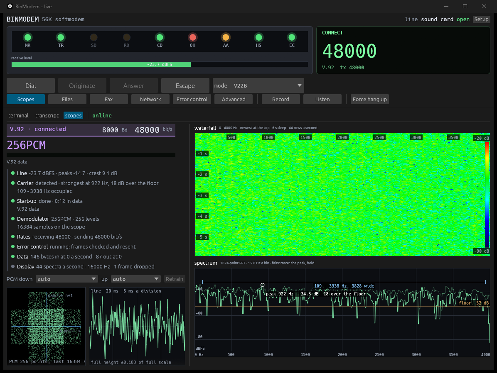
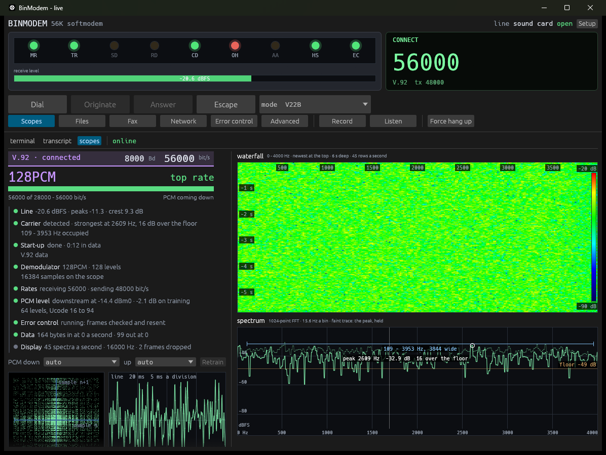

One file. Download `binmodem.exe` and run it. There is nothing to install, and no Visual C++ redistributable is needed because the C runtime is linked in.

```
binmodem.exe                  a modem on a real line
binmodem.exe --devices        what audio this machine has
binmodem.exe --telnet         a board over a socket
binmodem.exe --capture        replay the golden capture
```

[docs/usage.md](https://github.com/CasualArclamp/BinModem/blob/main/docs/usage.md) has the setup.

## What's new in 4.0.0



### V.92: PCM both ways

- **A whole V.92 call between two of these modems.** `AT+MS=V92` at both ends, with `BINMODEM_V92_PCM_UP=1` set for both: V.8, phase 2 with V.92's INFO sequences, a Table 18 INFO1a, V.92's Phases 3 and 4, and data with PCM going *up* the line as well as down. Over a pair of virtual cables it connects first time at 48 000 down and 48 000 up, with V.42 and V.44 on top, and takes 56 000 down when asked.
- **The server.** `AT+MS=V92` on the answering end is a V.92 digital modem: INFO0d's capability bits, PCM upstream offered in INFO1d, and the analogue modem's Ru, TRN1u, Ja, Su, CPt and E1u read and answered. The V.92 server was contributed by rgwan, and has taken a real Agere modem through Phase 3.
- **The calling side, on a sound card.** The analogue modem reads the downstream one sample a symbol on the phase the server's Sd gives it, and sends its upstream through a transmitter that takes S-bar-u's half symbol and Jp's epsilon as the steps they are.
- **The upstream rate is chosen from the line.** The calling modem is silent while the server sends TRN1d, and what arrives then is the noise the upstream will have against it: the server asks for the fastest of 6.1's nineteen rates that stands clear of it. Behind a codec it stays at 24 000, which is where it used to stay always.
- **A ladder to choose from.** The window has *PCM down* and *up* menus: any downstream rate from 28 000 to 56 000 and any upstream rate from 24 000 to 48 000, from either end. Chosen during a V.92 call, the line retrains to take it.
- **The call card has V.92's figures.** The bar is the rate this end receives along the rates it could be sent at, and a *PCM level* row gives the downstream's power in dBm0 and which levels it is made of. PCM has no gain to turn, so the power is the constellation's: 32 levels spread over Ucodes 16 to 93 come to -14.6 dBm0.
- **Both scopes have something to draw.** PCM has no plane, so each symbol is set against the next: the calling end shows the downstream's grid, the answering end the upstream's.



### V.8 bis

- **Signals, messages and transactions** (ITU-T V.8 bis, 11/2000): MRe, MRd, CRe, CRd, ESi and ESr as their tone pairs, and MS, CL, CLR, ACK and NAK as HDLC frames on V.21, with the capabilities tree coded both ways. The window turns it on with its other settings (`AT+A8E=,,,1`, V.251), with a box in the modulation window to turn it off; the modem's own factory setting is off.
- **A call that starts with it.** The answering end sends CRe, the caller answers with its capabilities or a mode, and the mode selected is the one the call then trains in. A far end with no V.8 bis is heard answering and gets V.8 as before, and the answering end tries three times before it gives up on it.

### Also

- **`binmodem --answer --stats`** prints the line's counters, the share of exact silence and the level each second, and **`--record <file>`** writes what arrived, which an ignored test replays into a fresh answerer: how a call that would not come up was found to be the window's own drive setting scaling the PCM upstream to nothing.
- **The answering end's start-up is in its transcript** for V.92, a line a step, as the calling end's always was.

The pictures are from a call between two instances over a pair of virtual audio cables, four-wire: no echo, no noise and no codec. 48 000 each way there is what the modems do on a clean line, not what a telephone route gives.

## Status

- **Sending over Super G3 is not yet confirmed against a real machine.** On the first try, both control channels came up, and each end read the other's MPh and E. Then the far end sent its NSF and DIS and never answered our TSI and DCS, four times over. Every frame in the recording decodes whole in both directions, with the headers right. The likeliest cause is that our E reached that machine about 50 ms before it had sent its own, so it never started reading ours. The last change above answers that, but it has not been tried live yet. Untick V.34 to send at V.17.
- **V.32's round-trip measurement can still be halved by a lost packet.** On a V.32bis call over a trunk, the concealment brought the far end's alternation back inverted, and the reversal that came out of it stopped the clock at 706 ms on a line whose real round trip is 1.22 s. The call connects regardless; the bad reading still costs the echo canceller's tap placement.
- **One ISP's V.90 pool sometimes stops dead** just as its modem takes up our constellation, at the end of phase 4 or in a renegotiation. Every CP we sent was checked against V.90 Table 14 bit for bit, and they are correct.
- **Known:** after a V.90 call falls back to V.34, the V.34 retrain watch can still take the hang-up beep for tone B.
- **V.92 has only carried data between two of these modems.** PCM upstream is off unless `BINMODEM_V92_PCM_UP=1` is set at both ends. Against a real V.92 modem the server has reached Phase 3 and no further. The calling side chooses its sample phase once and follows no clock, cancels no echo and asks for no DIL, so it wants a four-wire line with both ends on one clock, which a pair of virtual cables is and a telephone line is not. V.92's own rate renegotiation, cleardown, quick connect and modem on hold are not built.
- **Not yet tried against real far ends:** V.17, and the V.29 and V.27 ter receivers, have been measured against our own modems and simulated lines only.

Checksums are in `SHA256SUMS.txt`.
