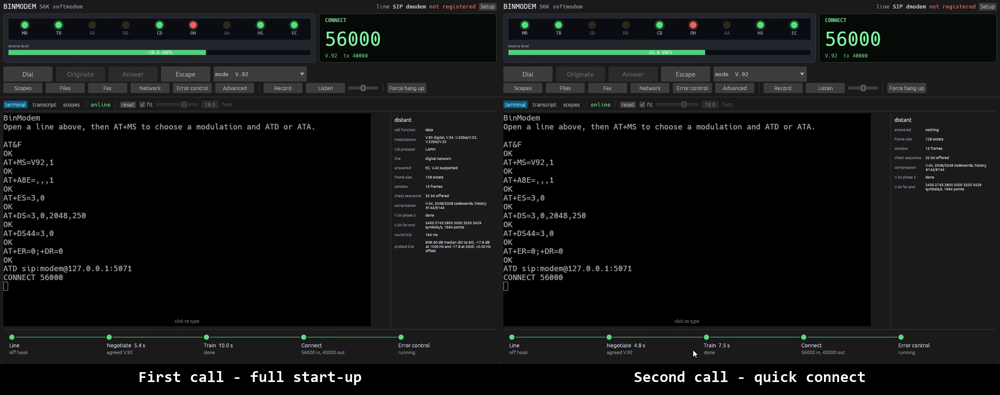
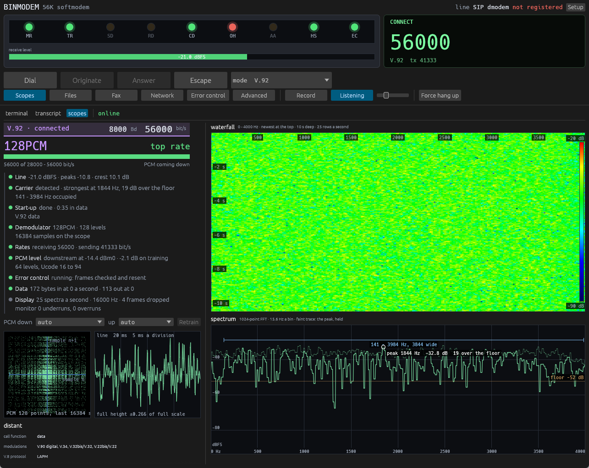

One file. Download `binmodem.exe` and run it. There is nothing to install, and no Visual C++ redistributable is needed because the C runtime is linked in.

```
binmodem.exe                  a modem on a real line
binmodem.exe --devices        what audio this machine has
binmodem.exe --telnet         a board over a socket
binmodem.exe --capture        replay the golden capture
```

[docs/usage.md](https://github.com/CasualArclamp/BinModem/blob/main/docs/usage.md) has the setup.

## What's new in 4.2.0



### V.92 quick connect

- **A second V.92 call to the same number starts up the short way** (V.92 9.2, 9.4 and 9.2.5): QC1a and QCA1d in place of V.8's menus, a Phase 2 with no line probe, and no ODP/ADP. Both ends do it, calling and answering. It takes about three seconds off: from the window to D-Modem over SIP, 15.4 s from ring to CONNECT in full and 12.2 s the short way; D-Modem dialling in, 15.1 s and 12.4 s.
- **It is automatic.** A V.92 call that connects is remembered by the number dialled, in `v92-connections.txt` beside the window's settings, and the next call to that number asks for the short start-up. The first call to anywhere is the full one. A far end that does not answer the QC1a gets ordinary V.8, and a remembered call that does not reach V.92 is forgotten.
- **A Quick connect tick under the mode list**, beside PCM upstream, turns it off. `BINMODEM_V92_QC=0` does the same from outside, and `always` asks every server whether it has been called before or not. `modem-sip --memos <file>` is the same memory without a window.
- **Not in it:** the Table 19 INFO1a (V.34 upstream after a short Phase 2), the analogue answerer's and digital caller's sequences, V.8 bis's QC2, and the `+PQC` and `+PSS` commands. It has not been tried against a hardware V.92 modem.

## What's new in 4.1.0



### Calls with somebody else's modem

This release was tested against [D-Modem](https://github.com/D-Modem/D-Modem), a softmodem written by other people from the same Recommendations, over SIP on one machine. None of its code is here; it is the far end.

- **V.34, V.90 and V.92 connect in both directions**, with either modem dialling: 33 600 on V.34, 56 000 down on V.90, and on V.92 56 000 down with PCM upstream at about 41 000 when BinModem calls and 24 000 when it answers. A group 3 fax goes through as well.
- **The server's codewords reach a SIP line exact.** A V.90 or V.92 server chooses its levels at the network's 8000 Hz, and they used to go up to the modem's rate and back down on the way out, which blurred them. They now go straight to the G.711 encoder, and what the network delivers comes straight back in the same way. A modem dialling in to BinModem over a trunk trains at 56 000 first time where it had fallen back to V.34.
- **The V.92 server reads TRN2u in either bit order.** Tables 28 and 29 do not say which of a symbol's bits goes first; the fit tries both and the reader follows the one the line has.
- **The V.92 server allows for the codec.** Handed the network's own levels it can see that they are codewords, and it asks for an upstream rate the A/D converter's rounding leaves room for.
- **V.92 with no DIL no longer waits for ever.** The text has the server send Ri first and Figure 11 has the caller send CPt first; after 24 000 symbols of TRN1u with no Ri, the caller goes first.
- **`run-dmodem.bat`** starts a D-Modem built beside this repository and dials it, and **`modem-sip`** is the same call without a window. `BINMODEM_V92_PAIR_OFFSET=0` reads 6.4.2's equivalence classes as printed, which D-Modem does; the default is the reading fitted to an Agere capture.

### The window

- **A volume slider beside the Listen key.**
- **The mode box lists modulations**, V.92 down to Bell 103, and names no rate: the modem finds the fastest the line carries. A ceiling set on purpose is under Advanced.
- **V.92 in the mode box is V.92 with PCM upstream.** It used to want `BINMODEM_V92_PCM_UP=1` as well, and without it a V.92 call was V.90 in all but name. There is a tick under the list to have V.92 without it.
- **On a SIP line the window follows the modem after a call ends.** A call the trunk refused left it on "negotiating" with the hook lamp lit, although the modem had said NO CARRIER; and the scopes kept the call's last moment. Both are put right, and the error is shown for three seconds and not for ever.
- **The seconds down the side of the waterfall hold still**, and the call card names a start-up once.
- **`binmodem --record`** starts the window already recording.

The picture is a call from the window to D-Modem on the same machine, over SIP with G.711 between them: a codec, and no line. 56 000 down and 41 333 up there is what the two do with nothing in the way.

### Linux

- **Sound goes through PipeWire or PulseAudio** where there is one, so a device BinModem is using is not taken from everything else. `BINMODEM_AUDIO_HOST=alsa` opens the hardware as before. This has been built on Linux by CI and not yet run there by us: reports are welcome.
- **The README has the build**, from the clone to the window. The release itself is still the Windows executable.

## Status

- **Sending over Super G3 is not yet confirmed against a real machine.** On the first try, both control channels came up, and each end read the other's MPh and E. Then the far end sent its NSF and DIS and never answered our TSI and DCS, four times over. Every frame in the recording decodes whole in both directions, with the headers right. The likeliest cause is that our E reached that machine about 50 ms before it had sent its own, so it never started reading ours. The last change above answers that, but it has not been tried live yet. Untick V.34 to send at V.17.
- **V.32's round-trip measurement can still be halved by a lost packet.** On a V.32bis call over a trunk, the concealment brought the far end's alternation back inverted, and the reversal that came out of it stopped the clock at 706 ms on a line whose real round trip is 1.22 s. The call connects regardless; the bad reading still costs the echo canceller's tap placement.
- **One ISP's V.90 pool sometimes stops dead** just as its modem takes up our constellation, at the end of phase 4 or in a renegotiation. Every CP we sent was checked against V.90 Table 14 bit for bit, and they are correct.
- **Known:** after a V.90 call falls back to V.34, the V.34 retrain watch can still take the hang-up beep for tone B.
- **V.92 has only carried data between softmodems:** two of these, and one of these with D-Modem. PCM upstream comes with V.92 chosen in the window; `AT+MS=V92` typed at a terminal still wants `BINMODEM_V92_PCM_UP=1`, and both ends have to ask for it. Against a real V.92 modem the server has reached Phase 3 and no further. Super G3 to D-Modem does not come up: it does not recognise our control channel's start. The calling side chooses its sample phase once and follows no clock, cancels no echo and asks for no DIL, so it wants a four-wire line with both ends on one clock, which a pair of virtual cables is and a telephone line is not. V.92's own rate renegotiation, cleardown and modem on hold are not built. From the window, a V.92 call to D-Modem sometimes fails in Phase 3 and comes up as V.90 or not at all (two of seven while this release was being filmed); the same call without a window has not done it, and the cause is not yet known.
- **Not yet tried against real far ends:** V.17, and the V.29 and V.27 ter receivers, have been measured against our own modems and simulated lines only.

Checksums are in `SHA256SUMS.txt`.
