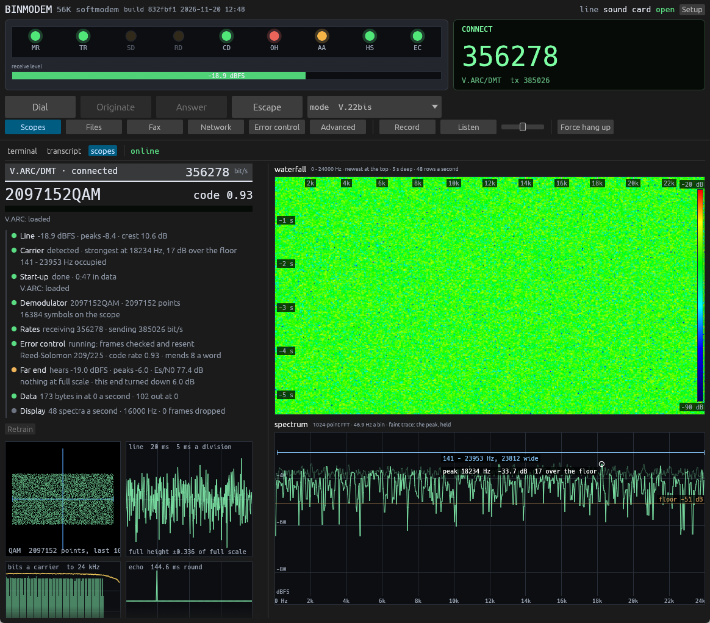
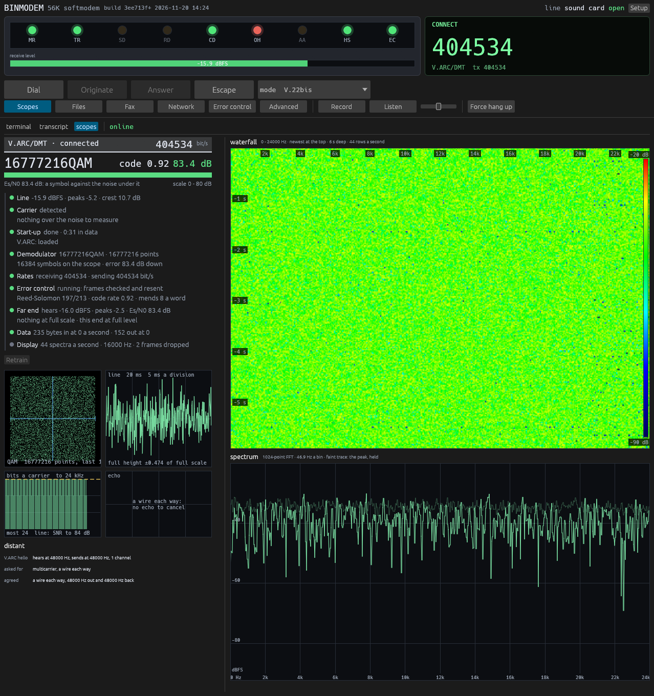
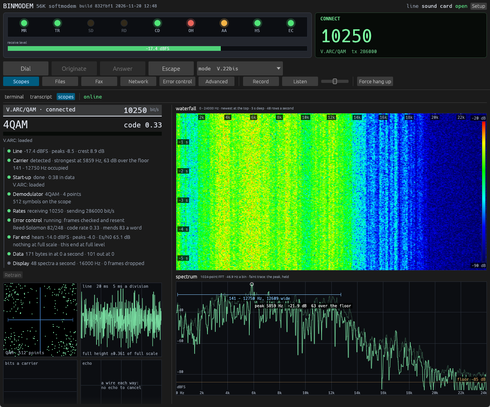
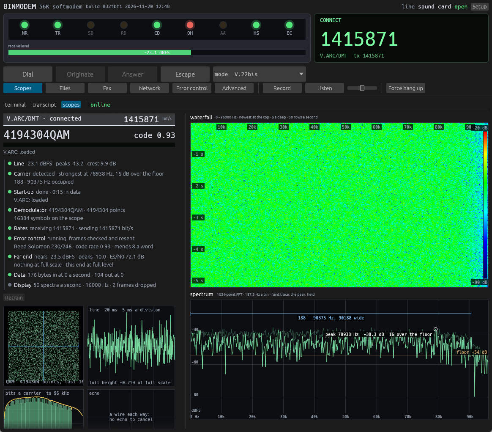

Download `binmodem.exe` and run it; `dialsnoop.exe` beside it is the call reader on its own. There is nothing to install, and no Visual C++ redistributable is needed because the C runtime is linked in.

```
binmodem.exe                  a modem on a real line
binmodem.exe --devices        what audio this machine has
binmodem.exe --telnet         a board over a socket
binmodem.exe --capture        replay the golden capture
binmodem.exe --review         read a recording of a call
dialsnoop.exe                 the same reader, as a program of its own
```

[docs/usage.md](https://github.com/CasualArclamp/BinModem/blob/main/docs/usage.md) has the setup.

## What's new in 5.5.2

### V.34 phase 2: a tone that stops is not a phase reversal

- **The fault:** in phase 2, the far end's tone sometimes stopped before it reversed. The reversal detector then reported a reversal in the silence, approximately 50 ms later. This end answered a reversal that did not occur, and the retrain failed.
- **The fix:** the detector now reports a reversal only when the tone is present before and after it. A real reversal is reported at the same sample as before.
- **Where it shows:** V.34, V.90 and V.92 retrains on a VoIP line that has short gaps of digital silence.

### Documentation

- The README is now a short overview with links. The detail is in [docs/manual](https://github.com/CasualArclamp/BinModem/tree/main/docs/manual).
- The README, `docs/usage.md` and `docs/quickstart.md` are now in Simplified Technical English.

## What's new in 5.5.1

### V.92 PCM upstream to Netstalgia, on every call

Calls to Netstalgia came up V.92 on some days and V.90 on others. It depended on which of the line's 16 kHz samples the network's 8 kHz codewords landed on, which changes from call to call. On the odd one, two things went wrong:

- **The upstream was half a sample off the network's codec.** The downstream was read on the right sample but the upstream always went out on the even one. Netstalgia never found Su and retrained to V.90. The upstream now moves to the same phase as soon as Sd shows it.
- **S-bar-u's half symbol and Jp's fraction were taken as steps the wrong way.** This end now steps later, as D-Modem does and libv90modem expects. At a fraction of nought the old way was a symbol out and Netstalgia let it go. At the half a symbol the odd phase brings, it never read the CPt.

With both, calls on the odd phase come up at 56000 down and 42666 up. A V.92 server here takes the step either way, so calls between two BinModems are unchanged.

### The window on older graphics

- **The window opens without OpenGL 2.0** ([#52](https://github.com/CasualArclamp/BinModem/issues/52)). Where OpenGL fails, as on an Intel GMA 4 series, it opens again through Direct3D 12, Vulkan or, failing those, Windows' own software renderer. `BINMODEM_RENDERER=glow|wgpu|warp` picks one. This makes `binmodem.exe` about 27 MB.
- **`run-live.bat` finds the audio devices again** ([#51](https://github.com/CasualArclamp/BinModem/issues/51)). It said "no audio devices found" on every machine.

## What's new in 5.5.0

### U.S. Robotics x2, as a server

A V.92 or V.90 server here also offers x2 when `ATS70=1` is set, or the new **x2** tick in the window is on. A caller offering V.34 and no PCM, as a USR modem without its V.90 upgrade does, then gets x2: 32000 to 56000 down and V.34 up, with the client's rate changes followed. Everyone else gets what they got before. It is off by default and mu-law only. USR's own Courier firmware, running in courier-emu, connects at `CONNECT 49333/ARQ/x2/LAPM/V42BIS`, moves to 54666 when it asks, and its data arrives intact. It has not met a real x2 modem yet. The level banks for the rates above 32000 are D-Modem's published numbers, carried as data.

### A Review tab, and DialSnoop

Open a WAV of someone else's call and read it: a waterfall with a box on each signal, and everything decoded from the one you click. That covers V.8 and V.8 bis, phase 2, V.34 and V.90 training both ways, data mode, V.42 frames, and PPP or text above them. It uses the modem's own receivers. `binmodem --review file.wav` opens on the tab, and `dialsnoop.exe`, now in the release beside `binmodem.exe`, is the same reader on its own.

### HST

USRobotics' HST, contributed by wanax2 ([#32](https://github.com/CasualArclamp/BinModem/pull/32)): the Courier HST's 14400 one way and 450 the other, and the original 1986 HST 9600. `AT+MS=HST` or `HST96`, or the mode box. Only another HST modem answers it.

### Faster dial-up

- **V.42 now uses the frame size and window it agrees.** It offers 256-octet frames and a window of 63, and uses what is settled. It always ran 128 and 15 before, which held a SIP call to about 2.4 kB/s. A loaded page took 1.9 s where it took 5 to 6.5 s, and a download went from 2.1 to 5.5 kB/s.
- **PPP shares the line fairly between connections**, and is fed at most about a quarter of a second ahead of the modem, so one big transfer no longer holds everything else up.

### Fixed

- **V.42 answered an XID with its own offer, not the agreed values.** A far end that offered less, like a Courier with N7 32, took that as no answer and never sent SABME.
- **V.42 lost a frame whose opening flag was cut short.** A frame that starts straight after seven or more ones is now taken.
- **V.44 let its history run past N8** ([#64](https://github.com/CasualArclamp/BinModem/issues/64)). Netstalgia dropped the link after about 4 kB upstream.
- **V.34 against a Courier.** A start-up that reaches phase 4 and retrains before data mode keeps off the symbol rate that failed for the rest of the call. A Courier that would not train at 3429 now connects at 31200 on 3200.
- **A V.8 bis CL with no modulation in it is answered.** Netstalgia's server sends one, and the call used to sit in silence until it timed out.
- **Modems with no V.8 are found, calling or answering.** An automode V.92 end now finds a V.22bis, V.21, Bell 212A or Bell 103 far end, which used to hang.
- **The V.92 pairs scope** draws the whole picture to one scale, not each pair to its own.

### Also

- **A contacts list beside the dialler**, with how the last call to each went: modulation, rates and when. Kept in `%APPDATA%\BinModem\contacts.txt`.
- **PipeWire on Linux**, contributed by SarahRoseLives ([#1](https://github.com/CasualArclamp/BinModem/pull/1)): cpal's native PipeWire host lists PipeWire's own nodes, virtual loopbacks among them. Building on Linux now needs `libpipewire-0.3-dev` and `libclang-dev`.

## What's new in 5.4.3

Two faults in V.92 calls to a server that is not BinModem's own, reported with recordings by the people who run one ([#54](https://github.com/CasualArclamp/BinModem/issues/54)). Calls to such a server fell back to V.90.

- **Fixed: PCM upstream data was unreadable to other V.92 servers.** Half of the upstream symbols were sent two constellation points away from where V.92 6.4.2 puts them, a reading fitted to one capture of one modem. They are now sent as the text has them. `BINMODEM_V92_PAIR_OFFSET=2` in the environment brings the old reading back; two BinModems connect either way.
- **Fixed: over SIP, the server often never heard the caller's Su turn over, and retrained.** The caller stopped for about 90 ms to fit its equaliser, and its answer to Jd went out late in the burst of sound that followed, where a short jitter buffer discards it. The fit now takes about a quarter of the time, and Su waits 200 ms after it.
- **Fixed: the S-bar-u that answers Jp could start part of the way through a period of Su.** It now starts on a twelve-symbol boundary.

## What's new in 5.4.2

- **Fixed: the mode box follows `AT+MS` typed at the terminal.** `AT+MS=V34` typed there changed the next call and left the box, the command on the faceplate and the remembered settings on the old modulation. The window now takes the modulation, automode and rate limits from the modem whenever they change.
- **Fixed: a V.ARC call dialled straight after another call in the same window, on a SIP line.** Samples left over from the first call reached V.ARC before the second was answered, and it fell back to V.8 bis. Nothing reaches it now until the call is up.
- **A fax page is drawn at whole screen pixels, unsmoothed.** It is fitted across the panel by the least whole number that fits, and 1:1 when it does. The mouse wheel zooms in whole steps around the pointer, from 1:7 to 8:1, and a double click goes back to fit. The same for the page to send and the page arriving.
- **A quick start guide**: [docs/quickstart.md](https://github.com/CasualArclamp/BinModem/blob/main/docs/quickstart.md), from the download to a call between two windows.
- **Scripted calls that type like a person.** `--type` lines can be steps: `@type`, `@key`, `@wait`, `@until <text>`, `@tab`, `@files` and `@receive`. Plain lines are typed as before.
- **`modem-sip --answer --bbs <folder>`** answers as a small bulletin board: ANSI screens from the folder, a login, a menu, a scripted chat channel and a ZMODEM file area. `modem-sip` is built from source; the release is `binmodem.exe`.

## What's new in 5.4.1

- **Fixed: a fax received with ECM was reported as failed.** The outcome said "disconnected in phase E, after page 1 was confirmed" although every page had arrived. A sender that hangs up as it sends its DCN cuts it off. The receiver had already confirmed the last page and was waiting for the far end to hang up, which T.30 only reaches after the last page, so that now counts as confirmed.
- **The page arriving fits a whole sheet** to the Fax tab, with the rest of the sheet dark until it comes. A large window now shows the page filling its paper, where it used to show a strip scrolling past.
- **For filming or testing with nobody at the keyboard:**
  - `--answer-as fax` (or `modem`) presses that answer once an incoming SIP call has rung for 2.5 s.
  - `BINMODEM_LINE_NOISE=-52` adds white noise at that level (dBFS RMS) to everything the line delivers.
  - `modem-sip` sends a page of your own with `--page <file.pbm>` (and `--fine`), and chooses the modulations with `--offer v27ter,v29,v17`. `--no-ecm` and `--no-jbig` turn those off.

## What's new in 5.4.0

### A Fax tab, and calls that ask before they are answered

- **Fax is a tab now**, beside terminal, transcript and scopes, laid out like Scopes:
  - **Left:** the call card, the constellation, and the far end's DIS where V.8's would be.
  - **Middle:** the page, as large as the window allows, over the waterfall.
  - **Right:** the number (the dialler's own) and this end's TSI/CSI, then the call's progress, how the last call went, the document, the rates and the calls so far.
- **How the call went, kept on screen** once it is over: confirmed (MCF), kept but retrain asked (RTP), refused (RTN), or disconnected in phase B, C or D and why. It also gives pages sent and received, the carrier and rate, the coding, ECM on or off, and how long it took. It is read from the T.30 frames both ends sent.
- **Progress you can read**: the T.30 phase, page n of m, kB of the page gone, the line it has reached, and the time left at the agreed rate.
- **The page going out is shaded to the line its bits have reached.** It is not drawn at the share of the bits sent, which runs ahead over blank paper and lags in dense parts. Receiving, the page is drawn a line at a time as before.
- **The rate table goes fastest first**, with the rate and modulation the call agreed lit up.
- **A list of the session's calls**: when, the far end, the result and the pages. A received fax opens in the big view and saves as one PDF or a PNG a page.
- **An incoming SIP call rings and asks.** It rings on the monitor output (opened for the ring if Listen is off), flashes the taskbar, and puts the caller's number and name in the middle of the window with **Answer as modem**, **Answer as fax** and **Decline** (603). Nothing answers by itself. If the caller hangs up first, the ringing stops and the question goes.
- **`binmodem --fax`** opens on the Fax tab.

### Fixed

- **ECM progress on a page larger than one block.** It counted every block as an equal share, and the last is seldom full, so an MMR page of two and a bit blocks read 50 % with three quarters gone.
- **A page at standard resolution** is drawn the shape of its paper, not half its height.
- **After a V.17 page** the badge and the outcome no longer say V.21, which carries the frames between pages.
- **Receiving**, the far end's DCS is read as this call's choice. It used to be read as a DIS, which said "nothing in common" in the middle of a V.17 page.

### On real lines

- **V.17 to real fax machines.** Pages went at 14 400 to Telstra's FaxStream test line and were confirmed with MCF. Confirmed pages also went to Faxbeep, to Canon's test line in the US, and to a SpanDSP machine at JBIG with ECM. Telstra's line reports 36.8 dB signal to noise and calls the transmission level poor at -30.5 dBm.
- **Received** at V.17 14 400 and at V.34 33 600 with JBIG and ECM between two windows.

## What's new in 5.3.0

- **Bell 212A and Bell 202.** `AT+MS=B212` is 1200 bit/s DPSK with Bell's 2225 Hz answer tone, falling back to Bell 103 at either end. `AT+MS=B202` is 1200 bit/s FSK, half duplex.
- **A steadier SIP line.** The modem is now stepped on a local clock, so a stall in what arrives never puts silence into what it sends. The jitter buffer holds 300 ms instead of 100: on a long international route the holes in data mode were packets that came late, not lost ones. `BINMODEM_SIP_JITTER` still sets it (1 to 25 packets).
- **V.92 on real routes.** A robbed bit on the downstream (a T1 on the way) no longer stops Phase 4. A full start-up asks for a DIL and builds its constellations from it, so such a route gets about 49 000 bit/s down instead of falling back to 28 000; a quick connect still skips it. The Sd deadline allows for the round trip, R-bar-i is heard through short dropouts, and the downstream phase is chosen only once Sd is on every phase.
- **Quick connect that fails falls back fast.** A server that goes silent after TONEq is dropped from the quick-connect memo, and the call starts V.8 again about 3.4 s later, inside the 60 s some ISPs allow.
- **Phase 2 recovers a lost INFO0d** by sending INFO0a again, rather than waiting for one that is not coming.
- **V.8 bis through dropouts.** A capabilities list a VoIP path has cut into is reported and answered with NAK(1), instead of vanishing.
- **The distant panel says everything known about the far end**: phase 2's INFO sequences, the probed line and round trip, Jd and the PCM mode, kept after a call that never connected.
- **Recording stops** when Stop is pressed after the far end has hung up, rather than at the next call.

## What's new in 5.2.0

- **V.ARC compresses.** A V.ARC call had no compression at all: `+DS` and `+DS44` are about V.42, and V.ARC has its own retransmission in place of V.42. Its stream is now compressed with the best method both ends have, each direction for itself, and the window says which and what it has been worth.
- **LZ, a compressor of its own**, in LZMA's manner: matches against the last 256 kilobytes, and everything coded by a range coder with probabilities learnt as it goes. Text goes in under a third and tables of records in about a seventh; what will not compress costs a fiftieth more. It is not LZMA's format and reads no `.lzma` or `.xz` file.
- **V.44 and V.42bis** as well, with their largest dictionaries, for whichever of `+DS44` and `+DS` is on.
- **`AT+VARCZ=<n>`**: 0 for none, 1 for V.44 and V.42bis only, 2 (as it comes) for LZ as well.
- **The two ends agree while the call runs**, with a frame an older build ignores, so a call to one of those is carried as it was. An end holds back what is written for one round trip while the far end learns where the compressed stream begins.

## What's new in 5.1.0

- **V.ARC/G.711.** V.ARC on a SIP call in G.711, which until now quietly became an ordinary V.90 call. Between two BinModems on a direct call the 8-bit codewords arrive as they were sent, so they are the data, in both directions alike: 60 928 bit/s each way in A-law and 56 832 in mu-law, where V.90 on the same call is 56 000 down and 31 200 up. Any of the three V.ARC modes becomes it on such a call. If something on the way recodes the call, or the far end is not V.ARC, it carries on as an ordinary call after four seconds. mu-law is the slower because it has two codewords for nought that arrive as one.
- **The direct modes stop spending a fifth of the line on check octets.** V.ARC/L16 and V.ARC/G.711 carried forty-eight check octets a codeword, enough to rebuild a lost packet, whether or not any packet was being lost: the code rate sat at 0.80. After five seconds with nothing missing they now ask for none, and go back to the full count the moment a packet is lost. V.ARC/L16 at 48 kHz: 744 186 bit/s where it was 601 302.
- **Code rates of 0.99 and 1.0 for every mode.** Two check octets a codeword, and none. The receiver asks for them when the line has more in hand than its grid can use. On two virtual cables V.ARC/DMT took 0.99 and went from 404 534 to 432 941 bit/s, and V.ARC/QAM from 348 000 to 353 500. With no check octets a frame that arrives wrong is sent again, and one that does counts against the code as a failed codeword would.
- **EasySip through a router, by UPnP.** A tick box on the EasySip row: the router is asked for its outside address and to forward this end's two ports, the far end is told that address, and the transcript says what to give the other end. The ports close when the line does. Not used for a far end on this network. It has since carried a call across the internet.

## What's new in 5.0.1


- **V.ARC/QAM and V.ARC/PCM hold their rate.** In 5.0.0 the signal to noise on a good line swung by ten to fifteen decibels every few seconds, and the two ends kept renegotiating the grid to follow it. The timing loop never settled and the equaliser was too slow to keep up with it; both are fixed. On two virtual cables the reading now moves by under half a decibel and the rate, once reached, stays.
- **V.ARC/L16 shows its symbols.** The diagram was empty on a linear SIP call. A sample is sixteen bits at once, and its two octets are now the two axes.
- **The window says what a SIP call is carried in**, in the line at the top: `L16/48000`, `PCMA`.
- **EasySip chooses its coding.** The fastest linear coding both ends have, any one of the eight linear codings, or G.711 in either law, which is what the ordinary modes (V.34, V.90 and the rest) are for. V.ARC/QAM and V.ARC/PCM also run on an EasySip call at 48 kHz: 270 and 305 kbit/s between two windows on one machine.
- **Fixed:** V.90 and V.92 on a linear SIP call at anything but 8 kHz. The digital end sent one level to a sample as it does into G.711, which at 16 kHz filled half of every packet: "gaps sent" by the hundred and a far end stuck in phase 2. It is now carried as a waveform there, as on a sound card: 56 000 down and 31 200 up between two windows on EasySip at 16 kHz stereo.
- **Fixed:** V.90 and V.92 on an A-law SIP call. The digital end built its levels for mu-law and said mu-law in INFO0d whatever the call was in, so on A-law every level was moved to the nearest the line had and the call came up at its lowest rate, 28 000. It is now told the call's law: 56 000 down on A-law, the same as on mu-law.
- **Fixed:** with the Setup row showing, an EasySip line opened from the command line was reopened with an empty address.
- **Not fixed:** a gap of a few milliseconds in the sound still costs V.ARC/QAM and V.ARC/PCM several seconds while the two ends renegotiate.

## What's new in 5.0.0



### V.ARC: a mode of our own, for a sound card and not a telephone line

No Recommendation covers this one. Both ends have to be BinModem, and both have to be this release. [docs/design/v-arc.md](https://github.com/CasualArclamp/BinModem/blob/main/docs/design/v-arc.md) is the design and every measurement.

- **V.ARC** in the mode box, or `AT+MS=VARC`, then Dial and Answer as for any call. Hundreds of carriers 47 Hz apart, each given the bits its own stretch of the line will bear, from none to 24. The window opens the sound card at its own rate on both channels and the waterfall follows it out to half that rate.
- **Through a lead** from a Realtek line output to its line input at 192 kHz: 1.4 Mbit/s, no octet wrong. A call is one signal, the same on both channels and both added together on the way in.
- **V.ARC/QAM and V.ARC/PCM** are one carrier and baseband levels, at a third and two-thirds of the card's sample rate in baud, so they fill its band whatever it is: 64 000 and 128 000 baud at 192 kHz, where the lead carries 1.14 Mbit/s and 972 kbit/s. Four points to sixteen million; 2PCM to 65 536PCM, of which a real line has borne 2048.
- **`AT+VARC=<baud>,<code>,<bits>`**, and "by hand" in the modulation window, set the baud, the code and the grid a single-carrier call is asked for, for whoever wants to choose them.
- **It starts on a line it knows nothing about.** The starting signal is 48 four-point symbols, each sent on every carrier in turn and added together by the receiver, so any 2.3 kHz of the band that works is enough; every carrier's noise is measured against the result and the table loads only where the line is. In simulation it starts on 300 to 3400 Hz, and on the whole band with a carrier 3 dB above its noise.
- **A call starts with a handshake any line will carry**: 200 bit/s in two tones a direction, in the middle of the voice band. Each end says what rates it hears and sends at, how many channels, which modulation it was asked for and whether it was told the line is two-wire, and both work out the same answer. A fast card and a slow one meet at the slow one's rate; ends told two-wire that cannot be run a wire each way and say why. The "distant" panel shows what the far end said.
- **An end that cannot hear the other says so, and is sent to slower.** A line can carry the modulation one way and not the other. The end that reads nothing says so in the handshake's tones, and the far end runs the modulation at half the speed, then a quarter, then an eighth, until it is read. Each direction for itself.
- **Codes from 0.93 down to 0.25**, chosen by the receiver with the bits. A line at 8 dB that carried nothing carries a bit a symbol.
- **It has been through the air**: one direction out of a monitor's loudspeakers into a webcam's microphone. The multicarrier mode carried 20 kbit/s that way and V.ARC/QAM 10 kbit/s at half speed, with nothing wrong.
- **Two sound devices at two rates are a line each way.** An input at 192 kHz and an output at 48 kHz run each direction at its own.
- **Each end tells the other what it hears**: level, peaks, samples at full scale, and Es/N0. A sender told it is reaching the far converter's stops turns itself down. The window has a Far end line for it.
- **V.ARC two-wire** (`AT+MS=VARC2W`) is the same mode on one pair of wires, both ends sending into it, with this end's echo taken out. A canceller finds the echo and fits a filter to it; then the receiver, once it has read a symbol, takes the far end's part of it away and fits a second filter to what is left. Each end first has the line to itself for two seconds, the caller and then the answerer, so each learns its echo with nobody talking over it. Two ends sharing one virtual cable connect at 327 kbit/s, reach 384, and go on improving past 75 dB, a million octets and none wrong. It wants one sound card, input and output at one rate. `VARCQ2W` and `VARCP2W` are the single-carrier modes the same way, by the first canceller alone: 139 kbit/s for QAM.
- **An ordinary call finds it, through V.8 bis.** `AT+VARCBIS=1`, or "list V.ARC" under the V.8 bis switch, puts V.ARC in the non-standard field of the V.8 bis capabilities. Two BinModems that both list it choose it there and go to V.ARC's handshake in place of V.8; with a far end that does not, or is not BinModem, the call is what it would have been. Between two windows on two virtual cables, each set to V.92: 404 kbit/s, and 164 kbit/s with noise added at -55 dBFS. The country and provider codes in the block are made up, not registered.
- **Over SIP**, the call carries sixteen-bit samples exactly, the samples are the data, and the rate is the sample rate: 601 kbit/s at 48 kHz, 200 kbit/s at 16 kHz.





### SIP: linear PCM at every rate, and EasySip


- **EasySip** is a third kind of line, beside the sound card and SIP. Type the other BinModem's address, open, and dial: no account, no registrar and no password. Each end listens on a port (5060 unless changed) and calls the other's. Linear samples are offered first and G.711 behind them. The far end answers with Answer when it rings.
- **Linear PCM at 8, 16, 44.1 and 48 kHz, on one channel or two**, which are the codings softphones list as LPCM. An account with `linear = yes`, and every EasySip line, offers all eight ahead of G.711, the fastest first, and takes the first of them it is offered. Two channels carry one signal. 4.2 had 16 kHz on one channel only, and still gets it from this.
- **A packet is the packet time at any rate**, so at 44.1 and 48 kHz it is larger than one Ethernet frame and the network sends it in pieces. That is how other softphones send these codings; a network that drops fragments will not carry them.

### The window



- **The symbol diagram draws on a V.ARC call**, and beside the grid's size is the code rate (`code 0.94`).
- **Two more scopes under it** on a V.ARC call: the bits on each carrier with the signal to noise they were chosen from, and the echo as the canceller has learned it.
- **The window says which build it is**, top left. Two windows that will not talk are often two builds.
- **A call the line cannot run says why**, in red on the line's row. It used to say `NO CARRIER` and keep the reason in the transcript.

### Calls between two of these without a window

- **`modem-sip` drives the line a tenth as hard**, as the window does. It was clipping its own signal into G.711, and a V.34 call between two of them ended in `NO CARRIER` more often than not. With the fix V.34 connected 13 times of 13 at 33 600, and V.92 3 of 3.

### What V.ARC has not done

- **It has never run between two machines.** Every figure above is one computer: one sound card, a lead, or virtual cables. Clock recovery is tested in simulation, to 150 parts in a million.
- **Two-wire has only met a virtual cable**, whose echo is one spike with no tail and no noise. A real hybrid or a telephone pair has not been tried, and neither has an echo through the air.
- **The starting signal on a poor line** is tested in simulation only, and so is a fast sound card calling a slow one.
- **A gap in the sound costs a call seconds**: half the blocks bad until the tables are made again.
- **Over SIP and EasySip** it has run between two processes on one machine and over no network, and with no softphone or exchange at the far end. The single-carrier modes have not been tried on a SIP call at all.
- **Through V.8 bis** it has run on virtual cables only. A caller that misses the ACK goes on to V.8 while the answerer is in V.ARC, and that call does not recover.
- **On a SIP call the scopes show the line brought down to 16 kHz**, whatever the call's rate, and call an exact line "hot" for reaching full scale, which on that line is only data.

## What's new in 4.2.0


### V.92 quick connect

- **A second V.92 call to the same number starts up the short way** (V.92 9.2, 9.4 and 9.2.5): QC1a and QCA1d in place of V.8's menus, a Phase 2 with no line probe, and no ODP/ADP. Both ends do it, calling and answering. It takes about three seconds off: from the window to D-Modem over SIP, 15.4 s from ring to CONNECT in full and 12.2 s the short way; D-Modem dialling in, 15.1 s and 12.4 s.
- **It is automatic.** A V.92 call that connects is remembered by the number dialled, in `v92-connections.txt` beside the window's settings, and the next call to that number asks for the short start-up. The first call to anywhere is the full one. A far end that does not answer the QC1a gets ordinary V.8, and a remembered call that does not reach V.92 is forgotten.
- **A Quick connect tick under the mode list**, beside PCM upstream, turns it off. `BINMODEM_V92_QC=0` does the same from outside, and `always` asks every server whether it has been called before or not. `modem-sip --memos <file>` is the same memory without a window.
- **Not in it:** the Table 19 INFO1a (V.34 upstream after a short Phase 2), the analogue answerer's and digital caller's sequences, V.8 bis's QC2, and the `+PQC` and `+PSS` commands. It has not been tried against a hardware V.92 modem.

## What's new in 4.1.0


### Calls with somebody else's modem

This release was tested against [D-Modem](https://github.com/D-Modem/D-Modem), a softmodem written by other people from the same Recommendations, over SIP on one machine. None of its code is here; it is the far end.

- **V.34, V.90 and V.92 connect in both directions**, with either modem dialling: 33 600 on V.34, 56 000 down on V.90, and on V.92 56 000 down with PCM upstream at about 41 000 when BinModem calls and 24 000 when it answers. A group 3 fax goes through as well.
- **The server's codewords reach a SIP line exact.** A V.90 or V.92 server chooses its levels at the network's 8000 Hz, and they used to go up to the modem's rate and back down on the way out, which blurred them. They now go straight to the G.711 encoder, and what the network delivers comes straight back in the same way. A modem dialling in to BinModem over a trunk trains at 56 000 first time where it had fallen back to V.34.
- **The V.92 server reads TRN2u in either bit order.** Tables 28 and 29 do not say which of a symbol's bits goes first; the fit tries both and the reader follows the one the line has.
- **The V.92 server allows for the codec.** Handed the network's own levels it can see that they are codewords, and it asks for an upstream rate the A/D converter's rounding leaves room for.
- **V.92 with no DIL no longer waits for ever.** The text has the server send Ri first and Figure 11 has the caller send CPt first; after 24 000 symbols of TRN1u with no Ri, the caller goes first.
- **`run-dmodem.bat`** starts a D-Modem built beside this repository and dials it, and **`modem-sip`** is the same call without a window. `BINMODEM_V92_PAIR_OFFSET=0` reads 6.4.2's equivalence classes as printed, which D-Modem does; the default is the reading fitted to an Agere capture.

### The window

- **A volume slider beside the Listen key.**
- **The mode box lists modulations**, V.92 down to Bell 103, and names no rate: the modem finds the fastest the line carries. A ceiling set on purpose is under Advanced.
- **V.92 in the mode box is V.92 with PCM upstream.** It used to want `BINMODEM_V92_PCM_UP=1` as well, and without it a V.92 call was V.90 in all but name. There is a tick under the list to have V.92 without it.
- **On a SIP line the window follows the modem after a call ends.** A call the trunk refused left it on "negotiating" with the hook lamp lit, although the modem had said NO CARRIER; and the scopes kept the call's last moment. Both are put right, and the error is shown for three seconds and not for ever.
- **The seconds down the side of the waterfall hold still**, and the call card names a start-up once.
- **`binmodem --record`** starts the window already recording.

The picture is a call from the window to D-Modem on the same machine, over SIP with G.711 between them: a codec, and no line. 56 000 down and 41 333 up there is what the two do with nothing in the way.

### Linux

- **Sound goes through PipeWire or PulseAudio** where there is one, so a device BinModem is using is not taken from everything else. `BINMODEM_AUDIO_HOST=alsa` opens the hardware as before. This has been built on Linux by CI and not yet run there by us: reports are welcome.
- **The README has the build**, from the clone to the window. The release itself is still the Windows executable.

## Status

- **Sending over Super G3 is not yet confirmed against a real machine.** On the first try, both control channels came up, and each end read the other's MPh and E. Then the far end sent its NSF and DIS and never answered our TSI and DCS, four times over. Every frame in the recording decodes whole in both directions, with the headers right. The likeliest cause is that our E reached that machine about 50 ms before it had sent its own, so it never started reading ours. The last change above answers that, but it has not been tried live yet. Untick V.34 to send at V.17.
- **V.32's round-trip measurement can still be halved by a lost packet.** On a V.32bis call over a trunk, the concealment brought the far end's alternation back inverted, and the reversal that came out of it stopped the clock at 706 ms on a line whose real round trip is 1.22 s. The call connects regardless; the bad reading still costs the echo canceller's tap placement.
- **One ISP's V.90 pool sometimes stops dead** just as its modem takes up our constellation, at the end of phase 4 or in a renegotiation. Every CP we sent was checked against V.90 Table 14 bit for bit, and they are correct.
- **Known:** after a V.90 call falls back to V.34, the V.34 retrain watch can still take the hang-up beep for tone B.
- **V.92 has only carried data between softmodems:** two of these, and one of these with D-Modem. PCM upstream comes with V.92 chosen in the window; `AT+MS=V92` typed at a terminal still wants `BINMODEM_V92_PCM_UP=1`, and both ends have to ask for it. Against a real V.92 modem the server has reached Phase 3 and no further. Super G3 to D-Modem does not come up: it does not recognise our control channel's start. The calling side chooses its sample phase once and follows no clock, cancels no echo and asks for no DIL, so it wants a four-wire line with both ends on one clock, which a pair of virtual cables is and a telephone line is not. V.92's own rate renegotiation, cleardown and modem on hold are not built. From the window, a V.92 call to D-Modem sometimes fails in Phase 3 and comes up as V.90 or not at all (two of seven while this release was being filmed); the same call without a window has not done it, and the cause is not yet known.
- **Not yet tried against real far ends:** receiving from a real fax machine, and the V.29 and V.27 ter receivers, which have been measured against our own modems and simulated lines only. Sending at V.17 has now been confirmed by real machines.

Checksums are in `SHA256SUMS.txt`.
