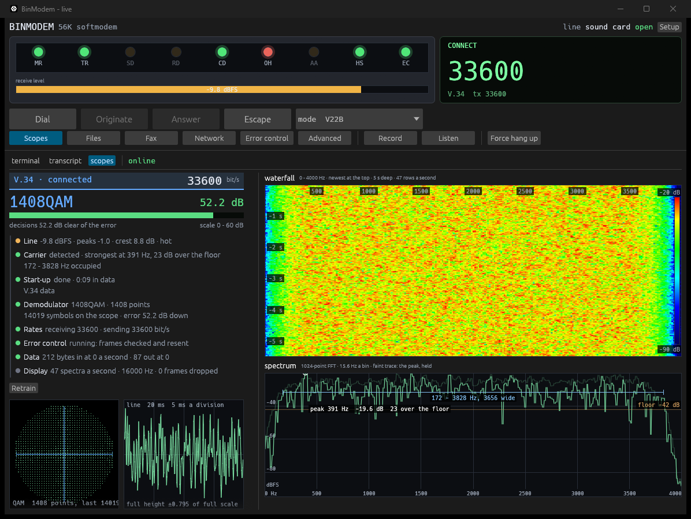
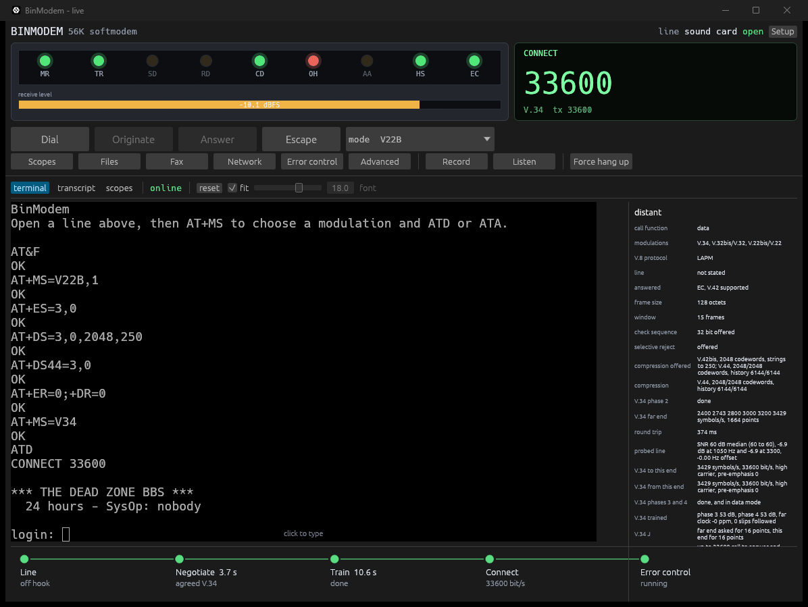
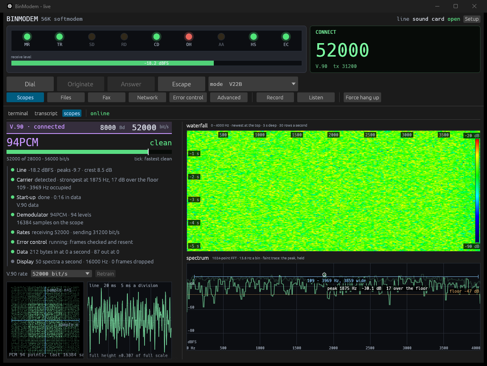
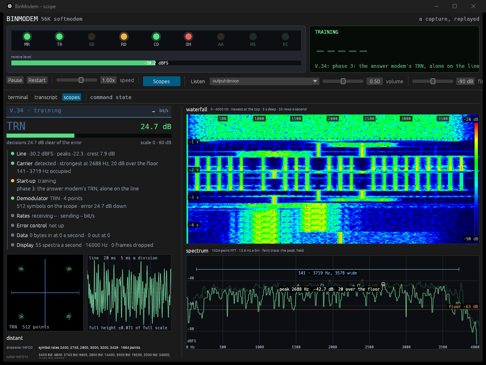
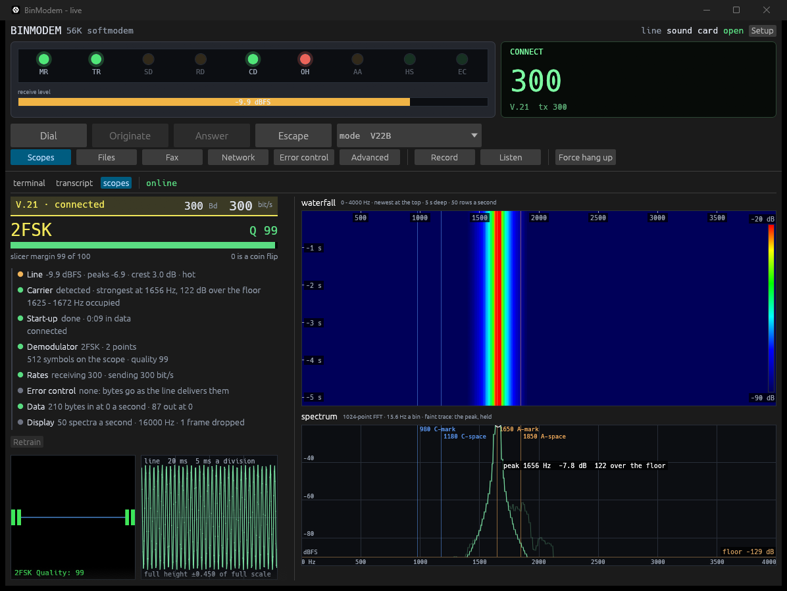

One file. Download `binmodem.exe` and run it. There is nothing to install, and no Visual C++ redistributable is needed because the C runtime is linked in.

```
binmodem.exe                  a modem on a real line
binmodem.exe --devices        what audio this machine has
binmodem.exe --telnet         a board over a socket
binmodem.exe --capture        replay the golden capture
```

[docs/usage.md](https://github.com/CasualArclamp/BinModem/blob/main/docs/usage.md) has the setup.

## What's new in 3.0.0



### The window is a modem's faceplate

- **Lamps, level and the rate, first.** The window opens on the front of a modem: the nine lamps, the receive level, and a readout with the state, the rate it connected at and the modulation. Under them, keys that dial, originate, answer and hang up, and the mode. Line setup is behind a Setup key and opens by itself when there is no line or it failed.
- **The terminal fills its room.** Its type is sized so the whole 80 by 24 screen fits the space there is, to the half point. A *fit* box beside the font slider turns that off.
- **A timeline under the terminal.** The call as five steps -- line, negotiate, train, connect, error control -- each lit when it is done, with what it settled and how long the two that take time took. A call that is not coming up is stuck at one of them, and the terminal alone shows nothing until the last is over.



### The scopes say what they are showing

- **The scopes are a tab** beside the terminal and the transcript, and a key on the faceplate goes straight to them.
- **A call card**, laid out as DecSAT lays out a DVB carrier's: a title bar in the modulation's colour with the symbol rate and the bit rate; what the receiver is slicing, large -- 2FSK, 16QAM, 1408QAM, 116PCM -- with its margin beside it and a bar of the same; and then the receive chain, a line a stage with a health dot: line, carrier, start-up, demodulator, echo canceller, rates, error control, data, fax.
- **Every modulation has a figure on the bar.** FSK its slicer's quality; V.32 how far it misses by against the gap between points, as decibels in hand before a retrain; V.22bis and V.34 the signal to noise of their decisions; V.90 the rate in use along the rates the line carries, ticked at the fastest one predicted clean.
- **An oscilloscope** of the line beside the constellation: the last twenty milliseconds, started on a zero crossing, with its scale written on it.
- **The waterfall** carries its frequency scale, how long ago each row was, and its colour ramp with the levels at both ends. **The spectrum** has a held peak, the noise floor, the occupied band and the peak, each named. Both read out what is under the pointer.



### A recording of a V.32 or V.34 call can be followed

- **As far as one tap goes.** Both put the two directions on one band, so a recording of one tap has their sum and the data cannot be had from it by anybody. Each end's training is sent while the other listens, and that can: V.32's S, S-bar and TRN with the rate signal after it, the answering modem's and then the calling modem's; V.34's INFO sequences, and each modem's S, PP and TRN of phase 3 through to its J. The constellation is drawn while a receiver is trained, what each end said goes in the far-end rows, and when both ends start sending at once the phase says so.
- **Nothing is cued by time.** Each step starts from what the last one read. `binmodem path.wav` replays one; the name says which modulation.



### V.21

- **V.21 as a data modem at 300 bit/s**, `AT+MS=V21`, in the mode list and the run scripts. It answers with V.25's 2100 Hz tone and then channel 2. Its four tones are marked on the waterfall and the spectrum. Contributed by FIM43-Redeye.



### Also

- **`--type <line>`** types a line at the modem once its line is open, as many as are given and a second apart, and **`--scopes`** opens on the scopes: `binmodem --in A --out B --type AT+MS=V34 --type ATD --scopes` places a call with nobody at the keyboard. With `binmodem --answer` on the other pair of cables, that is one instance calling another, which is how the pictures here were taken.
- **Fax:** a PDF sends a page to a sheet, and the pages received are saved as one PDF.
- **V.34 half-duplex:** the source's E waits for the recipient's in a resync too.

The pictures are from calls between two instances over a pair of virtual audio cables, four-wire: no echo, no noise and no codec. 33 600 and 54 666 there are what the modem does on a clean line, not what a telephone route gives.

## Status

- **Sending over Super G3 is not yet confirmed against a real machine.** On the first try, both control channels came up, and each end read the other's MPh and E. Then the far end sent its NSF and DIS and never answered our TSI and DCS, four times over. Every frame in the recording decodes whole in both directions, with the headers right. The likeliest cause is that our E reached that machine about 50 ms before it had sent its own, so it never started reading ours. The last change above answers that, but it has not been tried live yet. Untick V.34 to send at V.17.
- **V.32's round-trip measurement can still be halved by a lost packet.** On a V.32bis call over a trunk, the concealment brought the far end's alternation back inverted, and the reversal that came out of it stopped the clock at 706 ms on a line whose real round trip is 1.22 s. The call connects regardless; the bad reading still costs the echo canceller's tap placement.
- **One ISP's V.90 pool sometimes stops dead** just as its modem takes up our constellation, at the end of phase 4 or in a renegotiation. Every CP we sent was checked against V.90 Table 14 bit for bit, and they are correct.
- **Known:** after a V.90 call falls back to V.34, the V.34 retrain watch can still take the hang-up beep for tone B.
- **V.92:** planned and in progress on a branch; not in this release.
- **Not yet tried against real far ends:** V.17, and the V.29 and V.27 ter receivers, have been measured against our own modems and simulated lines only.

Checksums are in `SHA256SUMS.txt`.
