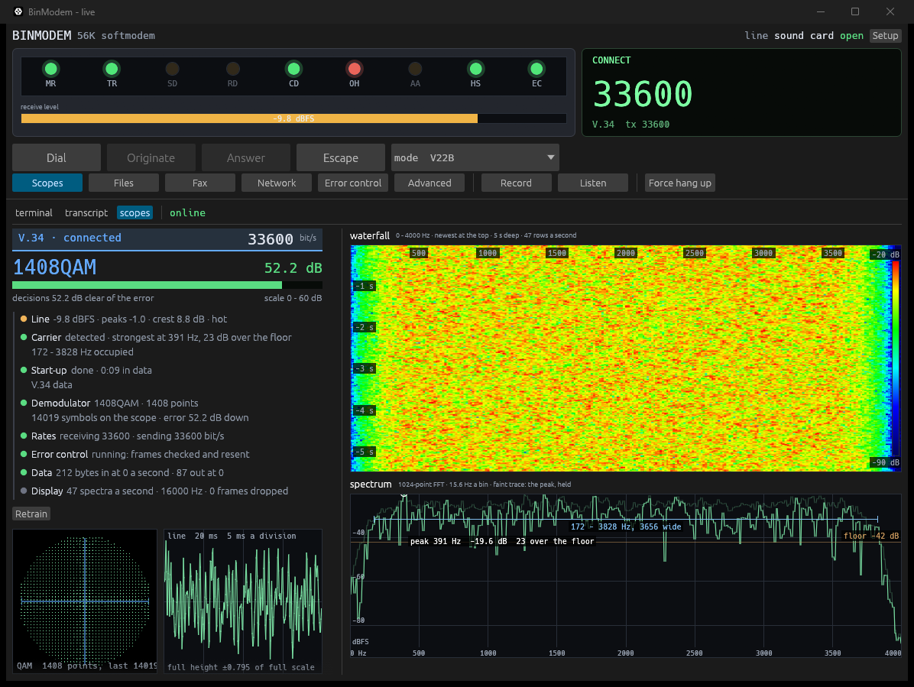

# BinModem

[](https://github.com/CasualArclamp/BinModem/releases/latest) [](https://github.com/CasualArclamp/BinModem/releases)

If this project was worth your time, please consider a [donation via PayPal](https://www.paypal.me/Arclamp).



BinModem is a dial-up softmodem in Rust. Everything that a modem does is code:
the tones, the handshakes, the error control and the compression. The line is
a sound card. There is no DSP chip and no driver blob. It does not depend on
the Windows of one vendor, as a winmodem does.

The code follows the ITU-T Recommendations. The source cites the clause number
for every normative constant. The code follows the RFCs for everything that
the modem carries. There are 2175 tests.

## What it does

BinModem places and answers real calls. Every modulation from Bell 103 to V.90
has connected to real modems and to the servers of providers over a VoIP
trunk.

| Function | Summary |
|---|---|
| **Modulations** | Bell 103, Bell 212A, Bell 202, V.21, V.22, V.22bis, V.32, V.32bis, V.34 (4800 to 33600), V.90 analogue and digital modems (28000 to 56000 PCM down), U.S. Robotics x2 as a server |
| **Negotiation** | V.8 and ANSam, and the V.25 answer tone |
| **Error control** | V.42 LAPM |
| **Compression** | V.44 (LZJH) and V.42bis (BTLZ) |
| **Commands** | V.250 AT commands and S-registers |
| **Terminal** | ANSI/CP437 with mouse reports, and telnet (RFC 854) |
| **Files** | ZMODEM send and receive |
| **Fax** | T.30 group 3, send and receive: V.17, V.29, V.27 ter and Super G3 at up to 33 600 |
| **Network** | PPP with LCP, PAP, CHAP and IPCP, a dial-in login prompt and a login script |
| **Internet** | our own TCP (RFC 9293) and an HTTP/HTTPS proxy (RFC 9112) |
| **SIP** | our own SIP caller (RFC 3261, 3550 and 4566) and a dialler |
| **Review** | `dialsnoop.exe` reads a recording of a call between other parties |

The full table, with every rate and option, is in
[docs/manual/status.md](docs/manual/status.md#functions).

## The line

BinModem can use these lines:

- a full-duplex sound card
- a WAV to replay
- a SIP trunk (`--sip <account>`), which needs no sound card
- a socket to a board (`--telnet`), which needs no sound card

BinModem is portable in principle. It uses `cpal` for the audio and `eframe`
for the window, and it has no OS-specific code. The releases are Windows
executables. [docs/manual/linux.md](docs/manual/linux.md) gives the build on
Linux.

## Install or build

Download `binmodem.exe` from the
[latest release](https://github.com/CasualArclamp/BinModem/releases/latest).
It is one file with nothing to install.

To run it from the source:

```bash
cargo run -p gui --release -- --live
```

As an alternative, run `dist.bat`. It makes two files:

- `dist\binmodem.exe` is a single file with nothing to install. It holds the
  scope, the terminal, a board that answers and a capture to replay.
- `dist\dialsnoop.exe` reads a recording of a call and does nothing else.

## Quick start

These steps need no sound card, no line and no second modem.

1. Put `binmodem.exe` in a folder.
2. Open a terminal in that folder.
3. Replay the Bell 103 call that the program contains:

   ```powershell
   .\binmodem.exe --capture
   ```

4. Open the **terminal** tab.
5. Click in the terminal.
6. Type `ATD`.
7. Press Enter.

The recording plays through the modem. The lamps, the waterfall and the scopes
follow it. The session that it carried comes out as text.

[docs/quickstart.md](docs/quickstart.md) goes from a download to a first call.

## Manual

| Page | Contents |
|---|---|
| [docs/quickstart.md](docs/quickstart.md) | From a download to a first call |
| [docs/usage.md](docs/usage.md) | The AT interface, the live-line setup, ZMODEM, the telnet terminal and every flag |
| [docs/manual/status.md](docs/manual/status.md) | What works: real calls, V.32bis, V.34, V.90 and the full table of functions |
| [docs/manual/x2.md](docs/manual/x2.md) | U.S. Robotics x2 as a server, and the test with the Courier firmware |
| [docs/manual/fax.md](docs/manual/fax.md) | Fax: V.29, V.27 ter, V.17, Super G3 and error correction mode |
| [docs/manual/network.md](docs/manual/network.md) | PPP, web pages through the proxy, the dial-in server and our own TCP |
| [docs/manual/window-and-sip.md](docs/manual/window-and-sip.md) | The window and its scopes, the SIP caller and the dialler |
| [docs/manual/review.md](docs/manual/review.md) | How to read a recording of a call between other parties |
| [docs/manual/roadmap.md](docs/manual/roadmap.md) | Work in progress (V.ARC and others) and next steps (V.33, V.92) |
| [docs/manual/linux.md](docs/manual/linux.md) | Build on Linux |
| [docs/design/architecture.md](docs/design/architecture.md) | The design and the milestone ladder |
| [docs/design/v-arc.md](docs/design/v-arc.md) | The design of V.ARC |
| [docs/design/v92](docs/design/v92) | The notes and the plan for V.92 |

## Security notes

- EasySip has no password. Use it only on a network that you trust.
- The SIP password is kept in clear text in `%APPDATA%\BinModem\sip.txt`.

## Scope

These items are not complete:

- **x2** has not met a real x2 modem yet.
- **T.38** is not there yet.
- **V.33** is next.

[docs/manual/roadmap.md](docs/manual/roadmap.md) has the detail.

## Credits

Nothing of x2 is standardised. The facts come from the notes of libv90modem.
Those notes came from D-Modem, from courier-emu and from its own study of the
server firmware. The level banks for each rate are data from the published
numbers of D-Modem.

## Licence

GPL-3.0-or-later. The ITU-T Recommendations themselves are not redistributed
here. `tools/fetch_specs.sh` downloads them.
