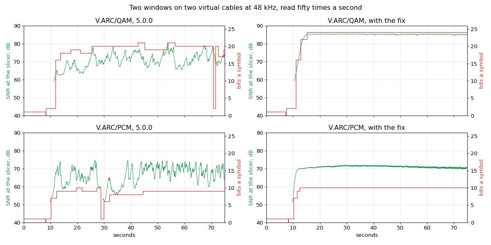
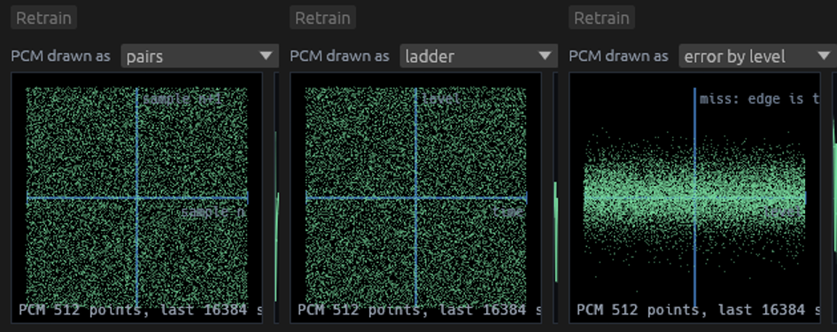
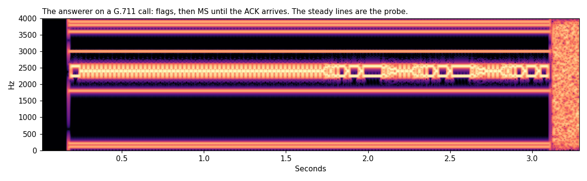
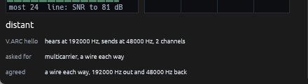
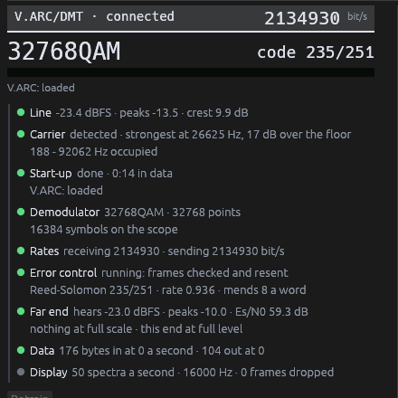
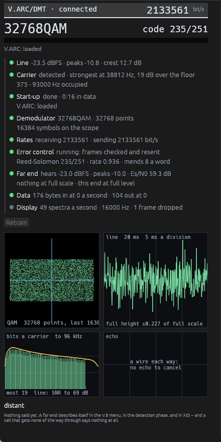
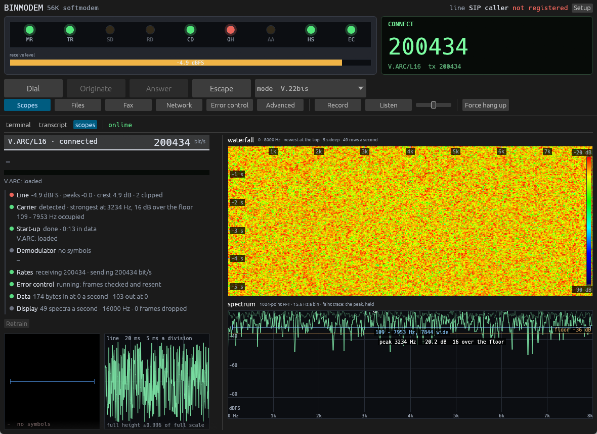

# V.ARC

BinModem's own wideband mode. Not an ITU recommendation and not compatible
with anything: both ends have to be BinModem.

Status: built and run on real sound devices, from the `varc-link` tool and
from the modem itself (`AT+MS=VARC`, `ATD`, `CONNECT .../VARC`, the window's
mode box), and over a SIP call between two of these. See
[What is not done](#what-is-not-done) for what has not been tried.

Every V.ARC call starts with V.8, then the V.ARC handshake, then the mode.
Every mode runs on every SIP coding, G.711 included. See
[The start of a call](#the-start-of-a-call).

Code: `crates/varc`. Line: `crates/line/src/wide.rs`. The call:
`crates/modem/src/varc.rs`. Tool: `crates/modem/src/bin/varc-link.rs`.


## What it is for

Every other mode here is built for a telephone channel: 3 kHz wide, about
35 dB of SNR, 64 kbit/s of G.711 underneath at best. V.ARC is for the channel
a sound card gives when it is wired to another sound card: 20 kHz wide or
more, 60 to 90 dB of SNR, and four wires (an output and an input each way),
so there is no echo to cancel.

Two ends, full duplex, each direction on its own wire. A stereo lead is two
wires, used either as one each way (one machine, a loopback) or both the same
way (two machines, a lead each way), in which case the two are bonded into
one octet stream.

## The start of a call

A V.ARC call does not start with its own signal. It starts as each other
call of this modem starts, because the far end can be any modem.

| Step | What it is | What it decides |
|---|---|---|
| 1 | V.8: ANSam, CM, JM, CJ | Whether the two ends have V.ARC |
| 2 | The V.ARC handshake: 300 bit/s DBPSK, one carrier for each direction, CL then MS then ACK | Rates, channels, wires, the modulation, and what the line is made of |
| 3 | The mode | The tables, then data |

This sequence is the same on a sound card, on an EasySip line and on a SIP
account. A call with `AT+A8E=,,,1` has the V.8 bis transaction before step 1.
The one exception is `ATDLOOP`. A lead that comes straight back has no far
end, thus that call starts at step 3.

### Step 1: V.ARC in V.8

V.8 has a category for non-standard facilities (tag `1111`, Table 8). A
modem that is set to V.ARC puts one block in that category of its menu:

| Octets | Contents |
|---|---|
| `09` | the length: nine octets follow |
| `FF FF` | the T.35 country code |
| `04` `42 69 6E 4D` | the length of the provider code, and the code "BinM" |
| `01` | the edition of this block |
| flags | bits 1 and 2: multicarrier, QAM or baseband levels; bit 3: not used (it asked for one pair of wires) |

- The block is the same block that V.8 bis carries. See
  [V.8 bis](#v8-bis). The codes are not registered.
- The block goes in extension octets, five bits in each octet, as Table 8
  specifies. That is sixteen octets after the category octet.
- The calling modem puts the block in its CM. The answering modem puts its
  own block in the JM only if the CM had one.
- A modem that is not BinModem ignores the category. Clause 5 of V.8 tells
  it to ignore what it does not know.
- The menu also offers V.92 and all the modes below it. Thus the two ends
  agree on an ordinary mode in the same exchange.

A modem is set to V.ARC if `+MS` names a V.ARC mode, or if `+VARCBIS` is
not 0.

After CJ, each end knows whether both menus had the block:

- If both had it, each end keeps the line quiet for 0.4 s. Then the V.ARC
  handshake starts. The quiet time lets a sound card send the end of CJ
  before the window opens the card again at its own rate.
- If one menu did not have it, the call continues as the ordinary mode that
  V.8 agreed. `+MS` stays as it was set. The transcript says
  `V.8: the far end has no V.ARC; an ordinary call instead`.

The flags in the block say what each end was set to. They do not select the
mode. Step 2 does that.

### Step 2: the V.ARC handshake

This is the V.ARC equivalent of V.8. See [The handshake](#the-handshake)
for the signal. It is one transaction of three messages, with the shape of
a V.8 bis transaction:

| Message | From | What it says |
|---|---|---|
| CL | The caller | The capabilities of the caller |
| MS | The answerer | The capabilities of the answerer, and the mode that the answerer selected |
| ACK | The caller | The caller has the MS and selected the same mode |

The capabilities of an end are:

- the rates at which this end hears and sends
- the number of channels
- the modulation that this end was set to
- a bit that is not used (it asked for one pair of wires)
- what the line of this end is made of: a sound card, a SIP call in linear
  samples, a SIP call in A-law, or a SIP call in mu-law
- the fit that the band of this end passes (see [The line probe](#the-line-probe))

Each end sends its message again and again until the reply arrives. Both
ends calculate the same result from the two sets of capabilities. On a SIP
call the handshake runs at the rate of the call. For G.711 that is 8 kHz.

### Step 3: the mode on each line

| Line | `VARC` | `VARCQ`, `VARCP` |
|---|---|---|
| Sound card | multicarrier | QAM, baseband levels |
| SIP, linear samples, the same at both ends | V.ARC/L16: the samples are the data | QAM or levels on the samples |
| SIP, G.711, the same law at both ends | V.ARC/G.711: the codewords are the data | QAM or levels at 8 kHz |
| SIP, but the ends do not have the same coding | multicarrier at the rate of the call | QAM or levels at the rate of the call |

- The two direct modes (V.ARC/L16, V.ARC/G.711) are a trial. If nothing is
  heard in 4 s, or the ends have no connection in 10 s, the call continues
  as the multicarrier modulation. The handshake does not run again.
- A call on a sound card looks for an echo before the modulation starts.
  See [One pair of wires](#one-pair-of-wires-the-echo-canceller). A SIP
  call has a path for each direction and no echo, and does not look.
- If the two ends were set to different modulations, the multicarrier
  modulation runs.

### Each mode on G.711

A G.711 call has 8000 samples each second. The law gives a signal to noise
ratio of approximately 38 dB. Each modulation runs at the rate of the call,
thus its band is the band of the call:

| Mode | At 8 kHz | Measured in simulation, A-law and mu-law |
|---|---|---|
| V.ARC/G.711 | 8000 codewords each second | 60 928 bit/s in A-law, 56 832 in mu-law, after the first tables |
| V.ARC/DMT | carriers 15.6 Hz apart, to 3.4 kHz | 25 700 to 26 100 bit/s |
| V.ARC/QAM | 3700 baud on a carrier at 2000 Hz, 58 Hz to 3942 Hz, with the trellis code | 37 000 bit/s |
| V.ARC/PCM | 5333 baud, 0 Hz to 3.2 kHz | 22 500 bit/s |

- The modulations do not need exact codewords. A call that a gateway
  decodes and codes again carries them at the same rates.
- With a 300 Hz high-pass filter in the path, V.ARC/PCM connected at
  9000 bit/s.
- V.ARC/QAM fits its baud to the band that the call passes. See
  [V.ARC/QAM on a narrow line](#varcqam-on-a-narrow-line).
- `AT+VARC=<baud>,<code>,<bits>` applies on a SIP call also. The baud is
  the nearest one that the rate of the call permits.

The tests are in `crates/modem/tests/varc_call.rs`. Each mode connects
through simulated PCMU and PCMA and passes a page with no incorrect octet.

### An older BinModem

A BinModem before this change starts a `+MS=VARC` call with the V.ARC
handshake and no V.8. It cannot make a V.ARC call with this one. Use the
same build at both ends.

## The three modulations

| | V.ARC/DMT | V.ARC/QAM | V.ARC/PCM |
|---|---|---|---|
| Kind | multicarrier, bit-loaded per carrier | single carrier | baseband levels |
| Symbol rate | 44.1 symbols/s of up to 2047 carriers | 16 000 baud | 16 000 baud |
| Band at 48 kHz | 47 Hz to 20.6 kHz | 0.9 to 20.1 kHz | DC to 9.6 kHz |
| Bits | 0 to 24 per carrier | 2 to 24 per symbol | 1 to 12 per level |
| Sample rates | any (plan follows the rate) | multiples of 48 kHz | multiples of 48 kHz |
| Module | `dmt.rs` | `sc.rs` | `sc.rs` |

All three share one framing layer, one link layer and one receiver front end
(a resampler steered by the timing loop).

### V.ARC/DMT

- Real baseband signal, no carrier, so no frequency offset between ends: only
  the difference in sample clocks.
- FFT size `n` by sample rate: 512 below 30 kHz, 1024 to 60 kHz, 2048 to
  120 kHz, 4096 above. Guard (cyclic prefix) `n/16`. Carriers are 31 to 47 Hz
  apart and a symbol is about 23 ms at every rate.
- Superframe: 1 sync symbol + 32 data symbols (0.75 s at 48 kHz).
- Sync symbol: a known QPSK point on every carrier. One of four sequences;
  which one says which bit table the following 32 symbols use.
- Data symbol: a carrier with `b > 0` bits carries a Gray-coded QAM point
  (rectangular when `b` is odd). A carrier with 0 bits, and every carrier
  `k` with `k mod 32 = 16` (the pilots), carries a known QPSK point.
- Carriers above 0.86 of Nyquist are never loaded. The resampler is flat to
  0.87 of Nyquist; above that its response moves as the clocks slide.
- Transmit level -16 dBFS RMS.

Receiver, in order:

1. **Hunt.** Correlate the guard against the end of the body it copies,
   folded over one symbol span for 8 symbols.
2. **Frame.** Transform each symbol and compare neighbouring carriers with
   the sync sequences (differential, so no channel estimate is needed).
3. **Place the window.** The channel's delay from the first estimate moves
   the transform to start a third of a guard before the signal.
4. **Train.** 44 symbols to settle, 88 to measure noise on each carrier
   against the known points (2 s at 48 kHz, about +-0.5 dB per carrier).
5. **Load.** `b = floor(log2(1 + SNR / gap))`, gap 8 dB, capped at 24.

Running, per symbol: timing error from a weighted fit of phase against
carrier number over the known carriers; that error is taken out of the
symbol at once and also drives a second-order loop (about 1 Hz) on the
resampler. One complex tap per carrier, adapted by LMS.

### V.ARC/QAM and V.ARC/PCM

One machine. PCM is QAM with the carrier at 0 Hz and the quadrature axis
empty.

- 16 000 baud, root raised cosine, 20% excess bandwidth, 24 symbols either
  side under a Kaiser window (beta 8).
- QAM carrier 10.5 kHz.
- Superframe 4096 symbols (0.256 s): a 128-symbol sync word, then 16 groups
  of 248 data symbols.
- Sync word: four quarters of 32 known symbols. The second and third
  quarters are inverted by the two bits of the table mark, the fourth by
  both.
- PCM only: symbols go in eights. The first of each eight gives up its sign
  bit as a polarity flag, and the eight are sent whichever way up brings the
  running sum of all levels sent back towards zero. That keeps DC out of a
  line that will not pass it. Cost: 1 bit in `8b`.
- Transmit level -14 dBFS RMS.

Receiver: resampler, mix to baseband (QAM), matched filter read three times
a symbol, a 121-tap equaliser at T/3 (NLMS, decision-directed), a
second-order phase loop (QAM) or a baseline tracker (PCM), slicer.

The sync word is read **ahead of the equaliser**, by correlation, for three
things: whether the signal is still there, which mark it carries, and timing
(a parabola through the correlation at the expected sample and its
neighbours). The equaliser's own output of the sync word is used for one
thing: to turn the constellation the right way up, since decision-directed
loops are equally happy a quarter turn round.

Loading: `b = floor(log2(1 + SNR/gap))` for QAM, half that for PCM.

### A measured line reads steadily



5.0.0 did not. On a line good for eighty decibels the figure rose and fell
by ten or fifteen every few seconds, the grid was renegotiated to suit each
swing, and every renegotiation cost throughput. Two things together:

- **The timing loop never came to rest.** Once the line was measured it
  still took out a twentieth of each sync word's timing error at once, and
  the measurement is only good to a hundredth of a sample. With the rate
  term it had, the loop was under half of critical damping. It is now a
  fifteenth as strong and critically damped, and takes minutes, which is
  how fast two crystals drift.
- **The equaliser was too slow to follow.** At a step of 0.005 it took a
  second and a half to catch up with each move of the sampling instant,
  and read badly for all of it. It is now 0.05, which costs a tenth of a
  decibel in noise of its own.

On two virtual cables the reading now moves by under half a decibel
(84 to 85 dB for QAM, 80 and 71 for PCM) and the grid, once chosen, stays.
`BINMODEM_VARC_TRACE=<file>` makes the window write the figure fifty times
a second, and `trace_of_the_slicer_over_a_minute` in `sc.rs` does the same
on a simulated line.

Nothing is learnt from a gap either: while the power under the equaliser
is well below what it has been, adaptation stops and the carrier coasts.
That is not yet enough to ride one out. A few milliseconds of silence on a
grid of twenty-four bits still leaves the receiver guessing until the two
ends renegotiate, which takes seconds; see "What is not done".

## One signal

A call is one signal however many channels the sound card has: what is sent
is the same on every channel, and what is heard is all of them added
together.

It was a signal a channel at first, each with its own data and its own
tables, which is twice the rate down a stereo lead. It is also a call that
half works down anything else. A stereo cable one way and a single
microphone back left one channel of two on its starting table for the whole
call, since the table asking it to do better could only come back down the
channel that was not there; and the window showed whichever channel it met
first. (Tables can now go round by another channel, `TABLE_FOR`, and each
direction of a channel is counted for itself; with one signal neither is
needed, and both are still there for a `Station` given more than one.)

Adding the channels together is worth about 3 dB where both carry the
signal. Measured since, on one machine, nothing wrong in any:

| Line | Rate |
|---|---|
| The Realtek lead at 192 kHz, a call to itself | 1.42 Mbit/s at 72 dB; it was 1.1 a channel, 2.1 over the two |
| Line In at 192 kHz one way, CABLE-B at 48 kHz back | 1.42 Mbit/s and 0.40 |
| Two ends on VB-Cable A, two-wire, multicarrier | connects at 327 kbit/s, 384 at 42 s, 77 dB |
| The same, V.ARC/QAM two-wire | 139 kbit/s |
| A cable one way, a monitor's loudspeakers to a webcam's microphone back, V.ARC/QAM | 10 250 bit/s through the air on four points with a code of a third; 286 000 the other way on a grid of a million |

**Figures elsewhere in this note that speak of two channels, or of rates
above these on the same lines, were measured before this** and are what two
signals carried.

## The single-carrier modes fill the card's band

V.ARC/QAM and V.ARC/PCM were 16 000 baud whatever the card: 1.5 to 19.5 kHz
and 0 to 9.6 kHz. On a card at 48 kHz that is four-fifths of the band for
the carrier and two-fifths for the levels; on one at 192 kHz it is a fifth
and a tenth.

They are still built for 48 kHz and 16 000 baud (`sc.rs` is unchanged), and
are now run at whatever rate the line has, sample for sample, so every
frequency in them moves with the rate (`Faster::paced`). The levels keep
below half their band, so they are run twice as fast again by sending every
other sample (`hello::Twice`, `hello::Half`).

| | V.ARC/QAM | V.ARC/PCM |
|---|---|---|
| Baud | a third of the sample rate | two-thirds of it |
| At 48 kHz | 16 000 baud, 1.5 to 19.5 kHz | 32 000 baud, 0 to 19.2 kHz |
| At 192 kHz | 64 000 baud, 6 to 78 kHz | 128 000 baud, 0 to 77 kHz |
| Bits a symbol | 2 to 24: four points to sixteen million | 1 to 16: 2PCM, 4PCM, 8PCM and so on to 65 536PCM |

On the Realtek lead at 192 kHz, a call to itself, nothing wrong in either:

| Mode | Was | Is |
|---|---|---|
| V.ARC/QAM | about 200 kbit/s | 1.14 Mbit/s, 3.5 million octets |
| V.ARC/PCM | 83 kbit/s | 972 kbit/s, 3.2 million octets |

The top of the PCM ladder is a limit and not a result. Each bit wants 6 dB,
so sixteen want about 104 dB at the slicer. The lead measures 63 dB and
carries 512 levels; a virtual cable has carried 2048; and asked by hand for
4096 or more on a simulated line with no noise at all, the receiver reads
nothing, its own floor being about 63 dB.

A card need no longer run at a multiple of 48 kHz for these modes.

PCM has levels and no plane to put them on, so the window draws it one of
three ways, chosen above the scope (`BINMODEM_PCM_VIEW=ladder` or `error`
starts on that one): each sample against the next; the levels with time
across; or how far each sample fell from its level, against the level, with
the box's top and bottom the decision lines. Below, 512 levels on the lead.



**By hand.** `AT+VARC=<baud>,<code>,<bits>` sets what a single-carrier call
asks the far end to send with, where somebody wants to choose and not have
the receiver choose; the modulation window has the same three under "by
hand". Nought leaves that one to the modem.

- **Baud**: the nearest the card has, which is its fastest and halves of
  it. It goes in the handshake, since it is the far end that sends at it,
  and a direction given one is not slowed further for not being heard.
- **Code**: the percentage of each codeword that is data: 93, 75, 50, 33
  or 25.
- **Bits a symbol**: the grid, whatever the line measures. Ask for more
  than it bears and nothing arrives.

Each end chooses for what it hears, so the two ways can differ. In
simulation `AT+VARC=8000,50,4` at one end of a 48 kHz line gives that end
8000 baud, sixteen points and a code of a half, 15 kbit/s, with the other
way left at 16 000 baud and whatever it will bear.

## V.ARC/QAM on a narrow line

A V.34 modem carries 33 600 bit/s at its best. On a G.711 call, V.ARC/QAM
carried 23 250 bit/s. It now carries 37 000 bit/s on the same call. Three
changes give that, and each one is for a line of 16 kHz or less. A sound
card is not changed.

| Step | Baud | Bits in a symbol | Rate through mu-law |
|---|---|---|---|
| Before | 2667 | 9 | 23 250 bit/s |
| The baud fitted to the call | 3700 | 9 | 31 797 bit/s |
| The trellis code and the shell mapper | 3700 | 10.375 | 37 000 bit/s |

Two `modem-sip` ends on one machine give `CONNECT 37000/VARC` in PCMU and
in PCMA. In simulation, 250 000 random octets crossed a mu-law call with no
incorrect octet at 34 626 bit/s of data. The difference from 37 000 is the
frame overhead and the blocks that were sent again.

### The baud

V.ARC/QAM is built for three samples in each symbol (`sc.rs`). Run sample
for sample at 8 kHz, that is 2667 baud between 150 Hz and 3350 Hz. A G.711
call between two BinModems has no filter in it and passes almost all of its
4 kHz.

- The modulation now runs at a rate of its own: three times the baud that
  is selected. A resampler brings it to the rate of the line and back
  (`fit.rs`). The modulation itself is not changed.
- The resampler is a windowed sinc with 72 samples on each side. The band
  goes to 98% of half the sample rate, and a short resampler is not
  accurate there.
- `Shape::fitted` gives the modulation a carrier and an excess bandwidth
  that put its band where the line is.

There are three fits, as shares of the sample rate (`hello::FITS`):

| Fit | Baud at 8 kHz | Carrier | Excess bandwidth | Band | Through mu-law, no trellis code |
|---|---|---|---|---|---|
| 1 | 3700 | 2000 Hz | 5% | 58 Hz to 3942 Hz | 31 797 bit/s at 37.6 dB |
| 2 | 3429 | 2000 Hz | 10% | 114 Hz to 3886 Hz | 29 468 bit/s at 38.0 dB |
| 3 | 3000 | 1900 Hz | 20% | 100 Hz to 3700 Hz | 26 062 bit/s at 38.5 dB |
| none | 2667 | 1750 Hz | 20% | 150 Hz to 3350 Hz | 23 250 bit/s at 39.0 dB |

### The line probe

A line that passes 300 Hz to 3400 Hz cannot carry 3700 baud. Thus each end
must know the band before it selects a fit. The V.ARC handshake measures
it, as the line probe of V.34 does (10.1.2.3), but smaller.

- On a line of 16 kHz or less, each end sends seven weak steady tones below
  its handshake carrier. At 8 kHz they are 1800 Hz and 3000 Hz in the middle
  of the band, 100 Hz and 200 Hz at the bottom, and 3600 Hz, 3800 Hz and
  3900 Hz at the top.
- The two middle tones are 375 Hz or more from the band of each handshake
  carrier, at 8 kHz and at 16 kHz. The handshake receiver hears nothing
  there.
- Each end measures the tones of the other end in blocks of 0.1 s. It
  waits for three blocks in which the middle tones are present and stable.
- An edge tone passes if it is not more than 6 dB below the middle tones.

| Tones that pass | Fit |
|---|---|
| 100 Hz and 3900 Hz | 1 |
| 200 Hz and 3800 Hz | 2 |
| 200 Hz and 3600 Hz | 3 |
| less than that | none: the carrier as it is built |

- An end sends no CL and no MS until it has measured. Until then it
  sends flags and its probe. The message then says which fit this end can
  hear.
- If the carrier of the far end is there for 0.8 s and no probe was
  measured, the far end has no probe. The end then says "none" and
  continues.
- If an end hears nothing of the modulation at one fit, it asks for the
  next fit, then for the carrier as it is built, then for halves of that.
  This is the procedure of
  [When one end cannot hear the other](#when-one-end-cannot-hear-the-other).
- `AT+VARC=<baud>` selects the nearest baud of all of these.

In simulation, a line that passes 300 Hz to 3400 Hz gets no fit and
2667 baud. A line that stops at 3850 Hz gets fit 2. A line that stops at
3700 Hz gets fit 3.

### The trellis code

A grid with no code needs approximately 11 dB between its points and the
noise. `trellis.rs` has a trellis code, as V.34 has, in its simplest form.

- The grid has two times the points that the data needs. It is divided
  into eight subsets (Ungerboeck, 1982). Points in one subset are 9 dB
  farther apart than adjacent points.
- A convolutional code of rate 2/3 selects the subset of each symbol. It
  has 64 states. Thus only some sequences of subsets are sent.
- The receiver uses the Viterbi algorithm. It finds the permitted sequence
  that is nearest to what arrived.
- The code is not the code of V.34. The V.34 code has four dimensions and
  is not changed by a quarter turn. V.ARC has a sync word that gives the
  direction, thus a code of two dimensions is sufficient.
- A computer search of all codes of this size selected the polynomials
  (`0o105`, `0o032`, `0o060`). The squared free distance is 7, where
  adjacent points are 1 apart. A grid with half the points and no code has
  2. That is 5.4 dB.
- Each block is coded as one unit. The code starts at state zero, and the
  last four symbols of the block steer it back to state zero. Those four
  symbols give up 8 bits.

### The shell mapper

The shell mapper is that of V.34 (9.4).

- The points of each subset are put in rings by their energy.
- A frame is eight symbols. The number of a frame selects its eight rings.
  The numbers go to the frames with the smallest total energy first.
- Thus the outer rings are used less than the inner rings. This is the
  shaping gain, almost 1 dB.
- A frame can carry any whole number of bits. Thus a symbol carries its
  bits in steps of an eighth of a bit.
- The grid has 20% more rings than the bits need, so that the mapper has
  frames to omit.

Measured with white noise, for blocks of 248 symbols with no Reed-Solomon
code: one block in a thousand is incorrect at 4 dB above the Shannon limit,
and none in a thousand at 4.5 dB. That is the same at 5, 9, 10, 10.5 and
11 bits in a symbol.

### What the receiver asks for

A table for the trellis code has two entries: the whole bits in a symbol,
and the eighths of a bit. A receiver calculates the best table with the
code and the best table with no code, and asks for the one that carries
more.

| Reed-Solomon code | Margin with no trellis code | Margin with the trellis code |
|---|---|---|
| none | 11.5 dB | 6.5 dB |
| 2 check octets | 10 dB | 5.5 dB |
| 16 check octets | 8 dB | 5 dB |

- The noise is measured against what the code decided, one block at a
  time. One point in thirty is nearer to an adjacent point than to its own,
  thus the distance to the nearest point is not a good measure.
- The equaliser and the carrier loop use the nearest point, as before.
- A grid that is set by hand (`AT+VARC=,,<bits>`) is a grid with no code.
- V.ARC/PCM does not have the code.
- On a very good line, a grid with no code carries more: the code stops at
  12.5 bits in a symbol and a grid goes to 24.

## The handshake

After V.8, each end says what it is (`hello.rs`). Two ends need
not have the same sound card: one hears at 192 kHz and sends at 48, the
other has one device both ways, one was told the line is a single pair of
wires and the other was not. Nothing in a wideband signal can settle that,
because until it is settled neither end knows what signal to listen for.

The handshake has the shape of a V.8 bis transaction: a capabilities list,
a mode select and an acknowledgement.

**The signal**

- **300 bit/s DBPSK.** The caller sends on a 1200 Hz carrier and the
  answerer on 2400 Hz. A nought turns the carrier over. A one does not
  change it.
- **A root raised cosine** with an excess bandwidth of 0.5 shapes each
  symbol. Each direction keeps to 450 Hz: 975 Hz to 1425 Hz, and 2175 Hz to
  2625 Hz. Less than a thousandth of the power is more than 300 Hz from the
  carrier.
- An end on one pair of wires hears the far end through its own signal with
  no echo canceller, because the two bands do not touch.
- A telephone channel carries both carriers. The sample rate of the card
  does not matter.
- The receiver has a symbol clock. It compares the energy a quarter of a
  symbol before and after each symbol, and moves to the middle.
- The level is -15 dBFS RMS.

**The frames**

The frames are HDLC frames, as in V.8 bis: flags between frames, a nought
after each five ones, and a 16-bit frame check sequence. The first octet
has the message type in its low half and the revision (1) in its high
half. MS, CL, ACK and NAK have the type codes of V.8 bis.

| Message | Type | Octets | What follows the type |
|---|---|---|---|
| MS | 0001 | 14 | Capabilities (12 octets), then the selected mode (1 octet) |
| CL | 0010 | 13 | Capabilities (12 octets) |
| ACK | 0100 | 1 | Nothing |
| NAK | 1000 | 1 | Nothing |

The capabilities are: one octet of flags (two-wire, the line, the fit), the
modulation, the channels, and three numbers of 24 bits (the rate this end
hears at, the rate it sends at, the baud it asks for). The selected mode is
one octet: the modulation, the wires, and whether the numbers of the call
are the data. `FF` means that the two ends have no mode in common.

**The transaction**

1. Each end starts with 16 noughts, for the clock of the far end, and then
   sends flags.
2. The caller sends CL again and again.
3. The answerer reads the CL. It calculates the mode from the two sets of
   capabilities (`hello::agree`). It sends MS again and again.
4. The caller reads the MS. It calculates the mode for itself. If the two
   results are the same, it sends ACK three times and starts the mode. If
   they are not, it sends NAK three times and the call stops.
5. The answerer reads the ACK and starts the mode.

If each ACK is lost, the answerer hears no caller for 4 s. It then starts
the mode, because a caller that sent its ACK is silent on its carrier.

The transaction takes about 1.5 s on a sound card. On a line of 16 kHz or
less the probe adds about 0.5 s.

What the answerer sends on a real G.711 call between two `modem-sip` on one
machine. The call has about 0.3 s of delay each way, thus the MS goes about
three times before the ACK arrives.



**Against the earlier handshake**

The earlier handshake (to 5.6.0) was 200 bit/s FSK with two tones for each
direction, asynchronous characters, and one message that each end sent
until it saw a "heard" flag. Measured in simulation, two ends at 48 kHz:

| | FSK, to 5.6.0 | DBPSK, CL, MS and ACK |
|---|---|---|
| Time on a clean line | 4.3 s | 1.5 s |
| Most noise it gets through (signal to noise in 24 kHz) | -9 dB | -12 dB |

A build with the earlier handshake cannot make a V.ARC call with this one. Use the same
build at both ends.

Both ends then work out the same answer from the same two messages
(`hello::agree`):

| Question | Answer |
|---|---|
| What rate does each direction run at? | The slower of the two cards on it. The end with the faster card converts, by a whole number of times (`Faster`, `Slower`). Cards that no whole number relates, 44.1 and 48 kHz, are told so. |
| Does each end look for its echo? | Yes, if both ends hear and send on one card at one rate, and the line is not a SIP call. An end that hears no echo uses no canceller. |
| Are the numbers of the call the data? | Only if both ends are on a SIP call of the same coding at one rate. See [The start of a call](#the-start-of-a-call). |
| Which modulation? | The one both asked for. If they differ, or a single-carrier mode would not have a multiple of 48 kHz each way, the multicarrier one. |

While it lasts the symbol scope shows each bit of the far end: up for a
carrier that did not change, down for a carrier that turned over. The
window's "distant" panel shows what the far end said, where the transaction
is, and what was agreed, where a V.8 menu would be:



There is no handshake on a lead that comes straight back (`ATDLOOP`), where
there is nobody else. Each other call has it, a SIP call included.

Run for real: a V.ARC/QAM call in G.711 mu-law between two `modem-sip` on
one machine (37 000 bit/s each way). The sound card rigs are tested in
simulation only with this handshake: two cards at different rates, a fast
card that calls a slow one, and one pair of wires.

Two things it turned up in the receiver, both now fixed:

- A receiver that began listening before the far end's last tone had
  finished framed on the tone, which repeats as a symbol's guard does. A
  sync symbol with an eighth of its power on one carrier is now refused.
- Having framed on nonsense it steered its clock by nonsense, to the limit,
  and could not then find a real signal. The clock now goes back to where
  it was last right whenever the signal is lost.

## V.8 bis

`AT+A8E=,,,1` puts a V.8 bis transaction before V.8. A modem that is set to
V.ARC lists it there also.

V.8 bis has a non-standard information field for what the ITU did not
define (8.5). The modem puts a block in that field beside its usual list:

| Octets | |
|---|---|
| `09` | nine octets follow |
| `FF FF` | country code |
| `04` `42 69 6E 4D` | provider code, "BinM", and its length |
| `01` | edition of this block |
| flags | bits 1 and 2: multicarrier, QAM or PCM; bit 3: not used (it asked for one pair of wires) |

"Non-standard field" is set in the identification field (Table 5-1) and
"non-standard capabilities" is set below the data mode (Table 6-3a).

**The country and provider codes are not registered.** A national
administration allocates T.35 codes and BinModem has none. These codes are
made up. Another BinModem knows them. A different modem ignores the block,
as 8.5 tells it to do with a block that it does not know.

The transaction is then as it was (CRe, CRd, CL, MS, ACK):

- If both lists have the block, the MS names the data mode, the block and no
  ITU modulation. V.8 follows the ACK, as it follows each transaction. Both
  V.8 menus then have the V.ARC block, and the V.ARC handshake follows V.8.
- If only one list has the block, the MS names an ordinary mode. The V.8
  that follows finds no V.ARC at the far end, and the call is an ordinary
  call.

`+VARCBIS=<mode>,<wires>` sets what a modem lists when `+MS` names an
ordinary mode. Mode 0 is off (the default), 1 is multicarrier, 2 is QAM, 3
is PCM. The modem accepts `<wires>` and does not use it. With `+MS=VARC` or one of the other
V.ARC modes, the modem lists that mode and `+VARCBIS` is not necessary.
In the window, the setting is below the V.8 bis switch.

Before this sequence, an MS that named V.ARC had no V.8 after it. The V.ARC
handshake started 0.4 s after the ACK.

Measured between two windows on two VB-Audio cables at 48 kHz with the
earlier sequence, each set `+MS=V92;+VARCBIS=1`: 404 534 bit/s each way.


## When one end cannot hear the other

A line can carry the modulation one way and not the other: a cable one way
and a loudspeaker and a microphone back, say. The end on the cable loads and
waits; the other hears nothing it can use; and neither used to do anything
about it.

- **Saying so.** A receiver that has read nothing of the far end for
  `6 + 3 x speed` seconds starts listening for the modulation at half the
  speed and says so on the handshake's carrier (a frame of type 1110 with
  one octet, three times over, `hello::Watch`). It cannot say so in the modulation,
  since it does not know its own is heard. Its own sending waits while it
  does: a second and a bit.
- **Slowing.** An end that hears that said sends at the speed it was told.
  The modulation is built as it was and run slower, by giving it more of the
  card's samples to each of its own (`Faster::slowed`, `Slower::slowed`).
  Every frequency in it comes down and every symbol lasts longer:

  | Slowed | V.ARC/QAM at 48 kHz | V.ARC/PCM at 48 kHz | A multicarrier symbol |
  |---|---|---|---|
  | 1 | 16 000 baud, 1.5 to 19.5 kHz | 32 000 baud, to 19.2 kHz | 23 ms, 1.3 ms of guard |
  | 2 | 8000 baud, 0.75 to 9.75 kHz | 16 000 baud, to 9.6 kHz | 45 ms, 2.7 ms |
  | 4 | 4000 baud, 375 Hz to 4.9 kHz | 8000 baud, to 4.8 kHz | 91 ms, 5.3 ms |
  | 8 | 2000 baud, 190 Hz to 2.4 kHz | 4000 baud, to 2.4 kHz | 181 ms, 10.7 ms |
  | 16 | | 2000 baud, to 1.2 kHz | |

- **Each direction for itself.** Only the direction that could not be heard
  is slowed.
- **Heard means read**: four codewords the code could mend. Not found, since
  a receiver can find a signal through a room and read none of it, and not
  a figure in decibels, since what figure is enough depends on the code.
  Both were tried first and both kept a call that was already working
  stepping down to an eighth.

## Codes

A table says how many check octets its codewords have, so the code is the
receiver's to choose along with the bits (`link::CODES`):

| Data in a word | Decibels in hand | For |
|---|---|---|
| all but 16 octets, about 0.93 | 8 | a good line |
| 0.75 | 5 | |
| 0.5 | 3 | |
| 0.33 | 2 | |
| 0.25 | 1.5 | a line at 6 dB |

A receiver works out the table for each and asks for whichever carries most.
A code that is half checks mends a quarter of a word's octets, and four
points can then be read at a ratio where one in fourteen comes out wrong:
a line at 8 dB that carried nothing carries a bit a symbol. Below a quarter
there is little more to be had from a code that is told only right or wrong.

The starting tables are stronger than they were, since they have to work
before any of this is known: a third checks for the multicarrier mode (it
was a sixth), half for the single-carrier modes (an eighth).

**Through the air.** One direction a virtual cable, the other out of a
monitor's loudspeakers and into a webcam's microphone a metre away, which
passes nothing above 8 kHz and is a room:

| Mode | Before | Now |
|---|---|---|
| V.ARC/QAM | never heard; `NO CARRIER` | asks for half speed at 16 s; 7750 bit/s through the air at 8 dB, 255 000 the other way; 31 860 octets each way, none wrong |
| V.ARC/DMT | loaded at 8 dB and carried nothing | 20 449 bit/s through the air at full speed, 399 743 the other way; 136 438 octets, none wrong |

## Probing the line: the starting table

Both ends of a V.ARC/DMT call start on a table neither has had to be told,
and the first table made to measure has to be carried over it. So it has to
work on a line nothing is known about.

It used to be two bits on every carrier from 500 Hz to 6 kHz, each carrier
for itself. That wants the whole of that band and a dozen decibels on it. A
line that passed 300 to 3400 Hz, or only the top of the band, or was noisy,
never got as far as being measured.

The starting table now chooses no stretch of the band (`Plan::spread`):

- A symbol carries 48 four-point symbols, 96 bits.
- Every carrier from the bottom of the band to the top that is not a pilot
  carries one of them, round and round: 9 copies of each at 48 kHz, 36 at
  192 kHz.
- Each copy is turned by its carrier's known point, so that a symbol sent
  dozens of times over is not a row of spikes.
- The receiver adds the copies together, each weighted by the noise heard on
  its carrier over the last few symbols, and slices the sum.
- What was sliced is then every carrier's right answer. Every carrier's noise
  is measured against it, the dead ones included, and that measurement is the
  probe: the table made from it puts bits where the line is and none where it
  is not.
- Timing is taken twice a symbol: roughly from the pilots, then from every
  carrier once the first pass has said what each was sent. A narrow line may
  have two pilots in it.

Any 48 carriers in a row that work are enough, which is 2.3 kHz, wherever in
the band they are. Tested in simulation at 48 kHz, where the figure is a
carrier's signal against its noise:

| Line | Result |
|---|---|
| 300 to 3400 Hz, 40 dB | starts, loads only inside the band |
| 12 to 16 kHz only, 40 dB | starts, loads only inside the band |
| Whole band, 3 dB | starts |
| Whole band, 0 dB | starts after losing a few blocks at the beginning |
| 300 to 3400 Hz, 15 dB | starts |
| 300 to 3400 Hz, 10 dB | found, cannot be read |
| 300 to 3400 Hz, under 10 dB | not found: the sync symbol is not heard |

What it costs is speed before the first table: 3.4 kbit/s where there was
about 9. On the Realtek lead at 192 kHz the made-to-measure table is in use
about 7 s after the start.

It also measures a leak for what it is. Two ends with the same known points
used to measure a perfect line, because what leaked across was a faint copy
of what each expected. Now nearly every carrier carries data while the line
is measured, and the two ends' data differs.

V.ARC/QAM and V.ARC/PCM have no such thing. Their band is fixed, 1.5 to
19.5 kHz and 0 to 9.6 kHz, and a line that does not pass it does not carry
them.

## What the far end hears

A transmitter cannot hear its own line. It does not know whether what it
sends arrives faint, or so loud that the far converter is flat against its
stops. So each end measures what arrives on each channel, a second at a
time, and tells the other in a frame of its own (REPORT, 8 octets):

| Field | What it is |
|---|---|
| Level | RMS of what arrived, in half decibels below full scale |
| Peak | the largest sample in the second, the same way |
| Clipped | samples in the second at full scale |
| Es/N0 | signal to noise at the slicer over the band in use, in tenths of a decibel; nought until measured |
| Trim | how far the reporting end has turned itself down |

Reports are sent whether or not the reporting end can read anything, since
the end that most needs telling is the one deafening the other.

**Acting on it.** Samples at full scale are the one fault no table loads
around: the tops of the waveform are gone on every carrier at once. So:

- If the far end reports samples at full scale, or peaks within 1 dB of it,
  this end sends lower: by enough to put the peaks at -4 dBFS, and 3 or 9 dB
  more if any were clipped, since a clipped peak reads as full scale however
  far over it was.
- If it is trimmed and later hears that the peaks are below -14 dBFS, some
  comes back off.
- It never sends above the level it was made for. That level is already as
  much as its own converter has room for (-16 dBFS RMS for the multicarrier
  mode, whose peaks are 10 to 12 dB above that).
- A change of level moves everything the far receiver has learned. So each
  one puts the line back on the starting table and tells the far end to
  measure afresh (LEVEL), and changes are kept 3 s apart.

In simulation, 20 dB of gain into a converter that clips: the sending end
ends up 26 dB down, nothing is clipped, and the stream arrives whole.

**Seeing it.** The window has a line for it while a V.ARC call is up, and the
transcript says when the level changes. On the Realtek lead:



What this cannot do is turn the far end's input down, or this end's output
up past its own full scale: those are the sound card's mixer. It says which
is needed.

## One pair of wires: the echo canceller

Everything above supposes a wire each way. On one pair of wires both ends
send into the same pair, and each hears the other with its own signal on top
(`echo.rs`).

### The call finds the type of line

There is one way to run a V.ARC call. The modes `VARC2W`, `VARCQ2W` and
`VARCP2W` told the modem that the line was one pair of wires. They are now
other names for `VARC`, `VARCQ` and `VARCP`.

- Each call on a sound card starts with the turns that are given below.
  Each end has the line to itself for 2 s.
- An end that hears its own signal come back keeps its canceller.
- An end that hears nothing come back has no echo. When the turns are
  complete, it starts again with no canceller and at its full level.
- An end also drops a canceller that did not learn the echo, if the echo
  is 20 dB or more below the sound of the handshake.
- The turns add approximately 4 s to the start of a call.
- A SIP call does not look for an echo. A call where an end hears and
  sends on two sound cards does not look, because two cards cannot cancel
  an echo.

A canceller with no echo to learn is not harmless. It learns the far end as
if the far end were an echo, and that adds noise. The table shows a line
with a wire each way in simulation at 48 kHz, after 50 s.

| Mode | Told one pair of wires, before | A wire each way | Now |
|---|---|---|---|
| Multicarrier | 337 kbit/s, and it started at 153 | 437 kbit/s | 437 kbit/s |
| QAM | 160 kbit/s | 338 and 356 kbit/s | 338 and 356 kbit/s |
| PCM | 90 kbit/s | 306 and 333 kbit/s | 306 and 333 kbit/s |

Two `varc-link` ends on one machine, V.ARC/QAM, with nothing set for the
type of line:

| Line | What the call found | After 40 s to 60 s |
|---|---|---|
| VB-Cable A one way and VB-Cable B the other way | no echo at each end | 369 and 372 kbit/s, 0 octets incorrect |
| VB-Cable A, shared | an echo 151 ms round the line, 28 dB down after the turn | 181 and 187 kbit/s, 0 octets incorrect |

### A different carrier in each direction does not help

Does QAM on one pair of wires get a better result if the two directions
have different carriers? The measurement says no.

- The canceller subtracts a filtered copy of the samples that this end
  sent. It does not use the carrier.
- The two directions already use different sync words, thus a receiver
  does not lock to its own echo.
- A small difference keeps the two bands on top of each other. A large
  difference pushes one band against the edge of the line.

In simulation the carrier of one direction was moved. The echo was 6 dB
louder than the far end. The table shows the two directions after 50 s.

| Carrier difference | Echo of four samples | Echo with a tail of 2 ms |
|---|---|---|
| 0 Hz | 177.5 and 191 kbit/s | 175.5 and 164 kbit/s |
| 500 Hz | 181.5 and 189 kbit/s | 179.5 and 158 kbit/s |
| 1000 Hz | 156 and 177.5 kbit/s | 171.5 and 160 kbit/s |
| 2000 Hz | 126 and 131 kbit/s | 138.5 and 137 kbit/s |

The limit for QAM on one pair of wires is the canceller. It leaves the
signal approximately 41 dB above the echo. The multicarrier mode has a
second stage that goes to 70 dB and more. QAM does not have that stage.

### The canceller

- **Where the echo is.** A sound card puts tens of milliseconds between a
  sample written and the same sample heard. The delay is found by laying a
  stretch of what was sent against what was heard at every lag up to a third
  of a second, with one transform, and it is looked for again every few
  seconds.
- **What shape it is.** A filter 4 ms long (192 taps at 48 kHz, 768 at
  192 kHz), fitted by normalised least mean squares.
- **The far end does not stop talking** while it is learned, and to the
  filter the far end is noise. So the step shrinks as one over the samples
  seen: after `k` samples the echo left is about `taps / k` of the far end's
  signal, 3 dB better for each doubling of the time.
- **The table follows.** A multicarrier receiver that has looked good for a
  twelfth more bits than it asked for, eleven seconds running, asks for
  them. (This is for any V.ARC/DMT call, not only this one.)

It needs one sound card, input and output at the same rate, since it lays
what was sent against what was heard sample for sample.

The single-carrier modes run on one pair of wires also. The canceller in
front knows nothing of the modulation and serves
them as it is; the second stage below is the multicarrier receiver's and
they do not have it, so they settle where the first stage leaves them. On
the shared virtual cable, learning while the far end talked: QAM 85 to
100 kbit/s, PCM 12 to 27 kbit/s. With turns: QAM 278 kbit/s, PCM 112 to
166 kbit/s, nothing wrong.

| Where | What happened |
|---|---|
| Simulation, echo 6 dB louder than the far end | connects; 117 kbit/s at 10 s, 150 at 30 s, 164 at 60 s; Es/N0 34 dB at 15 s, 40 dB at 90 s, 41.6 dB at 165 s |
| Two windows on one machine, both sending into and hearing VB-Cable A, 48 kHz | connects both ways; about 300 kbit/s each way at 35 s, Es/N0 38 dB |
| The Realtek lead at 192 kHz, this end's own signal only | echo found 81.4 ms round, 40 dB down in 1.3 s; did not reach 50 dB in 14 s; no sound underruns |
| The same pair with no canceller (`VARC`), simulation | never connects |

**Turns.** After the handshake, and before either modulation is heard by
anyone, each end has the line to itself (`Turn` in the modem's `varc.rs`):

1. Both fall silent until the handshake's carriers have gone.
2. The caller sends alone for 2 s. Its canceller finds its echo and fits
   it against the line's noise and nothing else.
3. The caller stops; when its echo has died away the answerer hears the line
   go quiet and takes its 2 s.
4. The caller hears the answerer begin, counts 2 s, and joins it.

Each step is taken on what is heard, since neither end can see the other's
clock, and each wait has a limit past which the end goes on regardless. A
canceller that has had its turn takes only its smallest steps afterwards,
or the far end's signal would undo in a second what the turn did.

Three things went wrong on the way and are worth knowing:

- The caller took the tail of its own echo for the answerer starting, and
  came back 130 ms early, over the end of the answerer's turn. It now waits
  for quiet before it listens for the answerer.
- What each end tells the other about levels was measured after cancelling,
  so each saw only the other, well inside full scale, while the two together
  were clipping the line. It is measured on the line as the converter
  delivers it.
- Two signals at the level one is made for do not fit in one converter. A
  two-wire call starts each end 6 dB down.

**The second stage.** Without turns, the slow climb is the price of learning
while the far
end talks, and by itself it stops at about 40 dB after a minute. With them
the canceller starts some 50 dB down, and what takes it on from there, for
as long as the call lasts, is in the multicarrier receiver
(`Rx::learn_echo`):

- Once a symbol has been read, the receiver knows what the far end sent on
  every carrier and what the line did to each. That is the far end's whole
  part of the window, so it is built again and taken away.
- What is left is the echo the canceller missed and the line's noise. A
  second filter, the same 4 ms, is fitted to that, and is working against
  the noise alone.
- It is fitted after the receiver's resampler, where the far end's symbols
  are. This end's own signal is put through a resampler steered exactly as
  the line's is, so the two stay sample for sample.
- It learns only from symbols that were read, since a wrong decision leaves
  the far end in what it learns from, and that feeds itself: the filter goes
  wrong, the next symbol is read worse, and it learns from that. On the
  starting table's four points "read" is three carriers in four within 6 dB
  of a point. On a grid of thousands every sample is near some point, so the
  test there is against each carrier's known noise: a symbol that missed by
  twice that on average was not read. The first version used the four-point
  test throughout, and a call went round and round between loaded and
  starting again for minutes. It forgets what it knows when the receiver
  loses the far end.
- Once the receiver reads at 30 dB the canceller in front is held still, so
  that what it missed stays put for the second stage to find; below 24 dB it
  is let go again. Before that was conditional, an end that started badly
  stayed at 10 dB for the whole call.

| Where | First stage only | With the second stage |
|---|---|---|
| Simulation, echo 6 dB louder than the far end | Es/N0 41.6 dB at 165 s, 164 kbit/s | 75 dB at 50 s, 392 kbit/s, which is what a wire each way gives |
| Two ends on one machine, both on VB-Cable A, 48 kHz, two channels | about 38 dB at 35 s, 300 kbit/s each way | 70 to 80 dB at 60 s; 607 to 781 kbit/s; two runs of 115 s, 6 to 7 million octets each way in each, none wrong |
| The same with turns | | connects at 15 s at 651 kbit/s where it had connected at 67; 731 kbit/s at 40 s; 59 dB at 40 s and 70 to 74 dB at 60 s, still rising; none wrong |

Not tried: a real two-wire line (a hybrid, a telephone pair), two machines,
or two sound cards whose clocks differ, where the echo of one card is still
its own but the far end slides. The virtual cable is as kind as a line gets:
its echo is one spike with no tail and it adds no noise. A real hybrid's echo
has a tail and a converter's is not perfectly linear, and neither stage can
take out what is not a filtered copy of what was sent.

`varc-link --modem --mode 2w --dial ATA` and `--dial ATD1` run the two ends
without a window.

**Two more scopes.** Under the symbol diagram while a V.ARC call is up: the
bits on each carrier with the signal to noise they were chosen from, and the
echo as the canceller has learned it.

| Two-wire, VB-Cable A | A wire each way, the Realtek lead |
|---|---|
|  |  |

## Modulation and coding

There is no list of modes to pick from. The receiver measures the line and
asks for a number of bits; the far end adopts it.

| | V.ARC/DMT | V.ARC/QAM | V.ARC/PCM | V.ARC/L16 |
|---|---|---|---|---|
| Symbols | carriers 46.9 Hz apart (31.3 at 16 kHz), up to 0.86 of half the sample rate | 16 000 baud on a 10.5 kHz carrier | 16 000 baud at baseband | none: the samples |
| Bits | 0 to 24 on each carrier, each for itself | 2 to 24 a symbol | 1 to 12 a symbol | 16 a sample |
| Grid | square for an even count, a 2:1 rectangle for an odd one | the same | a ladder of levels | - |
| Code, starting | Reed-Solomon 128/192, rate 0.67 | 124/248, rate 0.5 | 108/217, rate 0.5 | - |
| Code, loaded | 0.93 on a good line, down to 0.25 on a poor one; see [Codes](#codes) | the same | the same | 48 check octets |
| Net rate, starting | 2.7 kbit/s | 15.5 kbit/s | 6.8 kbit/s | 200 kbit/s |

A bit more on a carrier or a symbol wants about 3 dB more signal to noise,
and there are 8 dB kept in hand: `bits = floor(log2(1 + SNR / 6.3))`, so
about `3 x bits + 8` dB. For PCM it is half as many bits for the same ratio.

| Bits | Grid | SNR wanted | V.ARC/QAM net | V.ARC/DMT net at 48 kHz, every carrier alike |
|---|---|---|---|---|
| 2 | 4 | 13 dB | 29 kbit/s | 34 kbit/s |
| 4 | 16 | 20 dB | 58 kbit/s | 67 kbit/s |
| 6 | 64 | 26 dB | 85 kbit/s | 101 kbit/s |
| 8 | 256 | 32 dB | 116 kbit/s | 135 kbit/s |
| 10 | 1024 | 38 dB | 139 kbit/s | 169 kbit/s |
| 12 | 4096 | 44 dB | 170 kbit/s | 202 kbit/s |
| 16 | 65 536 | 56 dB | 232 kbit/s | 270 kbit/s |
| 20 | 1 048 576 | 68 dB | 286 kbit/s | 337 kbit/s |
| 24 | 16 777 216 | 80 dB | 348 kbit/s | 405 kbit/s |

The DMT column is two, four and so on times that at 96 and 192 kHz, since
there are that many more carriers: 1.64 Mbit/s at 192 kHz with 24 bits on
every one. A real line gives each carrier its own count and the rate is
whatever they add up to.

The code does not change with the line. Retransmission covers what it does
not correct, and a table that turns out too high is asked for again lower.

## Over a SIP call: V.ARC/L16

A fourth way of running, which is no modulation at all (`exact.rs`).

An account with `linear = yes`, and every EasySip line, offers L16 in its
SDP ahead of PCMU and PCMA, and takes it when offered: sixteen-bit linear
samples, two octets each (RFC 3551 4.5.11). Between two such ends the
call's samples arrive as the sixteen bits that were sent, so the samples
are the data.

Eight codings are offered, the fastest first and one channel before two,
and an answerer takes the first of the offer's that is one of them:

| Rate | One channel | Two |
|---|---|---|
| 48 kHz | `L16/48000` | `L16/48000/2` |
| 44.1 kHz | `L16/44100`, payload type 11 | `L16/44100/2`, payload type 10 |
| 16 kHz | `L16/16000`, payload type 96 | `L16/16000/2` |
| 8 kHz | `L16/8000` | `L16/8000/2` |

These are what softphones list as LPCM. 44.1 kHz has static payload types;
16 kHz on one channel keeps the number 4.2 gave it, which is all 4.2 knows;
the rest are dynamic. Two channels carry one signal: the same sample is
sent on both and their mean is what is heard, which between two of these is
the sample that was sent. A packet is the packet time whatever the rate,
so at 44.1 and 48 kHz it is more octets than an Ethernet frame holds and
goes in pieces.

**EasySip** is that with no account: the window's third kind of line. The
far end is an address, a call is an INVITE sent to it, and this end
listens on a port of its own (5060 unless changed) for the same. There is
no registrar and no password. Two on one machine want two ports, each
naming the other's. Its coding can be chosen: all of the above (the
default), one of the eight, or G.711 in either law, in which case there is
no L16 in the offer and none taken from one.

The symbol diagram on V.ARC/L16 is the samples: a sample is sixteen bits
sent at once, and its two octets are the two axes, the first across. That
is a grid of 65 536 points with every one in use, and scrambled data fills
the square evenly.

- Superframe: a sync word of 64 known samples, then a block of 2000 samples
  that are 4000 octets. Eight a second.
- FEC: Reed-Solomon with 48 check octets a codeword.
- A lost RTP packet is 320 samples of silence where data should be. Scrambled
  data is never silence, so a run of 8 or more samples that are exactly zero
  is taken as a hole and its octets are given to the decoder as erasures. One
  lost packet in a block is 40 erasures a codeword and is rebuilt; two is not,
  and the block is resent.
- Rate: at 16 kHz, 256 kbit/s of samples and 200 434 bit/s of data; at
  48 kHz, 601 302 bit/s. Measured between two processes on one machine,
  both as two `modem-sip` and as two windows on EasySip.
- The level is left alone. Full scale is a value like any other when the
  samples are the data, and a far end that reports hearing it is not
  reporting a fault.



What the call is decides what `AT+MS=VARC` becomes:

| The call | What `AT+MS=VARC` becomes |
|---|---|
| L16 at both ends, and the samples arrive exactly | V.ARC/L16 |
| L16 at both ends, but nothing is heard in 4 s, or the two ends have no connection in 10 s | V.ARC/DMT at the rate of the call |
| G.711 | See the next section |

`VARCQ` and `VARCP` run on a linear call at 48 kHz as they do on a lead,
modulating the samples rather than using them: between two windows on
EasySip, 270 500 and 239 500 bit/s for QAM and 305 000 and 243 000 for
PCM. Slower than V.ARC/L16 on the same call, and there to be chosen, not
because they are better there.

## Over a SIP call in G.711: V.ARC/G.711

A call in G.711 is 8000 codewords each second. Between two BinModems on a
direct call nothing changes them. Thus `AT+MS=VARC` uses them as the data,
as it uses the samples of a linear call (`crates/varc/src/octets.rs`): a
sync word of 48 octets and a block of 952, eight times each second. Both
directions carry the same rate, which V.90 cannot do.

- mu-law has two codewords for zero, and the path between the modem and
  the packet changes one into the other. Thus `0xFF` on arrival is an
  erasure. mu-law keeps sixteen check octets in each codeword where A-law
  needs none: 56 832 bit/s against 60 928.
- A lost packet is filled with silence, which is a run of one codeword. It
  is erased in the same way.
- The two ends try the codewords only if both said the same law in the
  V.ARC handshake.
- A call that something recodes never gives a sync word. After 4 s the
  call continues as V.ARC/DMT at 8 kHz. In earlier builds it continued as
  an ordinary call from V.8.

`VARCQ` and `VARCP` do not become V.ARC/G.711. They run as themselves at
8 kHz. See [Each mode on G.711](#each-mode-on-g711).

The symbol diagram is successive octets against each other.

### The direct modes choose their code by what is lost

V.ARC/L16 and V.ARC/G.711 have no noise to code against: a sample arrives
exactly or its packet does not arrive. Forty-eight check octets a codeword
rebuild one lost packet in a block, and on a line that is losing none they
were a fifth of the line. After forty blocks with nothing missing the
receiver asks for none (sixteen in mu-law), and for the forty-eight again
at the first hole or the first frame that fails.

## Compression

V.ARC has its own retransmission and so no V.42 over it, which left it
with no compression either: `+DS` and `+DS44` are V.42's. The stream is
now compressed above the numbering (`crates/varc/src/squeeze.rs`), so that
what is numbered, sent again and put back in order is what the stream
turned into.

| Method | What it is |
|---|---|
| LZ | `crates/varc/src/lz.rs`: matches of 3 to 258 octets against the last 256 kilobytes, the last distance again for nearly nothing, and every bit through a range coder against a probability learnt as it goes. In LZMA's manner, not its format |
| V.44 | as V.42 runs it, 2048 codewords and strings of 255 |
| V.42bis | the same, 2048 codewords and strings of 250 |

Each direction uses the best both ends have. `AT+VARCZ=0` is none, `1` is
V.44 and V.42bis as `+DS44` and `+DS` allow them, `2` is LZ as well and is
how it comes.

**A write is a block.** Everything written in one go is readable at the far
end as soon as it has arrived: LZ ends its range coder and begins again,
which costs five octets, so a write of under 24 octets goes as it is with
two octets in front. A keystroke is three octets on the line and not one.

**Agreeing** is one frame of 19 octets, kind 9, the same each time: what
this end can do, what its stream turns into and at which octet, and the far
end's `at` as this end has it. An end that has heard what the far end can
do chooses a method and an `at`, which is where its stream has got to, and
holds back everything written after that until a frame comes back naming
that `at`. So nothing compressed can arrive before the far end knows where
it begins, whatever frames are lost. The frames are not retransmitted;
they are repeated until they have had their effect. A far end that never
answers, which an older build does not, is asked for half a minute and
then left alone, and gets the stream as it is.

A compressed stream that stops making sense ends the call. Nothing after
the first wrong octet can be read, and the retransmission under it has
already made sure there is no wrong octet for the line's sake.

Between two windows on one machine, lines of text: 5577 octets sent as
253. Real traffic will not be that kind.

## Octets on the line

Same for all three (`frame.rs`). Each modulation offers room for so many
octets per *block*: one DMT symbol or one group of 248 symbols on a loaded
line, more on the starting table, always at least 200 octets.

| Layer | What |
|---|---|
| Scrambler | x^15 + x^14 + 1, restarted every block |
| FEC | Reed-Solomon over GF(256), 16 check octets (32 on the starting table). The block is split into the fewest codewords of nearly equal length and sent a column at a time |
| Header | 3 octets: a count, and a pointer to the first frame that starts in this block |
| Frames | kind (1), length (2), body, CRC-32 (4). A frame may run on into the next block |
| Idle | a zero where a kind should be, then pseudo-random filler |

A block is on the line about 23 ms (DMT) or 16 ms (QAM, PCM) after its
octets were offered, on a loaded line.

## The link

`station.rs`. Frame kinds: TABLE (2), DATA (3), ACK (4), RESET (5), REPORT (6), LEVEL (7).

**Tables.** There are four marks. Mark 0 is the starting table: for DMT, 48
four-point symbols each sent on every carrier that has its turn (see
[Probing the line](#probing-the-line-the-starting-table)); 2 bits a symbol
(QAM); or 1 bit a level (PCM).

1. Each receiver measures its line and works out a table.
2. It gives the table the next mark (1, 2, 3, 1, ...) and sends it back the
   other way in a TABLE frame, in every block.
3. The far transmitter switches at its next superframe and marks the sync
   symbol or word.
4. The receiver sees the mark and stops sending the table. There is no other
   acknowledgement.

Recovery:

| Seen by a receiver | What it does |
|---|---|
| Uncorrectable codewords now and then | Proposes a new table with 1.5 dB more gap |
| Nearly every codeword bad for 1 s | Puts its *own* transmitter back on mark 0, asks the far end for mark 0 (RESET), and measures again with 3 dB more gap |
| A mark it has no table for | Asks for mark 0 (RESET) |

The second row is for both directions failing together, when neither end can
tell the other anything on a loaded table.

**Retransmission.** Selective repeat. DATA frames carry a 32-bit number and up
to 1024 octets; ACK carries the next number expected and a bitmap of what has
arrived beyond it. A frame is sent again after twice the measured round trip,
or after one round trip if the far end is seen to have a later frame.
Window 512 frames.

**Bonding.** A station has one channel per wire. Each has its own tables.
DATA frames are dealt to whichever channel has room next and put back in
order by number.

**Colours.** Each wire in a lead uses its own set of known points. See the
first finding below.

## In the modem

| | |
|---|---|
| Choosing it | `AT+MS=VARC` (multicarrier), `AT+MS=VARCQ` (QAM), `AT+MS=VARCP` (PCM), or the window's mode box |
| Calling | `ATD` with any number at one end, `ATA` at the other. V.8 first, then the V.ARC handshake |
| A far end with no V.ARC | an ordinary call, from V.92 down, as V.8 agreed it |
| A lead that comes straight back | `ATDLOOP`: the modem listens for its own signal and what is typed comes back |
| Connected | `CONNECT <rate>/VARC`, the rate being what arrives, in bit/s of data, over the channels that loaded |
| A lead with one channel wired | connects on that one after waiting 6 s for the other |
| Nobody there | `NO ANSWER` after 60 s |
| The far end gone | `NO CARRIER` after 5 s of hearing nothing |
| `+++`, `ATH`, `ATO` | as on any call |
| Error control | none of V.42's; the station's own retransmission. `+ES`, `+DS` are not consulted |

The two ends differ in which known points they send, so one must dial and
the other answer.

On a SIP line the same commands are used. The account can say
`linear = yes` for linear samples, or it can have G.711 only. The call is
placed and answered as any SIP call is.

The sound card: the rest of the modem runs at 16 kHz on one channel through
`line::Duplex`, and V.8 runs there. When V.8 has found V.ARC at both ends,
the window closes that line and opens the same two devices with
`line::Wide`. It then steps `Modem::varc_step` with the frames of the card.
When the call ends it puts the two-wire line back.

A program that has only the wide card uses `Modem::wide_step`. That
function runs V.8 on the card through a simple rate conversion and then
V.ARC on the frames as they are. `varc-link --modem` does this.

The two devices need not run at the same rate. A line can be a lead one way
and a virtual cable the other, at 192 kHz and 48 kHz, and then each direction
is a line of its own: the receiver is built for the rate of the device it
hears on and the transmitter for the rate of the one it sends on. What is
heard is stepped as it arrives (`Modem::varc_hear`) and what is sent is made
as fast as the sending device takes it (`Modem::varc_say`), since two
devices are two clocks. Below, two windows on one machine: Line In at 192 kHz
and CABLE-B at 48 kHz, 2.14 Mbit/s one way and 0.80 the other.


Before this a V.ARC call on two such devices ended at once in `NO CARRIER`,
with the reason only in the transcript. A call the line cannot run now says
why in red on the line's row of the window.

During a V.ARC call the waterfall and the spectrum are taken from the left
channel at the card's own rate and drawn from 0 Hz to half of it (24 kHz on a
48 kHz card, 96 kHz at 192 kHz), with the ticks in kilohertz. On every other
call they stay at 0 to 4000 Hz, except a V.ARC call on a SIP line, which is
drawn to the call's 8 kHz.

The symbol diagram shows what the receiver sliced, on the first channel that
is hearing anything, scaled so the grid's outermost point is at the edge of
the box:


- **V.ARC/QAM:** every symbol.
- **V.ARC/PCM:** each level against the one before, as V.90's is drawn,
  since levels have no plane to be points on.
- **V.ARC/DMT:** the carriers differ in how many bits they carry, and a grid
  of four points laid over one of a thousand shows neither. So it shows the
  carriers of the commonest loading, about sixty of them a symbol. Until a
  table is loaded it shows the four known points.
- **V.ARC/L16:** nothing. There are no symbols.

The panel's label gives the size of the grid shown. On a good lead that is
tens of thousands of points or more, which no screen resolves: what is drawn
is a filled box, sharp at the edges when the line is clean. The picture is
the Realtek lead: 32 768 points on the commonest carriers, 1 048 576 for the
single carrier, 64 levels.

Beside the size of the grid the panel gives the code on what is arriving,
as a decimal (`code 0.94`), and the error control line gives the code it is
the rate of (`Reed-Solomon 236/252`). It follows the table, so it changes when the two ends
change tables.


The oscilloscope and the level meter were
built for the modem's 16 kHz and are still shown the left channel cut down to
that without filtering, which shows that something is there and measures
nothing.

## Measured

All with `varc-link --loop`: two ends in one program, one sending on the left
channel and one on the right, each loading the other's line. Rates are the
net rate of the table in use (frames, after FEC), per direction. "Wrong
octets" is against a known stream at the far end.

| Path | Rate | Mode | SNR | Net rate each way | Wrong octets |
|---|---|---|---|---|---|
| Realtek, same lead, through the modem (`--modem`: `ATDLOOP`, both channels one way) | 192 kHz | DMT | 54 / 59 dB | 2146 kbit/s | 0 of 7.7 M |
| SIP between two `modem-sip` on this machine, L16 | 16 kHz | L16 | exact | 200 / 200 kbit/s | a line of text only |
| VB-Cable A | 48 kHz | DMT | 80 dB | 400 / 399 kbit/s | 0 of 699 k |
| VB-Cable A | 48 kHz | QAM | 70 / 80 dB | 240 / 232 kbit/s | 0 of 607 k |
| VB-Cable A | 48 kHz | PCM | 62 / 76 dB | 122 / 83 kbit/s | 0 of 298 k |
| Realtek line out to line in, real lead | 192 kHz | DMT | 54 / 60 dB | 1132 / 1017 kbit/s | 0 of 4.8 M |
| Realtek, same lead | 192 kHz | QAM | 64 / 68 dB | 201 / 201 kbit/s | 0 of 489 k |
| Realtek, same lead | 192 kHz | PCM | 47 / 47 dB | 83 / 83 kbit/s | 0 of 198 k |

Notes on those numbers:

- The VB-Cable DMT row was run before the colours change and has not been
  repeated since.
- The Realtek rows had uncorrectable codewords in the QAM run (12 of about
  2600 each way) and the PCM run (6 of about 1200). All were retransmitted.
  The DMT run had none in about 20 000.
- Both ends share one clock in every row (one device), so the clock recovery
  is exercised only in simulation, to +-150 ppm.
- The SIP row is two processes calling each other over the loopback
  interface: real SIP, SDP and RTP, no network and no lost packets. Both ends
  said `CONNECT 200434/VARC` half a second after the answer and one line of
  text crossed. No bulk transfer was measured on it. Erasure decoding of lost
  packets is tested in simulation only.
- The 192 kHz DMT figure uses carriers up to 82 kHz. SNR on the Realtek falls
  from about 66 dB below 48 kHz to about 51 dB at 78 kHz.
- SNR for the single-carrier rows is at the slicer. For DMT it is the mean
  over the loaded band.

### What the real lead found

Three faults that simulation with one clean wire each way did not show:

1. **Crosstalk measured as signal.** Both ends sent the same known points, in
   step. The leak from one channel into the other was then a faint copy of
   what each receiver expected, and measured as line gain. Once data started
   the leak was noise, about 66 dB down on the Realtek, on a table chosen for
   72 dB. Every block failed. Fix: each wire has its own known points.
2. **Deadlock.** With both directions failing, neither end could ask the
   other for a lower table. Fix: the second recovery row above.
3. **An idle line repeating itself.** Idle blocks were identical, so the leak
   between two idle channels was a fixed offset per carrier and the running
   noise estimate drifted. Fix: pseudo-random filler.

## Simulation tests

`cargo test -p varc --release` (36 tests). The ones that say most:

- DMT: measured SNR within 1 dB of the SNR set, at 30, 50 and 70 dB; 300 k
  octets exact at 55 dB with the clocks 0, +60 and -120 ppm apart.
- Station: a 0.2 s cut costs time and no octets; an end restarted mid-link
  recovers; a line that gets 6 dB noisier is reloaded lower; two channels at
  60 and 35 dB are loaded separately and bonded.
- QAM: SNR and table as predicted at 45 and 62 dB, clocks to 70 ppm.
- PCM: exact through a 10 Hz high-pass at 40 and 55 dB.
- Reed-Solomon: errors and erasures to the bound for 2 to 32 check octets.

## What is not done

- **A gap in the sound loses a dense single-carrier grid.** Five
  milliseconds of silence, as a sound card that ran dry gives, and
  V.ARC/QAM at twenty-four bits a symbol does not read again until the
  grid is renegotiated: seconds on a real pair of cables, and on the
  simulated line never. The equaliser is not what goes wrong (holding it
  still, or putting back a copy from before the gap, changes nothing), and
  what does is not yet found. `TRACE_GAP=480` on the trace test shows it.

- **SIP beyond this machine.** Never run over a network, through a PBX, or
  with packets really lost. Whether any PBX passes L16 at 16 kHz untouched
  is not known.
- **A real telephone network.** Each mode runs through simulated G.711 and
  between two `modem-sip` on EasySip in PCMU. No mode has run through a
  PBX, a gateway or a telephone line.
- **The probe on a real poor line.** The starting table is tested on poor
  lines in simulation only. The only real lines so far are a lead and a
  virtual cable, both good.
- **Recovery from a gap in the sound.** A gap in what the sound card sends
  cost a call seconds, in both the multicarrier and the single-carrier
  modes; half the blocks bad until the tables were made again. The gaps
  seen were the output running dry at 192 kHz, which a cushion of 40 ms
  where there were 10 has stopped on this machine. What a gap does once it
  happens is unchanged.
- **Scopes for it.** The window has the symbol diagram, and no
  SNR-by-carrier or bit table display for V.ARC; `varc-link --csv` is the
  only way to see those. The multicarrier diagram shows one loading of many.
- **The window beyond a loop.** The window has run V.ARC/DMT calls to itself
  (`ATDLOOP`) through VB-Cable A and through the Realtek lead. Choosing it
  from the mode box rather than typing `AT+MS`, and a file or PPP over it,
  have not been tried. The QAM and PCM modes have run in the window as loop
  calls on the Realtek lead.
- **44.1 kHz** for the single-carrier modes (they need a multiple of 48 kHz).

## Running it

```text
varc-link --list
varc-link --in "CABLE-A Output" --out "CABLE-A Input" --loop
varc-link --in "Line In" --out "Speakers" --loop --mode qam --seconds 60
varc-link --in "Line In" --out "Speakers" --oneway --csv snr.csv
varc-link --in "Line In" --out "Speakers" --modem
```

Over SIP, with two accounts that point at each other, in linear samples or
in G.711:

```text
modem-sip --accounts FILE --account host --answer --type AT+MS=VARC
modem-sip --accounts FILE --account caller --type AT+MS=VARC --type ATD100 --send hello
```

`--modem` drives the lead through a whole modem as the window does
(`AT+MS=VARC`, `ATDLOOP`) and checks what comes back. With `--dial ATA` at
one end and `--dial ATD1` at the other, the two ends run V.8 on the card
first.
`--loop` needs each output channel joined to the same input channel.
`--oneway` sends on both channels and returns the tables and
acknowledgements inside the program. `--csv` writes SNR and bits per carrier.
`--gap` and `--level` override the 8 dB gap and the transmit level.
