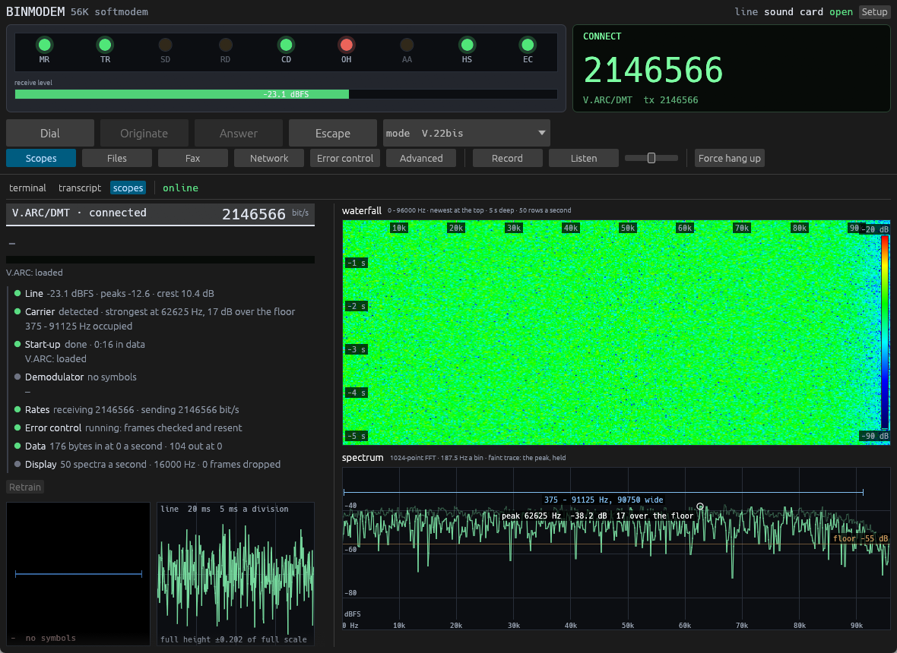
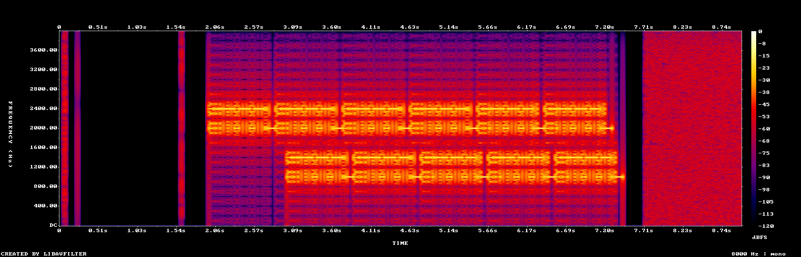
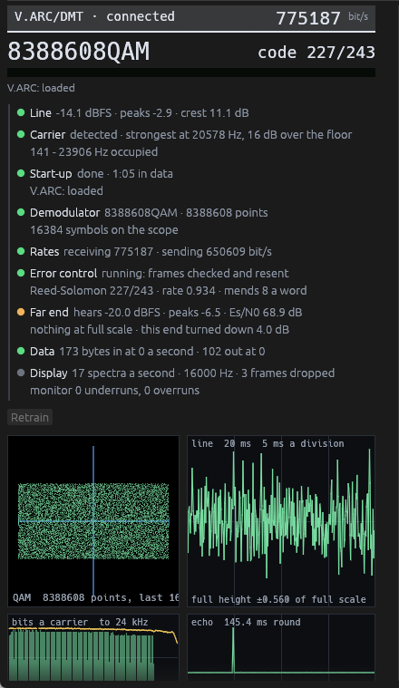
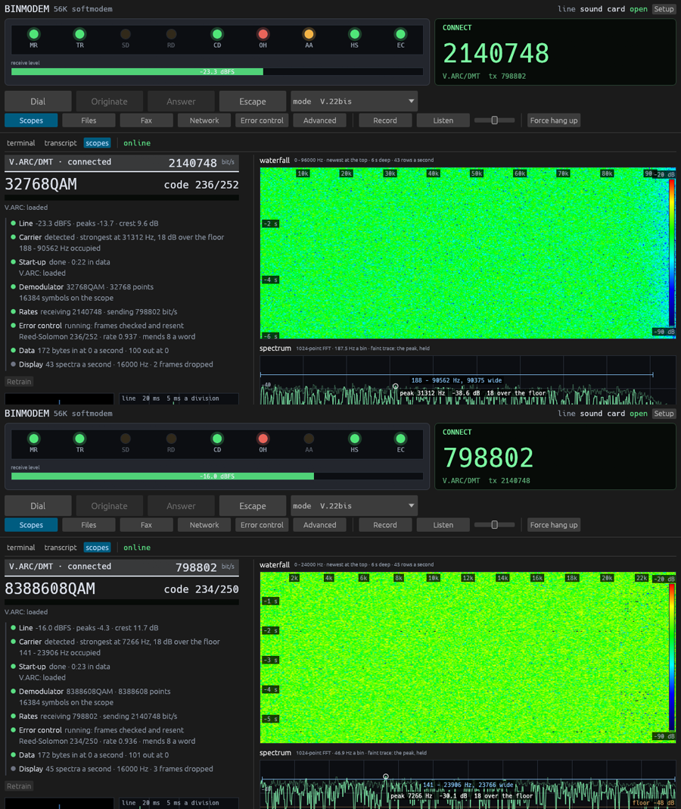
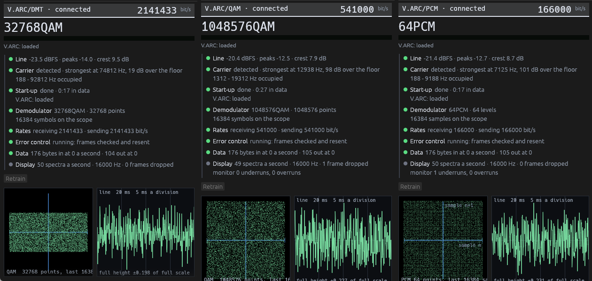
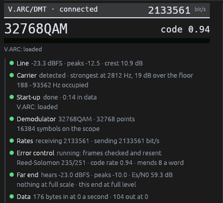

# V.ARC

BinModem's own wideband mode. Not an ITU recommendation and not compatible
with anything: both ends have to be BinModem.

Status: built and run on real sound devices, from the `varc-link` tool and
from the modem itself (`AT+MS=VARC`, `ATD`, `CONNECT .../VARC`, the window's
mode box), and over a SIP call between two of these on one machine. See
[What is not done](#what-is-not-done) for what has not been tried.

Code: `crates/varc`. Line: `crates/line/src/wide.rs`. The call:
`crates/modem/src/varc.rs`. Tool: `crates/modem/src/bin/varc-link.rs`.



## What it is for

Every other mode here is built for a telephone channel: 3 kHz wide, about
35 dB of SNR, 64 kbit/s of G.711 underneath at best. V.ARC is for the channel
a sound card gives when it is wired to another sound card: 20 kHz wide or
more, 60 to 90 dB of SNR, and four wires (an output and an input each way),
so there is no echo to cancel.

Two ends, full duplex, each direction on its own wire. A stereo lead is two
wires, used either as one each way (one machine, a loopback) or both the same
way (two machines, a lead each way), in which case the two are bonded into
one octet stream.

## The three modulations

| | V.ARC/DMT | V.ARC/QAM | V.ARC/PCM |
|---|---|---|---|
| Kind | multicarrier, bit-loaded per carrier | single carrier | baseband levels |
| Symbol rate | 44.1 symbols/s of up to 2047 carriers | 16 000 baud | 16 000 baud |
| Band at 48 kHz | 47 Hz to 20.6 kHz | 0.9 to 20.1 kHz | DC to 9.6 kHz |
| Bits | 0 to 24 per carrier | 2 to 24 per symbol | 1 to 12 per level |
| Sample rates | any (plan follows the rate) | multiples of 48 kHz | multiples of 48 kHz |
| Module | `dmt.rs` | `sc.rs` | `sc.rs` |

All three share one framing layer, one link layer and one receiver front end
(a resampler steered by the timing loop).

### V.ARC/DMT

- Real baseband signal, no carrier, so no frequency offset between ends: only
  the difference in sample clocks.
- FFT size `n` by sample rate: 512 below 30 kHz, 1024 to 60 kHz, 2048 to
  120 kHz, 4096 above. Guard (cyclic prefix) `n/16`. Carriers are 31 to 47 Hz
  apart and a symbol is about 23 ms at every rate.
- Superframe: 1 sync symbol + 32 data symbols (0.75 s at 48 kHz).
- Sync symbol: a known QPSK point on every carrier. One of four sequences;
  which one says which bit table the following 32 symbols use.
- Data symbol: a carrier with `b > 0` bits carries a Gray-coded QAM point
  (rectangular when `b` is odd). A carrier with 0 bits, and every carrier
  `k` with `k mod 32 = 16` (the pilots), carries a known QPSK point.
- Carriers above 0.86 of Nyquist are never loaded. The resampler is flat to
  0.87 of Nyquist; above that its response moves as the clocks slide.
- Transmit level -16 dBFS RMS.

Receiver, in order:

1. **Hunt.** Correlate the guard against the end of the body it copies,
   folded over one symbol span for 8 symbols.
2. **Frame.** Transform each symbol and compare neighbouring carriers with
   the sync sequences (differential, so no channel estimate is needed).
3. **Place the window.** The channel's delay from the first estimate moves
   the transform to start a third of a guard before the signal.
4. **Train.** 44 symbols to settle, 88 to measure noise on each carrier
   against the known points (2 s at 48 kHz, about +-0.5 dB per carrier).
5. **Load.** `b = floor(log2(1 + SNR / gap))`, gap 8 dB, capped at 24.

Running, per symbol: timing error from a weighted fit of phase against
carrier number over the known carriers; that error is taken out of the
symbol at once and also drives a second-order loop (about 1 Hz) on the
resampler. One complex tap per carrier, adapted by LMS.

### V.ARC/QAM and V.ARC/PCM

One machine. PCM is QAM with the carrier at 0 Hz and the quadrature axis
empty.

- 16 000 baud, root raised cosine, 20% excess bandwidth, 24 symbols either
  side under a Kaiser window (beta 8).
- QAM carrier 10.5 kHz.
- Superframe 4096 symbols (0.256 s): a 128-symbol sync word, then 16 groups
  of 248 data symbols.
- Sync word: four quarters of 32 known symbols. The second and third
  quarters are inverted by the two bits of the table mark, the fourth by
  both.
- PCM only: symbols go in eights. The first of each eight gives up its sign
  bit as a polarity flag, and the eight are sent whichever way up brings the
  running sum of all levels sent back towards zero. That keeps DC out of a
  line that will not pass it. Cost: 1 bit in `8b`.
- Transmit level -14 dBFS RMS.

Receiver: resampler, mix to baseband (QAM), matched filter read three times
a symbol, a 121-tap equaliser at T/3 (NLMS, decision-directed), a
second-order phase loop (QAM) or a baseline tracker (PCM), slicer.

The sync word is read **ahead of the equaliser**, by correlation, for three
things: whether the signal is still there, which mark it carries, and timing
(a parabola through the correlation at the expected sample and its
neighbours). The equaliser's own output of the sync word is used for one
thing: to turn the constellation the right way up, since decision-directed
loops are equally happy a quarter turn round.

Loading: `b = floor(log2(1 + SNR/gap))` for QAM, half that for PCM.

## One signal

A call is one signal however many channels the sound card has: what is sent
is the same on every channel, and what is heard is all of them added
together.

It was a signal a channel at first, each with its own data and its own
tables, which is twice the rate down a stereo lead. It is also a call that
half works down anything else. A stereo cable one way and a single
microphone back left one channel of two on its starting table for the whole
call, since the table asking it to do better could only come back down the
channel that was not there; and the window showed whichever channel it met
first. (Tables can now go round by another channel, `TABLE_FOR`, and each
direction of a channel is counted for itself; with one signal neither is
needed, and both are still there for a `Station` given more than one.)

Adding the channels together is worth about 3 dB where both carry the
signal. Measured since, on one machine, nothing wrong in any:

| Line | Rate |
|---|---|
| The Realtek lead at 192 kHz, a call to itself | 1.42 Mbit/s at 72 dB; it was 1.1 a channel, 2.1 over the two |
| Line In at 192 kHz one way, CABLE-B at 48 kHz back | 1.42 Mbit/s and 0.40 |
| Two ends on VB-Cable A, two-wire, multicarrier | connects at 327 kbit/s, 384 at 42 s, 77 dB |
| The same, V.ARC/QAM two-wire | 139 kbit/s |
| A cable one way, a monitor's loudspeakers to a webcam's microphone back, V.ARC/QAM | 10 250 bit/s through the air on four points with a code of a third; 286 000 the other way on a grid of a million |

**Figures elsewhere in this note that speak of two channels, or of rates
above these on the same lines, were measured before this** and are what two
signals carried.

## The single-carrier modes fill the card's band

V.ARC/QAM and V.ARC/PCM were 16 000 baud whatever the card: 1.5 to 19.5 kHz
and 0 to 9.6 kHz. On a card at 48 kHz that is four-fifths of the band for
the carrier and two-fifths for the levels; on one at 192 kHz it is a fifth
and a tenth.

They are still built for 48 kHz and 16 000 baud (`sc.rs` is unchanged), and
are now run at whatever rate the line has, sample for sample, so every
frequency in them moves with the rate (`Faster::paced`). The levels keep
below half their band, so they are run twice as fast again by sending every
other sample (`hello::Twice`, `hello::Half`).

| | V.ARC/QAM | V.ARC/PCM |
|---|---|---|
| Baud | a third of the sample rate | two-thirds of it |
| At 48 kHz | 16 000 baud, 1.5 to 19.5 kHz | 32 000 baud, 0 to 19.2 kHz |
| At 192 kHz | 64 000 baud, 6 to 78 kHz | 128 000 baud, 0 to 77 kHz |
| Bits a symbol | 2 to 24: four points to sixteen million | 1 to 12: 2PCM, 4PCM, 8PCM and so on to 4096PCM |

On the Realtek lead at 192 kHz, a call to itself, nothing wrong in either:

| Mode | Was | Is |
|---|---|---|
| V.ARC/QAM | about 200 kbit/s | 1.14 Mbit/s, 3.5 million octets |
| V.ARC/PCM | 83 kbit/s | 972 kbit/s, 3.2 million octets |

A card need no longer run at a multiple of 48 kHz for these modes.

**By hand.** `AT+VARC=<baud>,<code>,<bits>` sets what a single-carrier call
asks the far end to send with, where somebody wants to choose and not have
the receiver choose; the modulation window has the same three under "by
hand". Nought leaves that one to the modem.

- **Baud**: the nearest the card has, which is its fastest and halves of
  it. It goes in the handshake, since it is the far end that sends at it,
  and a direction given one is not slowed further for not being heard.
- **Code**: the percentage of each codeword that is data: 93, 75, 50, 33
  or 25.
- **Bits a symbol**: the grid, whatever the line measures. Ask for more
  than it bears and nothing arrives.

Each end chooses for what it hears, so the two ways can differ. In
simulation `AT+VARC=8000,50,4` at one end of a 48 kHz line gives that end
8000 baud, sixteen points and a code of a half, 15 kbit/s, with the other
way left at 16 000 baud and whatever it will bear.

## The handshake

A call begins with each end saying what it is (`hello.rs`). Two ends need
not have the same sound card: one hears at 192 kHz and sends at 48, the
other has one device both ways, one was told the line is a single pair of
wires and the other was not. Nothing in a wideband signal can settle that,
because until it is settled neither end knows what signal to listen for.
Before this, both simply started, and a pair that did not match heard
nothing for a minute and said `NO CARRIER`.

- **200 bits a second, two tones a direction**, in the middle of the voice
  band: the caller sends 1000 Hz for a one and 1400 Hz for a nought, the
  answerer 2000 Hz and 2400 Hz. A telephone channel carries them, and the
  sample rate of the card making or hearing them does not matter.
- **All four are multiples of the bit rate**, and each is measured over one
  bit through a raised-cosine window, so an end on one pair of wires hears
  the far end's tones through its own with no echo canceller. With a square
  window it did not: each change of its own tone splashed across the far
  end's.
- **Asynchronous characters**, a start bit and a stop bit, so there is no
  clock to recover.
- **One message of 16 octets, over and over**: the rates this end hears and
  sends at, how many channels, which modulation it was asked for, whether it
  was told two-wire, and whether it has the far end's message yet; then a
  CRC.
- When an end has the far end's message and has seen in it that the far end
  has its own, it sends once more and stops. About four seconds.

What it looks like on the line, recorded off a virtual cable both ends were
on: the answerer's pair at 2000 and 2400 Hz, the caller's at 1000 and
1400 Hz starting a second later, six messages each, a moment of quiet, and
then the first end's turn alone on the line.



Both ends then work out the same answer from the same two messages
(`hello::agree`):

| Question | Answer |
|---|---|
| What rate does each direction run at? | The slower of the two cards on it. The end with the faster card converts, by a whole number of times (`Faster`, `Slower`). Cards that no whole number relates, 44.1 and 48 kHz, are told so. |
| One pair of wires? | If either end was told so, and both hear and send on one card at one rate. Otherwise a wire each way, with a note. |
| Which modulation? | The one both asked for. If they differ, or a single-carrier mode would not have a multiple of 48 kHz each way, the multicarrier one. |

While it lasts the symbol scope shows the far end's tones as it shows any
FSK. The window's "distant" panel shows what the far end said and what was
agreed, where a V.8 menu would be:


There is no handshake on a lead that comes straight back (`ATDLOOP`), where
there is nobody else, or on a SIP call that carries samples exactly.

Run for real, both on one machine: Line In at 192 kHz with CABLE-B at 48 kHz
the other way (2.13 and 0.80 Mbit/s, as before it), and two ends sharing
VB-Cable A two-wire. A fast card calling a slow one, and two ends
told two-wire that cannot be, are tested in simulation only: there is no
pair of real devices here to wire that way.

Two things it turned up in the receiver, both now fixed:

- A receiver that began listening before the far end's last tone had
  finished framed on the tone, which repeats as a symbol's guard does. A
  sync symbol with an eighth of its power on one carrier is now refused.
- Having framed on nonsense it steered its clock by nonsense, to the limit,
  and could not then find a real signal. The clock now goes back to where
  it was last right whenever the signal is lost.

## When one end cannot hear the other

A line can carry the modulation one way and not the other: a cable one way
and a loudspeaker and a microphone back, say. The end on the cable loads and
waits; the other hears nothing it can use; and neither used to do anything
about it.

- **Saying so.** A receiver that has read nothing of the far end for
  `6 + 3 x speed` seconds starts listening for the modulation at half the
  speed and says so in the handshake's tones (a `VN` message of six octets,
  three times over, `hello::Watch`). It cannot say so in the modulation,
  since it does not know its own is heard. Its own sending waits while it
  does: a second and a bit.
- **Slowing.** An end that hears that said sends at the speed it was told.
  The modulation is built as it was and run slower, by giving it more of the
  card's samples to each of its own (`Faster::slowed`, `Slower::slowed`).
  Every frequency in it comes down and every symbol lasts longer:

  | Slowed | V.ARC/QAM at 48 kHz | V.ARC/PCM at 48 kHz | A multicarrier symbol |
  |---|---|---|---|
  | 1 | 16 000 baud, 1.5 to 19.5 kHz | 32 000 baud, to 19.2 kHz | 23 ms, 1.3 ms of guard |
  | 2 | 8000 baud, 0.75 to 9.75 kHz | 16 000 baud, to 9.6 kHz | 45 ms, 2.7 ms |
  | 4 | 4000 baud, 375 Hz to 4.9 kHz | 8000 baud, to 4.8 kHz | 91 ms, 5.3 ms |
  | 8 | 2000 baud, 190 Hz to 2.4 kHz | 4000 baud, to 2.4 kHz | 181 ms, 10.7 ms |
  | 16 | | 2000 baud, to 1.2 kHz | |

- **Each direction for itself.** Only the direction that could not be heard
  is slowed.
- **Heard means read**: four codewords the code could mend. Not found, since
  a receiver can find a signal through a room and read none of it, and not
  a figure in decibels, since what figure is enough depends on the code.
  Both were tried first and both kept a call that was already working
  stepping down to an eighth.

## Codes

A table says how many check octets its codewords have, so the code is the
receiver's to choose along with the bits (`link::CODES`):

| Data in a word | Decibels in hand | For |
|---|---|---|
| all but 16 octets, about 0.93 | 8 | a good line |
| 0.75 | 5 | |
| 0.5 | 3 | |
| 0.33 | 2 | |
| 0.25 | 1.5 | a line at 6 dB |

A receiver works out the table for each and asks for whichever carries most.
A code that is half checks mends a quarter of a word's octets, and four
points can then be read at a ratio where one in fourteen comes out wrong:
a line at 8 dB that carried nothing carries a bit a symbol. Below a quarter
there is little more to be had from a code that is told only right or wrong.

The starting tables are stronger than they were, since they have to work
before any of this is known: a third checks for the multicarrier mode (it
was a sixth), half for the single-carrier modes (an eighth).

**Through the air.** One direction a virtual cable, the other out of a
monitor's loudspeakers and into a webcam's microphone a metre away, which
passes nothing above 8 kHz and is a room:

| Mode | Before | Now |
|---|---|---|
| V.ARC/QAM | never heard; `NO CARRIER` | asks for half speed at 16 s; 7750 bit/s through the air at 8 dB, 255 000 the other way; 31 860 octets each way, none wrong |
| V.ARC/DMT | loaded at 8 dB and carried nothing | 20 449 bit/s through the air at full speed, 399 743 the other way; 136 438 octets, none wrong |

## Probing the line: the starting table

Both ends of a V.ARC/DMT call start on a table neither has had to be told,
and the first table made to measure has to be carried over it. So it has to
work on a line nothing is known about.

It used to be two bits on every carrier from 500 Hz to 6 kHz, each carrier
for itself. That wants the whole of that band and a dozen decibels on it. A
line that passed 300 to 3400 Hz, or only the top of the band, or was noisy,
never got as far as being measured.

The starting table now chooses no stretch of the band (`Plan::spread`):

- A symbol carries 48 four-point symbols, 96 bits.
- Every carrier from the bottom of the band to the top that is not a pilot
  carries one of them, round and round: 9 copies of each at 48 kHz, 36 at
  192 kHz.
- Each copy is turned by its carrier's known point, so that a symbol sent
  dozens of times over is not a row of spikes.
- The receiver adds the copies together, each weighted by the noise heard on
  its carrier over the last few symbols, and slices the sum.
- What was sliced is then every carrier's right answer. Every carrier's noise
  is measured against it, the dead ones included, and that measurement is the
  probe: the table made from it puts bits where the line is and none where it
  is not.
- Timing is taken twice a symbol: roughly from the pilots, then from every
  carrier once the first pass has said what each was sent. A narrow line may
  have two pilots in it.

Any 48 carriers in a row that work are enough, which is 2.3 kHz, wherever in
the band they are. Tested in simulation at 48 kHz, where the figure is a
carrier's signal against its noise:

| Line | Result |
|---|---|
| 300 to 3400 Hz, 40 dB | starts, loads only inside the band |
| 12 to 16 kHz only, 40 dB | starts, loads only inside the band |
| Whole band, 3 dB | starts |
| Whole band, 0 dB | starts after losing a few blocks at the beginning |
| 300 to 3400 Hz, 15 dB | starts |
| 300 to 3400 Hz, 10 dB | found, cannot be read |
| 300 to 3400 Hz, under 10 dB | not found: the sync symbol is not heard |

What it costs is speed before the first table: 3.4 kbit/s where there was
about 9. On the Realtek lead at 192 kHz the made-to-measure table is in use
about 7 s after the start.

It also measures a leak for what it is. Two ends with the same known points
used to measure a perfect line, because what leaked across was a faint copy
of what each expected. Now nearly every carrier carries data while the line
is measured, and the two ends' data differs.

V.ARC/QAM and V.ARC/PCM have no such thing. Their band is fixed, 1.5 to
19.5 kHz and 0 to 9.6 kHz, and a line that does not pass it does not carry
them.

## What the far end hears

A transmitter cannot hear its own line. It does not know whether what it
sends arrives faint, or so loud that the far converter is flat against its
stops. So each end measures what arrives on each channel, a second at a
time, and tells the other in a frame of its own (REPORT, 8 octets):

| Field | What it is |
|---|---|
| Level | RMS of what arrived, in half decibels below full scale |
| Peak | the largest sample in the second, the same way |
| Clipped | samples in the second at full scale |
| Es/N0 | signal to noise at the slicer over the band in use, in tenths of a decibel; nought until measured |
| Trim | how far the reporting end has turned itself down |

Reports are sent whether or not the reporting end can read anything, since
the end that most needs telling is the one deafening the other.

**Acting on it.** Samples at full scale are the one fault no table loads
around: the tops of the waveform are gone on every carrier at once. So:

- If the far end reports samples at full scale, or peaks within 1 dB of it,
  this end sends lower: by enough to put the peaks at -4 dBFS, and 3 or 9 dB
  more if any were clipped, since a clipped peak reads as full scale however
  far over it was.
- If it is trimmed and later hears that the peaks are below -14 dBFS, some
  comes back off.
- It never sends above the level it was made for. That level is already as
  much as its own converter has room for (-16 dBFS RMS for the multicarrier
  mode, whose peaks are 10 to 12 dB above that).
- A change of level moves everything the far receiver has learned. So each
  one puts the line back on the starting table and tells the far end to
  measure afresh (LEVEL), and changes are kept 3 s apart.

In simulation, 20 dB of gain into a converter that clips: the sending end
ends up 26 dB down, nothing is clipped, and the stream arrives whole.

**Seeing it.** The window has a line for it while a V.ARC call is up, and the
transcript says when the level changes. On the Realtek lead:


What this cannot do is turn the far end's input down, or this end's output
up past its own full scale: those are the sound card's mixer. It says which
is needed.

## One pair of wires: the echo canceller

Everything above supposes a wire each way. `AT+MS=VARC2W` is the multicarrier
mode on a line where both ends send into the same pair, and each hears the
other with its own signal on top (`echo.rs`).

- **Where the echo is.** A sound card puts tens of milliseconds between a
  sample written and the same sample heard. The delay is found by laying a
  stretch of what was sent against what was heard at every lag up to a third
  of a second, with one transform, and it is looked for again every few
  seconds.
- **What shape it is.** A filter 4 ms long (192 taps at 48 kHz, 768 at
  192 kHz), fitted by normalised least mean squares.
- **The far end does not stop talking** while it is learned, and to the
  filter the far end is noise. So the step shrinks as one over the samples
  seen: after `k` samples the echo left is about `taps / k` of the far end's
  signal, 3 dB better for each doubling of the time.
- **The table follows.** A multicarrier receiver that has looked good for a
  twelfth more bits than it asked for, eleven seconds running, asks for
  them. (This is for any V.ARC/DMT call, not only this one.)

It needs one sound card, input and output at the same rate, since it lays
what was sent against what was heard sample for sample.

`AT+MS=VARCQ2W` and `AT+MS=VARCP2W` are the single-carrier modes on one pair
of wires. The canceller in front knows nothing of the modulation and serves
them as it is; the second stage below is the multicarrier receiver's and
they do not have it, so they settle where the first stage leaves them. On
the shared virtual cable, learning while the far end talked: QAM 85 to
100 kbit/s, PCM 12 to 27 kbit/s. With turns: QAM 278 kbit/s, PCM 112 to
166 kbit/s, nothing wrong.

| Where | What happened |
|---|---|
| Simulation, echo 6 dB louder than the far end | connects; 117 kbit/s at 10 s, 150 at 30 s, 164 at 60 s; Es/N0 34 dB at 15 s, 40 dB at 90 s, 41.6 dB at 165 s |
| Two windows on one machine, both sending into and hearing VB-Cable A, 48 kHz | connects both ways; about 300 kbit/s each way at 35 s, Es/N0 38 dB |
| The Realtek lead at 192 kHz, this end's own signal only | echo found 81.4 ms round, 40 dB down in 1.3 s; did not reach 50 dB in 14 s; no sound underruns |
| The same pair with no canceller (`VARC`), simulation | never connects |

**Turns.** After the handshake, and before either modulation is heard by
anyone, each end has the line to itself (`Turn` in the modem's `varc.rs`):

1. Both fall silent until the handshake's tones have gone.
2. The caller sends alone for 2 s. Its canceller finds its echo and fits
   it against the line's noise and nothing else.
3. The caller stops; when its echo has died away the answerer hears the line
   go quiet and takes its 2 s.
4. The caller hears the answerer begin, counts 2 s, and joins it.

Each step is taken on what is heard, since neither end can see the other's
clock, and each wait has a limit past which the end goes on regardless. A
canceller that has had its turn takes only its smallest steps afterwards,
or the far end's signal would undo in a second what the turn did.

Three things went wrong on the way and are worth knowing:

- The caller took the tail of its own echo for the answerer starting, and
  came back 130 ms early, over the end of the answerer's turn. It now waits
  for quiet before it listens for the answerer.
- What each end tells the other about levels was measured after cancelling,
  so each saw only the other, well inside full scale, while the two together
  were clipping the line. It is measured on the line as the converter
  delivers it.
- Two signals at the level one is made for do not fit in one converter. A
  two-wire call starts each end 6 dB down.

**The second stage.** Without turns, the slow climb is the price of learning
while the far
end talks, and by itself it stops at about 40 dB after a minute. With them
the canceller starts some 50 dB down, and what takes it on from there, for
as long as the call lasts, is in the multicarrier receiver
(`Rx::learn_echo`):

- Once a symbol has been read, the receiver knows what the far end sent on
  every carrier and what the line did to each. That is the far end's whole
  part of the window, so it is built again and taken away.
- What is left is the echo the canceller missed and the line's noise. A
  second filter, the same 4 ms, is fitted to that, and is working against
  the noise alone.
- It is fitted after the receiver's resampler, where the far end's symbols
  are. This end's own signal is put through a resampler steered exactly as
  the line's is, so the two stay sample for sample.
- It learns only from symbols that were read, since a wrong decision leaves
  the far end in what it learns from, and that feeds itself: the filter goes
  wrong, the next symbol is read worse, and it learns from that. On the
  starting table's four points "read" is three carriers in four within 6 dB
  of a point. On a grid of thousands every sample is near some point, so the
  test there is against each carrier's known noise: a symbol that missed by
  twice that on average was not read. The first version used the four-point
  test throughout, and a call went round and round between loaded and
  starting again for minutes. It forgets what it knows when the receiver
  loses the far end.
- Once the receiver reads at 30 dB the canceller in front is held still, so
  that what it missed stays put for the second stage to find; below 24 dB it
  is let go again. Before that was conditional, an end that started badly
  stayed at 10 dB for the whole call.

| Where | First stage only | With the second stage |
|---|---|---|
| Simulation, echo 6 dB louder than the far end | Es/N0 41.6 dB at 165 s, 164 kbit/s | 75 dB at 50 s, 392 kbit/s, which is what a wire each way gives |
| Two ends on one machine, both on VB-Cable A, 48 kHz, two channels | about 38 dB at 35 s, 300 kbit/s each way | 70 to 80 dB at 60 s; 607 to 781 kbit/s; two runs of 115 s, 6 to 7 million octets each way in each, none wrong |
| The same with turns | | connects at 15 s at 651 kbit/s where it had connected at 67; 731 kbit/s at 40 s; 59 dB at 40 s and 70 to 74 dB at 60 s, still rising; none wrong |

Not tried: a real two-wire line (a hybrid, a telephone pair), two machines,
or two sound cards whose clocks differ, where the echo of one card is still
its own but the far end slides. The virtual cable is as kind as a line gets:
its echo is one spike with no tail and it adds no noise. A real hybrid's echo
has a tail and a converter's is not perfectly linear, and neither stage can
take out what is not a filtered copy of what was sent.

`varc-link --modem --mode 2w --dial ATA` and `--dial ATD1` run the two ends
without a window.

**Two more scopes.** Under the symbol diagram while a V.ARC call is up: the
bits on each carrier with the signal to noise they were chosen from, and the
echo as the canceller has learned it.

| Two-wire, VB-Cable A | A wire each way, the Realtek lead |
|---|---|
|  |  |

## Modulation and coding

There is no list of modes to pick from. The receiver measures the line and
asks for a number of bits; the far end adopts it.

| | V.ARC/DMT | V.ARC/QAM | V.ARC/PCM | V.ARC/L16 |
|---|---|---|---|---|
| Symbols | carriers 46.9 Hz apart (31.3 at 16 kHz), up to 0.86 of half the sample rate | 16 000 baud on a 10.5 kHz carrier | 16 000 baud at baseband | none: the samples |
| Bits | 0 to 24 on each carrier, each for itself | 2 to 24 a symbol | 1 to 12 a symbol | 16 a sample |
| Grid | square for an even count, a 2:1 rectangle for an odd one | the same | a ladder of levels | - |
| Code, starting | Reed-Solomon 128/192, rate 0.67 | 124/248, rate 0.5 | 108/217, rate 0.5 | - |
| Code, loaded | 0.93 on a good line, down to 0.25 on a poor one; see [Codes](#codes) | the same | the same | 48 check octets |
| Net rate, starting | 2.7 kbit/s | 15.5 kbit/s | 6.8 kbit/s | 200 kbit/s |

A bit more on a carrier or a symbol wants about 3 dB more signal to noise,
and there are 8 dB kept in hand: `bits = floor(log2(1 + SNR / 6.3))`, so
about `3 x bits + 8` dB. For PCM it is half as many bits for the same ratio.

| Bits | Grid | SNR wanted | V.ARC/QAM net | V.ARC/DMT net at 48 kHz, every carrier alike |
|---|---|---|---|---|
| 2 | 4 | 13 dB | 29 kbit/s | 34 kbit/s |
| 4 | 16 | 20 dB | 58 kbit/s | 67 kbit/s |
| 6 | 64 | 26 dB | 85 kbit/s | 101 kbit/s |
| 8 | 256 | 32 dB | 116 kbit/s | 135 kbit/s |
| 10 | 1024 | 38 dB | 139 kbit/s | 169 kbit/s |
| 12 | 4096 | 44 dB | 170 kbit/s | 202 kbit/s |
| 16 | 65 536 | 56 dB | 232 kbit/s | 270 kbit/s |
| 20 | 1 048 576 | 68 dB | 286 kbit/s | 337 kbit/s |
| 24 | 16 777 216 | 80 dB | 348 kbit/s | 405 kbit/s |

The DMT column is two, four and so on times that at 96 and 192 kHz, since
there are that many more carriers: 1.64 Mbit/s at 192 kHz with 24 bits on
every one. A real line gives each carrier its own count and the rate is
whatever they add up to.

The code does not change with the line. Retransmission covers what it does
not correct, and a table that turns out too high is asked for again lower.

## Over a SIP call: V.ARC/L16

A fourth way of running, which is no modulation at all (`exact.rs`).

An account with `linear = yes` offers `L16/16000` in its SDP ahead of PCMU
and PCMA, and takes it when offered: sixteen-bit linear samples, two octets
each, at 16 kHz (RFC 3551 4.5.11). Between two such accounts the call's
samples arrive as the sixteen bits that were sent, so the samples are the
data.

- Superframe: a sync word of 64 known samples, then a block of 2000 samples
  that are 4000 octets. Eight a second.
- FEC: Reed-Solomon with 48 check octets a codeword.
- A lost RTP packet is 320 samples of silence where data should be. Scrambled
  data is never silence, so a run of 8 or more samples that are exactly zero
  is taken as a hole and its octets are given to the decoder as erasures. One
  lost packet in a block is 40 erasures a codeword and is rebuilt; two is not,
  and the block is resent.
- Rate: 256 kbit/s of samples, 200 434 bit/s of data.


What the call turns out to be decides what runs on it:

| The call | What `AT+MS=VARC` becomes |
|---|---|
| L16, and the samples arrive exactly | V.ARC/L16 |
| L16, but nothing is heard in 4 s, or the two ends have not agreed in 10 s | V.ARC/DMT at the call's 16 kHz |
| G.711, because the far end answered with it | an ordinary call from V.8, with `+MS` set to `V92` |

`VARCQ` and `VARCP` do not run on a SIP call: they need a multiple of 48 kHz.

## Octets on the line

Same for all three (`frame.rs`). Each modulation offers room for so many
octets per *block*: one DMT symbol or one group of 248 symbols on a loaded
line, more on the starting table, always at least 200 octets.

| Layer | What |
|---|---|
| Scrambler | x^15 + x^14 + 1, restarted every block |
| FEC | Reed-Solomon over GF(256), 16 check octets (32 on the starting table). The block is split into the fewest codewords of nearly equal length and sent a column at a time |
| Header | 3 octets: a count, and a pointer to the first frame that starts in this block |
| Frames | kind (1), length (2), body, CRC-32 (4). A frame may run on into the next block |
| Idle | a zero where a kind should be, then pseudo-random filler |

A block is on the line about 23 ms (DMT) or 16 ms (QAM, PCM) after its
octets were offered, on a loaded line.

## The link

`station.rs`. Frame kinds: TABLE (2), DATA (3), ACK (4), RESET (5), REPORT (6), LEVEL (7).

**Tables.** There are four marks. Mark 0 is the starting table: for DMT, 48
four-point symbols each sent on every carrier that has its turn (see
[Probing the line](#probing-the-line-the-starting-table)); 2 bits a symbol
(QAM); or 1 bit a level (PCM).

1. Each receiver measures its line and works out a table.
2. It gives the table the next mark (1, 2, 3, 1, ...) and sends it back the
   other way in a TABLE frame, in every block.
3. The far transmitter switches at its next superframe and marks the sync
   symbol or word.
4. The receiver sees the mark and stops sending the table. There is no other
   acknowledgement.

Recovery:

| Seen by a receiver | What it does |
|---|---|
| Uncorrectable codewords now and then | Proposes a new table with 1.5 dB more gap |
| Nearly every codeword bad for 1 s | Puts its *own* transmitter back on mark 0, asks the far end for mark 0 (RESET), and measures again with 3 dB more gap |
| A mark it has no table for | Asks for mark 0 (RESET) |

The second row is for both directions failing together, when neither end can
tell the other anything on a loaded table.

**Retransmission.** Selective repeat. DATA frames carry a 32-bit number and up
to 1024 octets; ACK carries the next number expected and a bitmap of what has
arrived beyond it. A frame is sent again after twice the measured round trip,
or after one round trip if the far end is seen to have a later frame.
Window 512 frames.

**Bonding.** A station has one channel per wire. Each has its own tables.
DATA frames are dealt to whichever channel has room next and put back in
order by number.

**Colours.** Each wire in a lead uses its own set of known points. See the
first finding below.

## In the modem

| | |
|---|---|
| Choosing it | `AT+MS=VARC` (multicarrier), `AT+MS=VARCQ` (QAM), `AT+MS=VARCP` (PCM), or the window's mode box |
| Calling | `ATD` with any number at one end, `ATA` at the other. No V.8, no tones |
| A lead that comes straight back | `ATDLOOP`: the modem listens for its own signal and what is typed comes back |
| Connected | `CONNECT <rate>/VARC`, the rate being what arrives, in bit/s of data, over the channels that loaded |
| A lead with one channel wired | connects on that one after waiting 6 s for the other |
| Nobody there | `NO ANSWER` after 60 s |
| The far end gone | `NO CARRIER` after 5 s of hearing nothing |
| `+++`, `ATH`, `ATO` | as on any call |
| Error control | none of V.42's; the station's own retransmission. `+ES`, `+DS` are not consulted |

The two ends differ in which known points they send, so one must dial and
the other answer.

On a SIP line the same commands are used and the account has to say
`linear = yes`. The call is placed and answered as any SIP call is.

The sound card: the rest of the modem runs at 16 kHz on one channel through
`line::Duplex`. While a V.ARC call is up the window closes that and opens the
same two devices with `line::Wide`, and steps `Modem::varc_step` with the
card's own frames; when the call ends it puts the two-wire line back.

The two devices need not run at the same rate. A line can be a lead one way
and a virtual cable the other, at 192 kHz and 48 kHz, and then each direction
is a line of its own: the receiver is built for the rate of the device it
hears on and the transmitter for the rate of the one it sends on. What is
heard is stepped as it arrives (`Modem::varc_hear`) and what is sent is made
as fast as the sending device takes it (`Modem::varc_say`), since two
devices are two clocks. Below, two windows on one machine: Line In at 192 kHz
and CABLE-B at 48 kHz, 2.14 Mbit/s one way and 0.80 the other.



Before this a V.ARC call on two such devices ended at once in `NO CARRIER`,
with the reason only in the transcript. A call the line cannot run now says
why in red on the line's row of the window: a two-wire call on two devices,
for one, which is still refused.

During a V.ARC call the waterfall and the spectrum are taken from the left
channel at the card's own rate and drawn from 0 Hz to half of it (24 kHz on a
48 kHz card, 96 kHz at 192 kHz), with the ticks in kilohertz. On every other
call they stay at 0 to 4000 Hz, except a V.ARC call on a SIP line, which is
drawn to the call's 8 kHz.

The symbol diagram shows what the receiver sliced, on the first channel that
is hearing anything, scaled so the grid's outermost point is at the edge of
the box:



- **V.ARC/QAM:** every symbol.
- **V.ARC/PCM:** each level against the one before, as V.90's is drawn,
  since levels have no plane to be points on.
- **V.ARC/DMT:** the carriers differ in how many bits they carry, and a grid
  of four points laid over one of a thousand shows neither. So it shows the
  carriers of the commonest loading, about sixty of them a symbol. Until a
  table is loaded it shows the four known points.
- **V.ARC/L16:** nothing. There are no symbols.

The panel's label gives the size of the grid shown. On a good lead that is
tens of thousands of points or more, which no screen resolves: what is drawn
is a filled box, sharp at the edges when the line is clean. The picture is
the Realtek lead: 32 768 points on the commonest carriers, 1 048 576 for the
single carrier, 64 levels.

Beside the size of the grid the panel gives the code on what is arriving,
as a decimal (`code 0.94`), and the error control line gives the code it is
the rate of (`Reed-Solomon 236/252`). It follows the table, so it changes when the two ends
change tables.



The oscilloscope and the level meter were
built for the modem's 16 kHz and are still shown the left channel cut down to
that without filtering, which shows that something is there and measures
nothing.

## Measured

All with `varc-link --loop`: two ends in one program, one sending on the left
channel and one on the right, each loading the other's line. Rates are the
net rate of the table in use (frames, after FEC), per direction. "Wrong
octets" is against a known stream at the far end.

| Path | Rate | Mode | SNR | Net rate each way | Wrong octets |
|---|---|---|---|---|---|
| Realtek, same lead, through the modem (`--modem`: `ATDLOOP`, both channels one way) | 192 kHz | DMT | 54 / 59 dB | 2146 kbit/s | 0 of 7.7 M |
| SIP between two `modem-sip` on this machine, L16 | 16 kHz | L16 | exact | 200 / 200 kbit/s | a line of text only |
| VB-Cable A | 48 kHz | DMT | 80 dB | 400 / 399 kbit/s | 0 of 699 k |
| VB-Cable A | 48 kHz | QAM | 70 / 80 dB | 240 / 232 kbit/s | 0 of 607 k |
| VB-Cable A | 48 kHz | PCM | 62 / 76 dB | 122 / 83 kbit/s | 0 of 298 k |
| Realtek line out to line in, real lead | 192 kHz | DMT | 54 / 60 dB | 1132 / 1017 kbit/s | 0 of 4.8 M |
| Realtek, same lead | 192 kHz | QAM | 64 / 68 dB | 201 / 201 kbit/s | 0 of 489 k |
| Realtek, same lead | 192 kHz | PCM | 47 / 47 dB | 83 / 83 kbit/s | 0 of 198 k |

Notes on those numbers:

- The VB-Cable DMT row was run before the colours change and has not been
  repeated since.
- The Realtek rows had uncorrectable codewords in the QAM run (12 of about
  2600 each way) and the PCM run (6 of about 1200). All were retransmitted.
  The DMT run had none in about 20 000.
- Both ends share one clock in every row (one device), so the clock recovery
  is exercised only in simulation, to +-150 ppm.
- The SIP row is two processes calling each other over the loopback
  interface: real SIP, SDP and RTP, no network and no lost packets. Both ends
  said `CONNECT 200434/VARC` half a second after the answer and one line of
  text crossed. No bulk transfer was measured on it. Erasure decoding of lost
  packets is tested in simulation only.
- The 192 kHz DMT figure uses carriers up to 82 kHz. SNR on the Realtek falls
  from about 66 dB below 48 kHz to about 51 dB at 78 kHz.
- SNR for the single-carrier rows is at the slicer. For DMT it is the mean
  over the loaded band.

### What the real lead found

Three faults that simulation with one clean wire each way did not show:

1. **Crosstalk measured as signal.** Both ends sent the same known points, in
   step. The leak from one channel into the other was then a faint copy of
   what each receiver expected, and measured as line gain. Once data started
   the leak was noise, about 66 dB down on the Realtek, on a table chosen for
   72 dB. Every block failed. Fix: each wire has its own known points.
2. **Deadlock.** With both directions failing, neither end could ask the
   other for a lower table. Fix: the second recovery row above.
3. **An idle line repeating itself.** Idle blocks were identical, so the leak
   between two idle channels was a fixed offset per carrier and the running
   noise estimate drifted. Fix: pseudo-random filler.

## Simulation tests

`cargo test -p varc --release` (36 tests). The ones that say most:

- DMT: measured SNR within 1 dB of the SNR set, at 30, 50 and 70 dB; 300 k
  octets exact at 55 dB with the clocks 0, +60 and -120 ppm apart.
- Station: a 0.2 s cut costs time and no octets; an end restarted mid-link
  recovers; a line that gets 6 dB noisier is reloaded lower; two channels at
  60 and 35 dB are loaded separately and bonded.
- QAM: SNR and table as predicted at 45 and 62 dB, clocks to 70 ppm.
- PCM: exact through a 10 Hz high-pass at 40 and 55 dB.
- Reed-Solomon: errors and erasures to the bound for 2 to 32 check octets.

## What is not done

- **SIP beyond this machine.** Never run over a network, through a PBX, or
  with packets really lost. Whether any PBX passes L16 at 16 kHz untouched
  is not known.
- **The G.711 fallback, to a connection.** A V.ARC call answered in G.711
  does carry on as an ordinary call, and between two `modem-sip` on this
  machine it trained to V.90 data and then never said `CONNECT`. A plain
  `AT+MS=V92` call between the same two does exactly the same, and a plain
  `AT+MS=V34` one ends in `NO CARRIER`, on `main` as well as here, so that is
  not V.ARC's; but it means the fallback has not been seen to end in a
  connection.
- **The probe on a real poor line.** The starting table is tested on poor
  lines in simulation only. The only real lines so far are a lead and a
  virtual cable, both good.
- **Recovery from a gap in the sound.** A gap in what the sound card sends
  cost a call seconds, in both the multicarrier and the single-carrier
  modes; half the blocks bad until the tables were made again. The gaps
  seen were the output running dry at 192 kHz, which a cushion of 40 ms
  where there were 10 has stopped on this machine. What a gap does once it
  happens is unchanged.
- **Scopes for it.** The window has the symbol diagram, and no
  SNR-by-carrier or bit table display for V.ARC; `varc-link --csv` is the
  only way to see those. The multicarrier diagram shows one loading of many.
- **The window beyond a loop.** The window has run V.ARC/DMT calls to itself
  (`ATDLOOP`) through VB-Cable A and through the Realtek lead. Choosing it
  from the mode box rather than typing `AT+MS`, and a file or PPP over it,
  have not been tried. The QAM and PCM modes have run in the window as loop
  calls on the Realtek lead. The headless tools
  (`modem-sip`, `--answer`) do not know about V.ARC.
- **Two machines.** Never run between two sound cards with separate clocks.
- **44.1 kHz** for the single-carrier modes (they need a multiple of 48 kHz).
- **Compression** on top.

## Running it

```text
varc-link --list
varc-link --in "CABLE-A Output" --out "CABLE-A Input" --loop
varc-link --in "Line In" --out "Speakers" --loop --mode qam --seconds 60
varc-link --in "Line In" --out "Speakers" --oneway --csv snr.csv
varc-link --in "Line In" --out "Speakers" --modem
```

Over SIP, with two accounts that have `linear = yes` and point at each
other:

```text
modem-sip --accounts FILE --account host --answer --type AT+MS=VARC
modem-sip --accounts FILE --account caller --type AT+MS=VARC --type ATD100 --send hello
```

`--modem` drives the lead through a whole modem as the window does
(`AT+MS=VARC`, `ATDLOOP`) and checks what comes back.
`--loop` needs each output channel joined to the same input channel.
`--oneway` sends on both channels and returns the tables and
acknowledgements inside the program. `--csv` writes SNR and bits per carrier.
`--gap` and `--level` override the 8 dB gap and the transmit level.
