# Constellations

These pictures show what each receiver decides on, for each mode. Two
BinModems call each other through a simulated line, and the line adds noise.
Each dot is one symbol after the equaliser, as the symbol scope in the window
shows it.

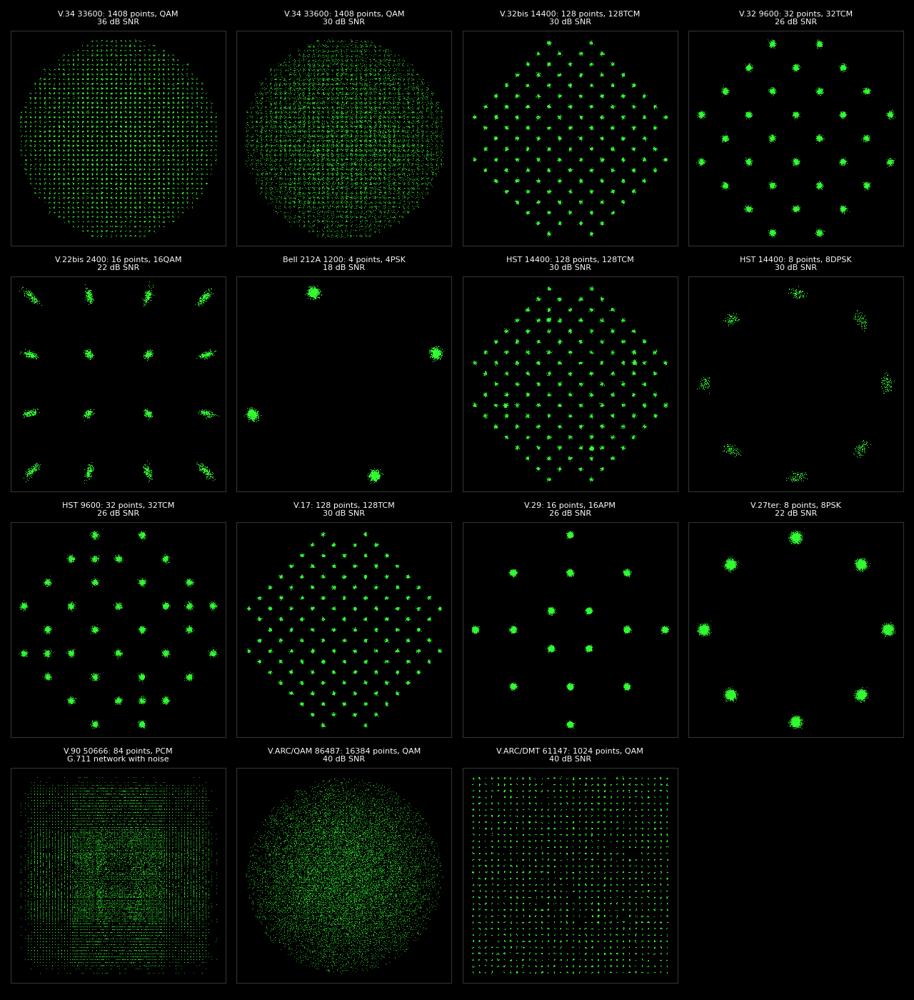

## How to make the pictures again

The noise is seeded, so a second run gives the same points.

```powershell
cargo run --release -p modem --example constellations -- docs/img/constellations
```

```powershell
python tools/constellations.py docs/img/constellations
```

The first command writes the points for each mode in a folder of its own. The
second command draws one PNG for each mode and `overview.png`, then deletes the
points. To run only some of the modes, add a part of the folder name after the
folder, for example `hst`.

The example is [constellations.rs](../../crates/modem/examples/constellations.rs).
The noise follows the level of the line, so each SNR is the same for each
modulation.

## The modes

### V.34

V.34 at 33 600 bit/s sends a shaped set of 1408 points. At 36 dB the grid is
clear. At 30 dB each point is a small cloud, and the call still holds 33 600.

| 36 dB SNR | 30 dB SNR |
|---|---|
| 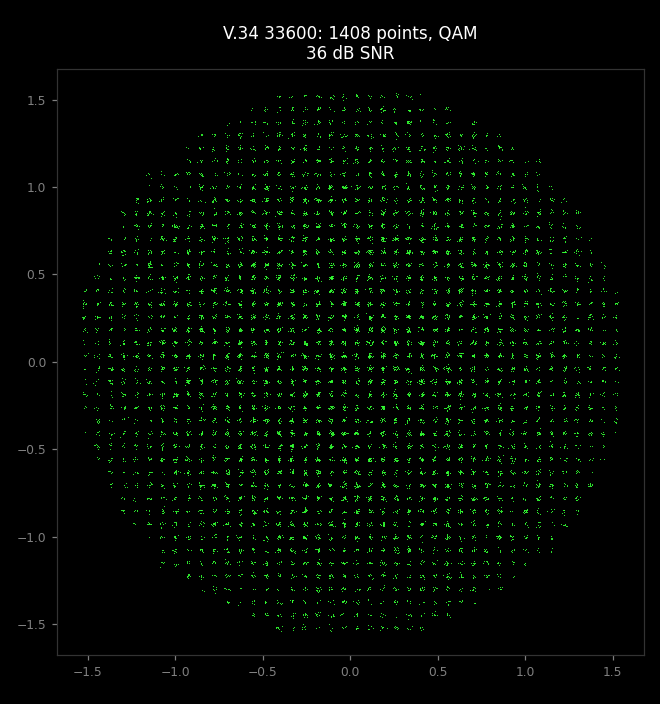 | 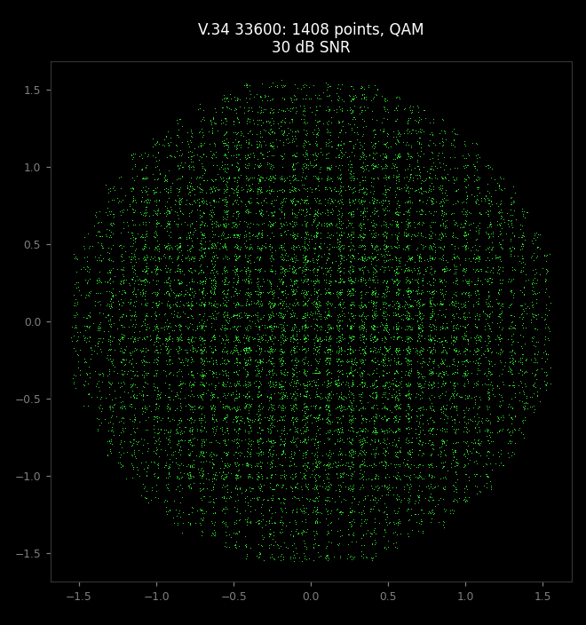 |

### V.32bis, V.32, V.22bis and Bell 212A

V.32bis at 14 400 and V.32 at 9600 use the trellis code of V.32, with 128 and
32 points. V.22bis at 2400 is 16QAM. Bell 212A at 1200 is 4PSK.

| V.32bis 14 400 | V.32 9600 |
|---|---|
| 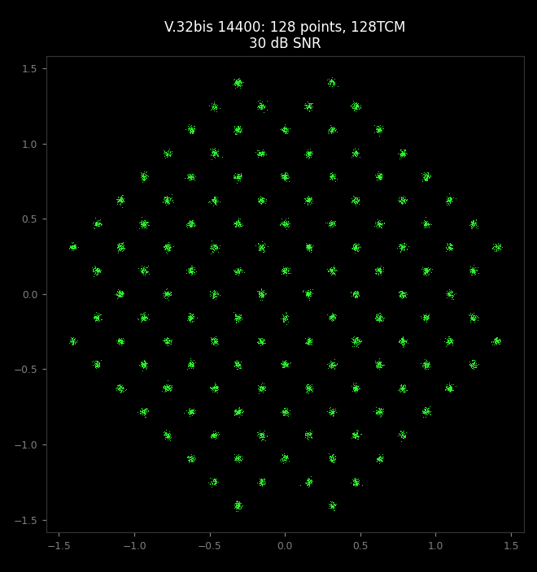 | 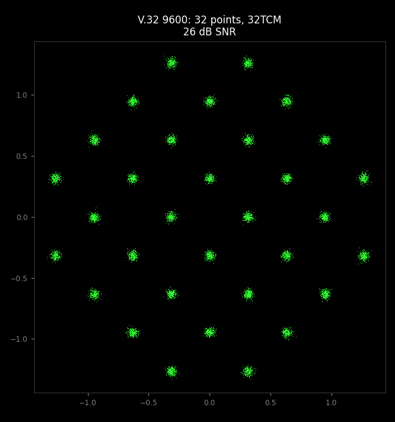 |

| V.22bis 2400 | Bell 212A 1200 |
|---|---|
| 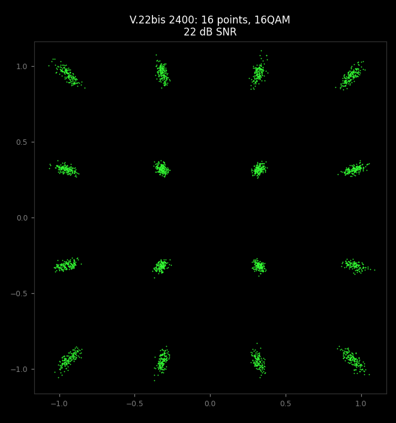 | 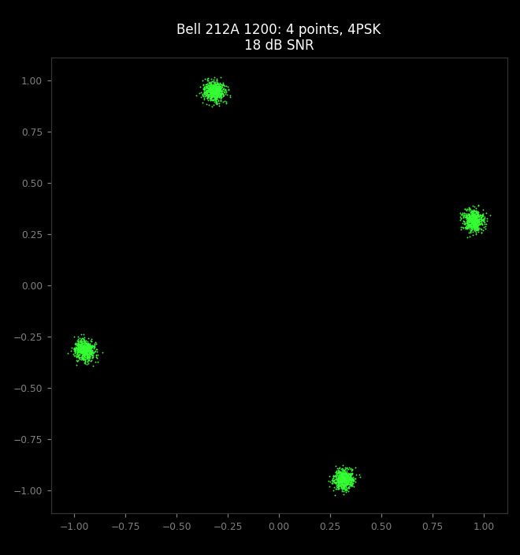 |

### HST

An HST call has two channels. The end that receives the forward channel shows
the trellis-coded points. The end that receives the back channel shows 8DPSK.
The back channel is differential, so the scope shows the phase turn from one
symbol to the next. The carrier phase itself is free to drift.

| HST 14 400 forward | HST 450 back | HST 9600 forward |
|---|---|---|
| 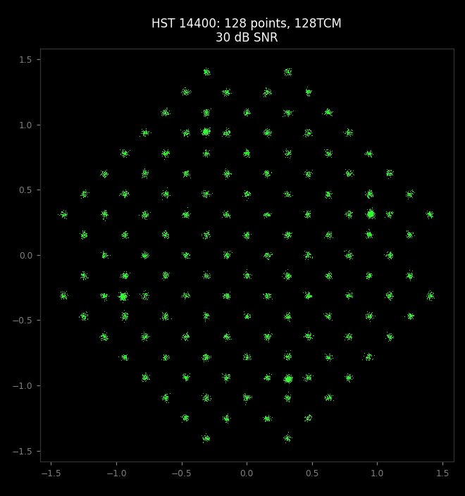 | 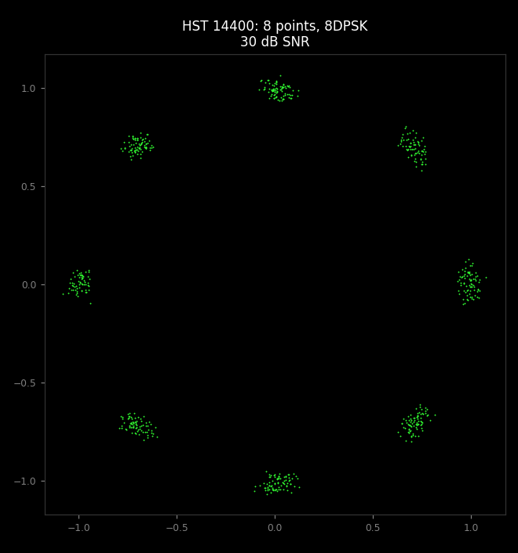 | 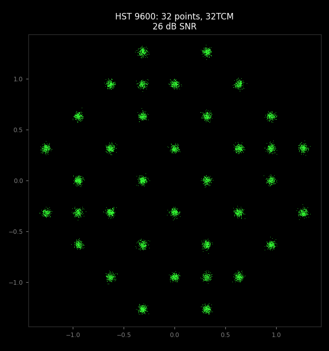 |

### Fax

Each picture is the page as the receiving fax machine reads it. The V.21
frames around the page are not included.

| V.17 14 400 | V.29 9600 | V.27 ter 4800 |
|---|---|---|
| 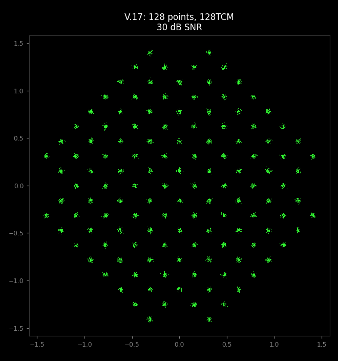 | 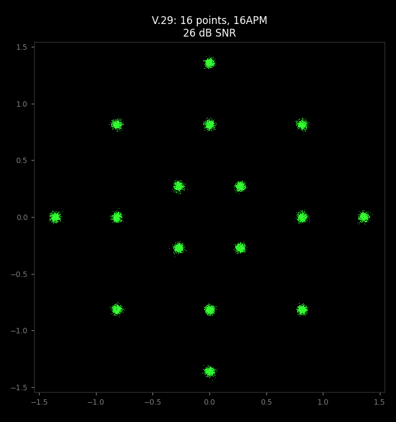 | 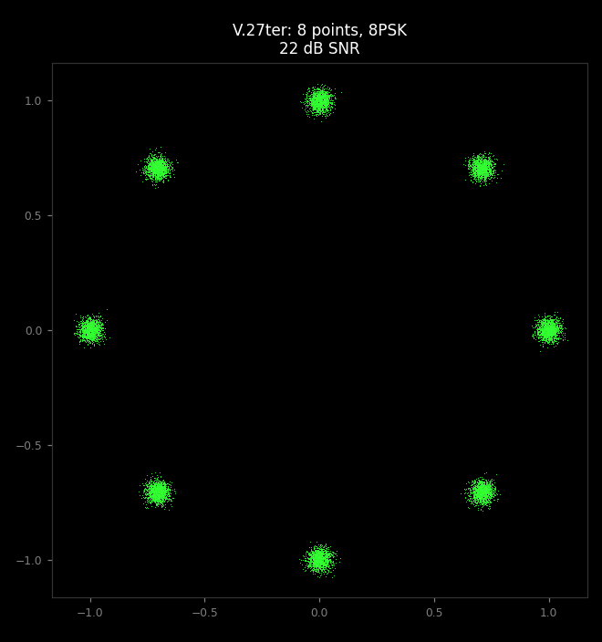 |

### V.90 and V.ARC

V.90 sends PCM levels downstream, not a constellation. The scope plots each
sample against the next one, so the grid shows the levels of the call. The
answering BinModem is the digital modem, behind a G.711 network with noise.

V.ARC/QAM and V.ARC/DMT run on a stereo lead with 40 dB SNR on each channel.

| V.90 PCM | V.ARC/QAM | V.ARC/DMT |
|---|---|---|
| 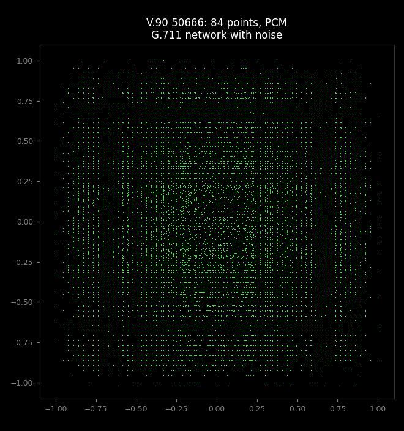 | 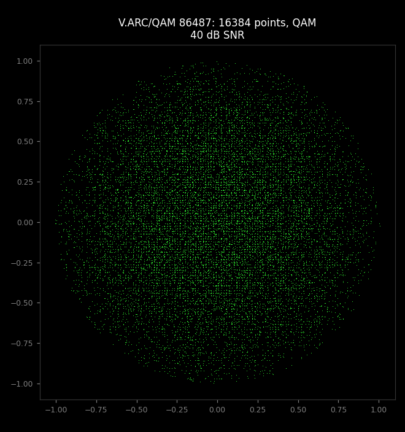 | 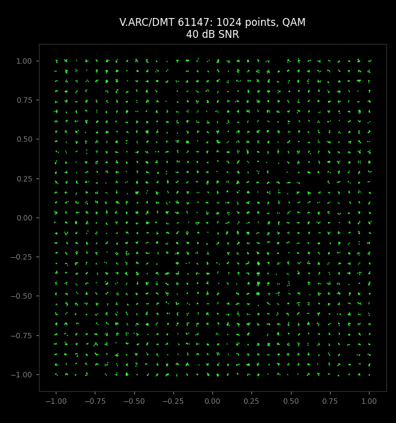 |

## Modes that are not shown

Bell 103, Bell 202 and V.21 are FSK. They have no constellation, and the
window shows an eye for them.
