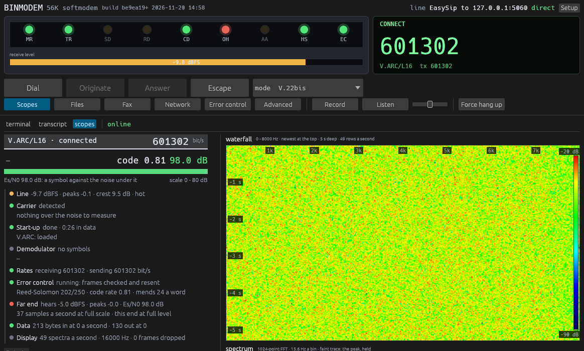

# Quick start

Ten minutes from a download to a modem call. [usage.md](usage.md) is the long
form; this is the shortest way to each thing worth seeing first.

## 1. Get it

Download `binmodem.exe` from the
[latest release](https://github.com/CasualArclamp/BinModem/releases/latest).
It is one file with nothing to install. Put it in a folder and open a terminal
there.

On Linux, or to build it yourself, see
[Building on Linux](../README.md#building-on-linux) in the README; the commands
below are the same with `./target/release/binmodem` in place of `binmodem.exe`.

## 2. See it work with nothing connected

No sound card, no line, no second modem. Replay the Bell 103 call that is
carried inside the program:

```powershell
.\binmodem.exe --capture
```

Click the terminal at the bottom, type `ATD` and press Enter. The recording
plays through the modem: the lamps, the waterfall and the scopes follow it, and
the session it carried comes out as text.

Or use the terminal by itself on a bulletin board, over a socket:

```powershell
.\binmodem.exe --telnet vert.synchro.net
```

## 3. A real call between two windows

Two modems on one machine, joined by EasySip: a direct call between two
BinModems with no account, no cable and no softphone. Each window names the
other's address and its own port.

The window that will answer:

```powershell
.\binmodem.exe --sip "easysip:127.0.0.1:5062|5060|PCMU"
```

The window that will call:

```powershell
.\binmodem.exe --sip "easysip:127.0.0.1:5060|5062|PCMU"
```

`PCMU` carries the call in G.711 mu-law, as a telephone network does, which is
what the ordinary modes are for.



Then:

1. In **both** windows, pick a modulation in the **mode** box (V.34 is a good
   first one), or type `AT+MS=V34` at the terminal.
2. In the calling window, type `ATD1` and press Enter. Any number will do; it
   rings the other window.
3. The answering window rings and asks what to do: press **Answer as modem**.
4. Listen to the handshake if you like (**Listen**), and watch the **Scopes**
   tab. `CONNECT 33600` or thereabouts appears in both terminals.
5. Type in one terminal and it appears in the other.
6. **Escape** (`+++`) and then **Hang up** (`ATH`) end the call.

The same thing between two machines: choose **EasySip** in the **line** box
(press **Setup** if the row is hidden), type the other machine's address in
**far end**, and press **Open**. Do the same at the other end. EasySip has no
password, so it is for a network you trust.

### Something to dial into

To be greeted by a board rather than another empty terminal, tick **answer
calls with a login prompt** in the answering window's **Network** panel before
the call. The caller then gets a banner, `login:` and `Password:`. The account
is the name and password in that same panel.

## 4. A call to the outside world

A SIP trunk from a VoIP provider reaches real modems and dial-up services.

1. Press **Dial**, then **Credentials** at the bottom of the dialler.
2. Fill in the first four boxes: **SIP server**, **username**, **password**
   (the SIP one, not the portal one) and **transport** (UDP unless told
   otherwise). Press **Save**.
3. In the **line** box choose **SIP**, press **Open**, and wait for the green
   **Online** at the foot of the dialler.
4. Type the number on the keypad and press **Call**.

The password is kept in clear text in `%APPDATA%\BinModem\sip.txt`.
`.\binmodem.exe --accounts` prints where that file is and what is in it.

A sound card works as a line too, through a virtual audio cable and a
softphone, but SIP is the better path: nothing resamples the audio or adjusts
its gain on the way. [usage.md](usage.md#running-it) has the sound card setup.

## AT commands worth knowing

| Command | What it does |
|---|---|
| `AT` | answers `OK` |
| `ATD<number>` | dial |
| `ATA` | answer |
| `+++` | back to command state without dropping the call |
| `ATH` | hang up |
| `AT+MS=V34` | choose the modulation: `B103`, `B212`, `B202`, `V21`, `V22B`, `V32`, `V34`, `V90`, `V92`, `VARC` |
| `AT+MS=V22B,1,1200,1200` | the same with a rate ceiling, for a poor line |
| `AT+FCLASS=1` / `AT+FCLASS=0` | fax class, and back to a modem |

Every key in the window types one of these at the terminal, so the transcript
always shows what was asked for.

## Where next

- **Files**: ZMODEM send and receive. [Moving a file](usage.md#moving-a-file)
- **Fax**: send a picture or a PDF, or wait for one. [Sending a fax](usage.md#sending-a-fax)
- **Network**: PPP, ping and web pages over the call. [Two of them on a network](usage.md#two-of-them-on-a-network)
- **V.90 and 56k**: [Trying V.90](usage.md#trying-v90)
- **V.ARC**: the wideband mode between two BinModems, hundreds of kilobits a
  second over EasySip. [design/v-arc.md](design/v-arc.md)

## If something goes wrong

- `.\binmodem.exe --help` lists every way to start it, and `--devices` the
  audio devices it can see.
- Two windows on one machine need two different ports, each naming the
  other's.
- A SIP call that fails: look at **lost** and **ms of silence** in the line
  row. With none of either the failure is in the modem; with any, it is in the
  network.
- Press **Record** before a call that misbehaves. The capture is what gets it
  fixed, and is worth attaching to an
  [issue](https://github.com/CasualArclamp/BinModem/issues).
