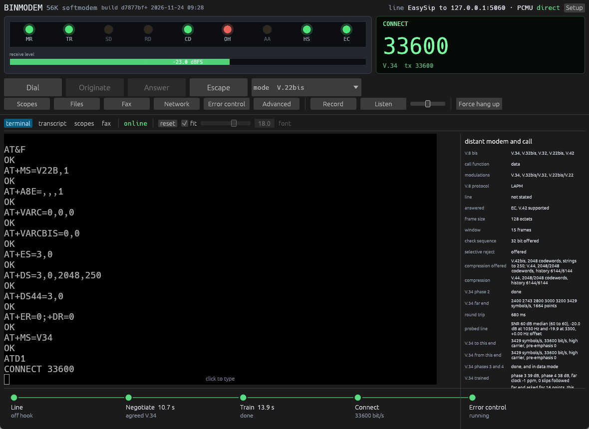

# Quick start

This page takes you from a download to a modem call in ten minutes.
[usage.md](usage.md) is the long form. This page gives the shortest way to
each thing that you should see first.

## 1. Get it

Download `binmodem.exe` from the
[latest release](https://github.com/CasualArclamp/BinModem/releases/latest).
It is one file with nothing to install. Put it in a folder and open a terminal
there.

On Linux, or to build it yourself, see [Build on Linux](manual/linux.md). The
commands below are the same with `./target/release/binmodem` in place of
`binmodem.exe`.

## 2. See it work with nothing connected

You need no sound card, no line and no second modem. Replay the Bell 103 call
that the program contains:

```powershell
.\binmodem.exe --capture
```

1. Open the **terminal** tab.
2. Click in the terminal.
3. Type `ATD`.
4. Press Enter.

The recording plays through the modem. The lamps, the waterfall and the scopes
follow it. The session that it carried comes out as text.

As an alternative, use the terminal alone on a bulletin board, over a socket:

```powershell
.\binmodem.exe --telnet vert.synchro.net
```

## 3. A real call between two windows

This step uses two modems on one machine, connected by EasySip. EasySip is a
direct call between two BinModems with no account, no cable and no softphone.
Each window names the address of the other window and its own port.

The window that will answer:

```powershell
.\binmodem.exe --sip "easysip:127.0.0.1:5062|5060|PCMU"
```

The window that will call:

```powershell
.\binmodem.exe --sip "easysip:127.0.0.1:5060|5062|PCMU"
```

`PCMU` carries the call in G.711 mu-law, as a telephone network does. The
ordinary modes are for that.



Then:

1. In **both** windows, select a modulation in the **mode** box, or type
   `AT+MS=V34` at the terminal. V.34 is a good first modulation.
2. In the window that calls, type `ATD1` and press Enter. Any number is
   satisfactory. It rings the other window.
3. The window that answers rings and asks what to do. Press **Answer as
   modem**.
4. If you want to hear the handshake, press **Listen**. Look at the **scopes**
   tab. After approximately fifteen seconds, `CONNECT 33600` shows in both
   terminals.
5. Type in one terminal. The text shows in the other terminal.
6. Press **Escape** (`+++`) and then **Hang up** (`ATH`) to end the call.

To do the same between two machines:

1. Select **EasySip** in the **line** box. Press **Setup** if the row is
   hidden.
2. Type the address of the other machine in **far end**.
3. Press **Open**.
4. Do the same at the other end.

EasySip has no password. Use it only on a network that you trust.

### Something to dial into

You can get a board, not a second empty terminal. Before the call, tick
**answer calls with a login prompt** in the **Network** panel of the window
that answers. The caller then gets a banner, `login:` and `Password:`. The
account is the name and password in that same panel.

## 4. A call to the outside world

A SIP trunk from a VoIP provider reaches real modems and dial-up services.

1. Press **Dial**, then **Credentials** at the bottom of the dialler.
2. Fill in the first four boxes: **SIP server**, **username**, **password**
   and **transport**. The password is the SIP password, not the portal
   password. The transport is UDP unless the provider tells you differently.
   Press **Save**.
3. In the **line** box select **SIP**, press **Open**, and wait for the green
   **Online** at the foot of the dialler.
4. Type the number on the keypad and press **Call**.

The password is kept in clear text in `%APPDATA%\BinModem\sip.txt`.
`.\binmodem.exe --accounts` prints where that file is and what is in it.

A sound card also works as a line, through a virtual audio cable and a
softphone. But SIP is the better path: nothing resamples the audio or adjusts
its gain on the way. [usage.md](usage.md#running-it) has the sound card setup.

## AT commands worth knowing

| Command | What it does |
|---|---|
| `AT` | answers `OK` |
| `ATD<number>` | dial |
| `ATA` | answer |
| `+++` | back to command state, and the call stays up |
| `ATH` | hang up |
| `AT+MS=V34` | select the modulation: `B103`, `B212`, `B202`, `V21`, `V22B`, `V32`, `V34`, `V90`, `V92`, `VARC` |
| `AT+MS=V22B,1,1200,1200` | the same with a rate ceiling, for a poor line |
| `AT+FCLASS=1` / `AT+FCLASS=0` | fax class, and back to a modem |

Every key in the window types one of these at the terminal. Thus the
transcript always shows what was asked for.

## Where next

- **Files**: ZMODEM send and receive. [Moving a file](usage.md#moving-a-file)
- **Fax**: send a picture or a PDF, or wait for one. [Sending a fax](usage.md#sending-a-fax)
- **Network**: PPP, ping and web pages over the call. [Two of them on a network](usage.md#two-of-them-on-a-network)
- **V.90 and 56k**: [Trying V.90](usage.md#trying-v90)
- **V.ARC**: the wideband mode between two BinModems, hundreds of kilobits a
  second over EasySip. [design/v-arc.md](design/v-arc.md)

## If something goes wrong

- `.\binmodem.exe --help` lists every way to start it. `--devices` lists the
  audio devices that it can see.
- Two windows on one machine need two different ports, and each names the port
  of the other.
- If a SIP call fails, look at **lost** and **ms of silence** in the line row.
  With none of the two, the failure is in the modem. With any, it is in the
  network.
- Press **Record** before a call that does not behave correctly. The capture
  is necessary for a fix. Attach it to an
  [issue](https://github.com/CasualArclamp/BinModem/issues).
