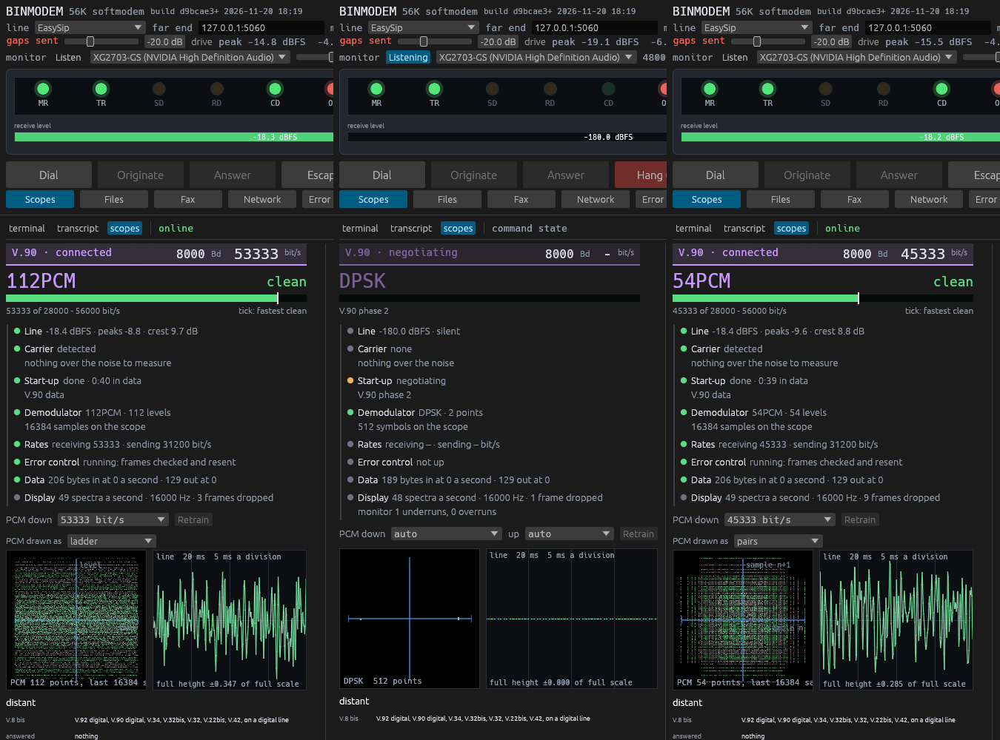

# Using BinModem

This is the long form. [README.md](../README.md) tells you what BinModem is
and what its state is. This page tells you how to operate it. The design and
the milestone ladder are in [design/architecture.md](design/architecture.md).

## Running it

Double-click `run.bat`, or use a shell:

```powershell
.\run.ps1
```

The script shows a menu of the captures, builds the program and starts it.

- `-Vector v34-33600` selects one capture directly.
- `-List` shows what is available.
- `-Dev` builds the debug profile.

`run.sh` does the same from Git Bash or Linux. As an alternative,
`cargo run -p gui --release -- tests/vectors/bell103-300.wav` works directly.

### Your own modem on a real line

To put your own modem on a real line, and not watch a recording, double-click
**`run-live.bat`** (or `./run-live.sh`). The script does these things:

- It builds the program.
- It shows a menu of the audio devices of the machine, with a virtual cable
  selected by default.
- It offers to start a second modem on the same line, so that there is
  something to dial.

Give a modulation to set both ends: `run-live.bat -Carrier V32`, or
`./run-live.sh V32`.

One cable is correct for that. A cable gives back what was written to it,
added to all other signals that are written to it. That is a two-wire pair
with two modems across it. You need a second cable only to reach something
*outside* the machine. Then the output can go to the microphone of a softphone
while the input comes from its speaker.

By hand:

```powershell
binmodem --devices
binmodem --live --in "<input device>" --out "<output device>"
```

`--live` alone opens with no line. You select the two devices in the window,
and Open joins them into one two-wire line. A change to one of the boxes moves
the call onto the new device.

### The AT interface

The terminal in the window is the DTE of the modem.

- Type `AT` and it answers `OK`.
- `AT+MS=B103`, `V21`, `V22B` or `V32` selects the modulation.
- `ATD` originates.
- `ATA` answers.
- `+++` escapes back to command state.

The buttons above the terminal do exactly those things and nothing else. The
modem has one interface. A button that went around the interface could ask for
things that a terminal could not. The scopes show the call as it occurs, not a
recording of a call between other parties.

### Bell 212A

`AT+MS=B212` is Bell 212A: 1200 bit/s, the four-phase DPSK of V.22 behind the
handshake of Bell.

- The end that answers waits two seconds and sends 2225 Hz. That is also the
  answer mark of Bell 103.
- A 212A that calls answers that with scrambled ones at 1200.
- A 103 that calls answers with its 1270 Hz mark.
- The end that answers goes the way that it heard.

A 212A that calls, offers 1200 and hears only a steady mark back also falls
back to 103. Thus a B212 reaches a 103 at each end at 300.
`AT+MS=B212,1,300,300` asks for the 103 directly. Error control operates at
1200, as over V.22, and not at 300.

### Bell 202

`AT+MS=B202` is Bell 202: 1200 bit/s FSK, mark 1200 Hz and space 2200 Hz. Both
ends use the one band and thus take turns. An end that has data to send does
these steps:

1. It waits for a quiet line.
2. It raises its carrier for 33 ms.
3. It sends.
4. It ends with 10 ms of the 900 Hz soft carrier turn-off.

The end that answers waits longer for quiet than the end that calls. Thus two
ends with data to send at the same time do not both key.

Bell 202 has no error control, no reverse channel, and no carrier to lose. An
idle half-duplex line has no carrier, so the call stays up until a hang-up.
The two Bell modems do not use V.8.

### Negotiation and `AT+MS`

An ordinary `ATD` now negotiates before it starts. V.250 6.4.1 names the
mechanism: `<automode>` "enables or disables automatic modulation negotiation
(e.g., Annex A/V.32 bis or ITU-T Rec. V.8)".

It is on by default. Thus the two
ends exchange call menus over V.21 and both go into the same modulation. No
end guesses. `AT+MS=V22B,0` turns it off, and then the command means what it
says.

A far end with no V.8 answers with a plain answer tone. Then the calling
modem listens, as V.32bis Annex A tells it to:

- 2250 Hz (unscrambled ones) is V.22bis. 2225 Hz is Bell 212A. 1650 Hz is
  V.21.
- 600 and 3000 Hz together (AC) is V.32 or V.32bis.

The calling modem does not send V.32's AA over the answer tone. It sends AA
only when AC starts, or 2 s after the answer tone stops if nothing follows.
Some automode answerers send AC only after their V.22bis offer. These
answerers do not reply to an AA that started before their AC. NIST's time
service (`ATD` +1 303 494 4774) is one of them. It now connects at V.22bis
2400 with V.42.

A V.22bis caller measures the round trip of the line in its handshake. V.42
adds it to the 750 ms of T400. Without it, the far end's answer to the ODP
came back too late on a SIP line with a 1 s round trip.

Plain V.32 (automode off) keeps V.32 5.4.1: AA after 1 s of answer tone.

**Advanced** adjacent to the modulation box opens the other parts of `AT+MS`.
These are the other three subparameters of V.250 6.4.1, as toggles and boxes
that you do not type. It is mode aware: the line-rate boxes offer only the
rates that the selected modulation has. A request to Bell 103 for 2400 is not
a slow connection but an error. The window shows the command as you compose
it, and Send types it. No part of this goes around the AT interface.

A rate ceiling is the most useful of these settings. Sixteen points at 2400
need approximately 20 dB of signal to noise. Four points at 1200 need
approximately 13. On a line that cannot give the first,
`AT+MS=V22B,1,1200,1200` is not the slower connection. It is the connection
that works.

### Something to dial

To have something to dial, run the same program again with `--answer` on the
same cable. It puts a second modem on the line and answers as a dial-up
provider did. The caller gets a banner, `login:` and `Password:`, and a prompt
where `ppp` starts PPP. Log in as `guest` with no password, or give it its own account:

```powershell
binmodem --answer --in "<input device>" --out "<output device>" --carrier V22B --user rory --password <password>
```

That window also prints all that the caller sees. It also prints who logged
in, the addresses that PPP gave and every ping that arrived.

### Answering for a real board

`--bbs` connects each caller to a bulletin board that takes telnet callers, in
place of the login prompt. The board can be WWIV's `wwivd`, Synchronet,
Mystic, or any other program that listens on a port. The board gets the
keystrokes of the caller and the caller gets the ANSI of the board. This is
exactly as with a serial port to a board in 1989.

```powershell
binmodem --answer --carrier HST --bbs localhost:2323 --in "<input device>" --out "<output device>"
```

Dial it from the window with HST (or HST 9600) selected and `ATD1`. When the
board logs the caller off, the modem waits until the last screen of the board
reaches the caller. Then it hangs up.

If you give no port, the port is 23, the telnet port. If the board does not
answer when a call comes in, the modem hangs up on the caller. The modem then
waits for the next call.

### A modem on a COM port, for DOSBox

`--com` puts the modem behind a TCP port, and the serial port of DOSBox
connects to that port. Thus a DOS terminal or BBS on COM1 controls it with
`AT` commands as it controlled a Courier: `ATDT`, `CONNECT 14400/ARQ/HST`,
`+++`, `ATH`. With `--in` and `--out` it dials and answers over that
sound-card line.

```bash
binmodem --com 5000 --telnet-in 2323 --carrier HST --in "<input device>" --out "<output device>"
```

In `dosbox.conf`:

```ini
[serial]
serial1=nullmodem server:127.0.0.1 port:5000
```

The nullmodem of DOSBox carries RTS and DTR and also data. Thus:

- The DOS program sees carrier detect when there is a call.
- It sees CTS drop while the buffer of the modem is full.
- A drop of DTR hangs up, which is how most BBS software ends a call.

With `transparent:1` in DOSBox, add `--transparent` here. Carrier detect is
then lost.

`--telnet-in` also takes calls from the internet. A person who telnets to that
port rings the DOS program. The program gets `RING` every six seconds. It
answers with `ATA`, or automatically after the number of rings that `ATS0=`
set. A DOS BBS such as WWIV 4 in DOSBox answers those calls as it answered
modem callers. A second caller while one call is on gets `BUSY`.

The COM port listens on this machine only. Use `--bind 0.0.0.0` if DOSBox is
on a different machine. Without `--in` and `--out` there is no line, and
telnet calls are the only calls.

## Trying V.34

**33600** in the rate row, or `AT+MS=V34`, offers V.34 in V.8 together with
V.32bis and V.22bis. A far end without V.34 selects one of those, and the call
continues as usual.

A far end with V.34 goes through the start-up of V.34 and into data mode.

In phase 2 the two modems do these things:

- They exchange capabilities.
- They measure the round trip with reversals of tones A and B.
- They probe the line with L1 and L2 in each direction.
- They agree symbol rates and carriers.

In phase 3 each end sends S, PP and TRN, on which the other end trains its
equaliser. Each end also sends J to say which constellation it wants next.

In phase 4 they train again and exchange MP sequences. These carry the data
rates, trellis code, shaping and precoding that each end wants.

Then each end sends B1 and its data. `CONNECT` gives the rate that arrives,
which can be different from the rate that leaves.

The terminal logs each step (`V.34 INFO0`, `V.34 ranging`,
`V.34 phase 3: training`, `V.34 phase 4: MP`, `V.34 data`). The constellation
scope shows the points of the far end after phase 3 has trained the receiver.
The far-end panel keeps what was found:

- the capabilities of the far end
- the round trip
- the probed line
- how well each phase trained
- the far clock and the VoIP slips that were followed
- what the J of each end asked for
- both MP sequences
- the rates in each direction

### The constellation in data mode

The constellation of data mode has hundreds of points: 832 at 31 200, and 1664
at 33 600. The scope in the panel is too small to show them apart. Click the
scope to open it in its own window, as large as you drag it. The window keeps
the last few seconds of symbols. Thus each point shows as a spot, and noise
shows as spots that have grown into each other.

### Rate renegotiation and cleardown

Each end can go back to MP from data mode without a new start. A far end whose
receiver has difficulty asks for a slower rate with a rate renegotiation: S,
S-bar, TRN and a new MP. This end answers immediately and continues at the
rates that the new MPs give. The log shows `V.34 rate renegotiation` during
this, with no `NO CARRIER` and no second `CONNECT`.

A far end that hangs up with a cleardown ends the call in the same way. The
panel counts the renegotiations and shows the rates that they gave.

### Text from a far end without V.42

A far end without V.42 frequently sends text at the moment that it connects,
such as a login banner or a prompt. BinModem identifies that as text and does
not read it as an answer pattern. The text goes to the terminal.

### Slips of the jitter buffer

The jitter buffer of a VoIP call sometimes plays twenty milliseconds of audio
that it made up, or drops some audio. The receiver detects the jump and finds
the signal again. In the start-up that costs nothing.

In data mode it costs approximately a third of a second. The receiver finds
the position of the frames again from the data itself, by the bit inversions
that every superframe carries. V.42 sends again what was lost.

The same search rescues a call where a slip removed the E of the far end.
Without the search the call would wait for E until it gave up. The panel
counts the times that the frames were found again.

Press **Record** before any V.34 call that goes wrong. The capture is
necessary for a fix.

### A capture as a picture

You can also draw a capture afterwards. The capture test of the data pump
dumps every equalised symbol of one direction. `tools/plot_constellation.py`
draws any parts of it as constellations side by side: training, data mode, a
renegotiation. The instructions are at the top of the script.

## Trying V.90

**56000** in the rate row, or `AT+MS=V90`, dials as the analogue half of V.90.
That is the end that calls the modem pool of an internet provider, or a second
BinModem that answers as the digital half (see below). V.8 offers PCM together
with V.34 and V.32bis. Thus a far end that is not a V.90 server selects V.34
or V.32bis, and the call continues as one of those.

A V.90 server answers with its own PCM offer. The start-up runs phase 2 of
V.34 with the INFO sequences of V.90 in it. The server says which codec law
and power it sends at. This end asks for its upstream symbol rate.

In phase 3 the server does these things:

- It trains the receiver of this end with TRN1d.
- It lists the downstream rates that it has in Jd.
- It plays a DIL: every one of the 128 codeword magnitudes, six frames each.
  Thus this end can see exactly how each codeword arrives.

From the DIL this end selects the constellations for phase 4 and for data
mode. It spaces them for the noise that it measured, at the power that the
server can send. In phase 4 the two ends exchange CP and MP and go to data.

`CONNECT` gives the downstream rate, from 28 000 to 56 000 in steps of 1333.
The upstream is V.34 and the panel shows it. Sometimes V.90 on a route would
be slower than the probe of V.34 phase 2 promised. Then V.90 has no advantage,
and the call is retrained as V.34.

The log shows `V.90 phase 2`, `V.90 phase 3: training`, `V.90 phase 3: Jd`,
`V.90 phase 3: DIL`, `V.90 phase 4`, `V.90 data`.

### The scope on a PCM call

PCM has no I and Q to plot. Thus the constellation scope plots each sample
that the modem reads against the next sample. A clean line draws a grid, with
one row and one column for each level in use. The dense middle is the quiet
levels, and the loud levels spread out to the edges. Noise shows as spots that
grow into each other. A line that has lost its place shows as a cloud.

### After the connection

After the connection, the call keeps itself up:

- **Rate renegotiation.** Each end can ask for new rates without a new start.
  This end answers the request of the server immediately. It asks for a slower
  downstream itself when the levels in use are too near each other. The limit
  is approximately seven times the error with which it reads them. The log
  shows `V.90 rate renegotiation` during this, with no `NO CARRIER` and no
  second `CONNECT`.
- **Retrain.** This end follows a server that retrains back through phase 2.
  It does the same for a line that this end cannot read at all.
- **Cleardown.** A server that ends the call correctly also ends it here.

Some lines do not carry PCM at all: the DIL shows nothing that V.90 could use,
or V.90 has failed three times. Such a line is retrained one more time with a
request for V.34. The call comes up as V.34 and does not hang up. The panel
shows why V.90 was abandoned.

### Answering as the server

Answer with `AT+MS=V90` (or **56000**) and this modem is the other half of
V.90: the digital modem that an internet provider has. It offers PCM from the
answer side of V.8. A caller that asks for PCM gets codewords downstream and
sends V.34 back. Two BinModems on two machines, each behind its own softphone,
reach each other this way.

The samples of the digital modem are codewords. They become the same codewords
again only if they reach the G.711 encoder of the softphone exactly as they
left: same level, same sample instants. Thus, while it is the digital modem,
this end ignores the **drive** slider and sends at unity. The softphone at
this end must have the same setup as the softphone at the end that calls. The
remainder depends on the softphone.

Some softphones convert sample rates on the way to the encoder. Such a
softphone filters the codewords and samples them between their original
positions. The end that calls then sees an ordinary line with the noise of
G.711 on it, which is a line for V.34. After one try at V.90 the call comes up
as V.34 at the rate that the line carries. In simulation that is 33 600, after
approximately forty seconds over a round trip of VoIP length.

A softphone that gives its encoder the samples that it got, at 8 kHz, gives
PCM rates: 52 000 to 54 666 in simulation.

### The softphone

PCM needs the digital path to arrive without a change. A VoIP call does this
if the softphone uses G.711 (PCMU or PCMA) and nothing on the way processes
the audio.

1. In the softphone, permit only PCMU and PCMA.
2. Turn off echo cancellation, noise suppression, automatic gain and voice
   activity detection or silence suppression.
3. Set both volumes to 100%.
4. Turn off the audio enhancements of Windows on the VB-Cable devices,
   Loudness Equalization most of all.

On the first live call, something with a gain control was in the path. Every
codeword up to approximately a third of full scale arrived exactly. Anything
much louder was held down, and all that came after it read low for a third of
a second.

The DIL that this modem asks for now stops at a third of full scale, and so do
its constellations. The powers of Table 15 never needed more than that. But a
gain control that acts lower than that will continue to damage the result.

The jitter buffer of the same call made its delay shorter. It cut ten
milliseconds out of the DIL on every pass, at the place where the DIL repeated
itself most. The DIL now steps through the codewords three at a time. Thus one
segment is never mistaken for the next when the modem starts to read again
after a cut.

A J'd whose Jd was cut is still read. If J'd is fully lost, the DIL is found
from its own levels. In data mode, the frames themselves show where a slip
moved them.

Press **Record** before you dial. A capture of a V.90 call that went wrong is
necessary for a fix.

## Calling over SIP, with no softphone

All the procedures above put a sound card between the modem and the network.
The **line** box has one more choice: a SIP account, which places the call
itself.

- Nothing is resampled.
- Nothing is concealed.
- No gain control touches the audio.
- The G.711 codewords that the far end sends are the codewords that the modem
  reads.

That is the full argument for it. It is most important for V.90, where those
codewords *are* the symbols of the far end.

### The credentials

Start with the credentials.

1. Press **Dial** on the toolbar to open the dialler.
2. Press **Credentials** at the bottom of the dialler.

Four items are important, and they are the first four in the form:

- **SIP server**: the registrar that your provider gave you, `host` or
  `host:port`.
- **username**: on an Australian trunk this is usually the full number.
- **password**: the SIP password from the portal of the provider, not the
  password with which you log in to the portal.
- **transport**: UDP unless the provider tells you differently. See below.

All other items have a default that is correct for an ordinary trunk. They are
folded away under *rarely needed*. Press **Save**. If an item is not there,
the form says so in red and does not let you dial and fail.

The form writes `%APPDATA%\BinModem\sip.txt`. You can also edit that file by
hand. `binmodem --accounts` prints the path and lists what is in it.

The file holds the password in clear text, because SIP digest authentication
calculates its answer from the password itself. The file is as private as your
profile directory and not more than that.

BinModem reads a hand-edited file at startup. Thus start it again after you
edit the file outside the window.

### The call

1. Select the account in the **line** box in place of a sound card.
2. Press **Open**.
3. Wait for the green **Online** at the foot of the dialler.
4. Type a number on the keypad.
5. Press **Call**.

The keypad is that of a telephone. It has digits, `*` and `#`, `+` for an
international number, `C` to clear and `R` to redial the last number. **Call**
becomes **Hang up** when there is a call.

Nothing is hidden behind it. **Call** types `ATD<number>` at the terminal.
Thus the call is placed in the same way as if you typed it, and you can watch
it in the transcript. The terminal can still do all that it could do:

- `ATD` dials.
- `ATH` hangs up the call and also the modem.
- `ATA` answers a call that arrives.
- A full SIP URI works for a PBX on the desk: `ATD sip:1000@pbx.local`, typed
  or pasted into the number box.

The modem hears nothing until the far end answers. Thus the handshake starts
on a connected call and not into ringback.

### EasySip: no account at all

EasySip is for two BinModems that can reach each other by address, on one
network or across a forwarded port.

1. In the line box select **EasySip**.
2. Type the address of the other end adjacent to it (`192.168.1.20`, or
   `192.168.1.20:5062` if it does not listen on 5060).
3. Press Open.
4. Do the same at the other end with the address of this end.

One end dials. The other end presses Answer when it rings.

- There is no account, registrar or password. Anything that can reach the
  port can ring it. Thus use it only on a network that you trust.
- "my port" is where this end listens: 5060 unless changed. Two on one
  machine need two different ports, and each names the port of the other.
- Linear samples are offered first, the fastest rate first, and G.711
  after them. With `AT+MS=VARC` the call is V.ARC/L16: 601 kbit/s at
  48 kHz between two windows on one machine.
- Each V.ARC mode runs on each coding, G.711 included. A V.ARC call starts
  with V.8, then the V.ARC handshake. If the far end has no V.ARC, the call
  is an ordinary call. See [the V.ARC design note](design/v-arc.md).
- **coding** is the format that carries the call. "best both have" is the
  fastest linear coding that the two ends share. You can select one of the
  eight linear codings instead, or G.711 mu-law or A-law. G.711 is what a
  telephone network carries, and the ordinary modes (V.34, V.90 and the
  others) are for it.

  The choice of the caller is tried first. An answerer
  that selected a different linear rate gets G.711. When a call is up, the
  top line of the window shows its coding, as `L16/48000` or `PCMA`.
- **UPnP** asks the router to let the call in, for a far end across the
  internet. With it ticked, BinModem does these things when you open the
  line:
  - It finds the router.
  - It asks for the outside address of the router.
  - It has the router forward the SIP port and the RTP port of this end
    (both UDP) to this machine.

  The transcript then says where the far end reaches this end, as
  `203.0.113.7:5060`. Each end gives the other that address. The ports are
  closed again when the line is closed. A program that is killed leaves them
  open for a day at most. UPnP is not used when the far end is on this
  network or this machine.

  A router with UPnP off cannot do it. A router behind a second router (that
  of the provider, on many mobile and some fibre lines) also cannot do it.
  The transcript says which.

  UPnP has carried a call across the internet.
- From the command line: `binmodem.exe --live --sip "easysip:192.168.1.20|5060"`.
  The fields are the address of the far end, a bar, and the port of this end.
  A third field selects the coding: `"easysip:192.168.1.20|5060|PCMU"`, or
  `L16/16000`, or `L16/44100/2`. `|upnp` after it turns UPnP on. `--setup`
  keeps the Setup row in view with the line open.

An account in the SIP file gets the same codings with `linear = yes`.

### Compression on a V.ARC call

A V.ARC call compresses what the terminal sends, with a method that both ends
have: LZ (the own method of BinModem, the strongest), V.44 or V.42bis. The
"Compression" line in the scopes shows which method is in use in each
direction and what it has saved.

- `AT+VARCZ=2` is the default: all three, LZ preferred.
- `AT+VARCZ=1` omits LZ: V.44 if `+DS44` is on, V.42bis if `+DS` is on.
- `AT+VARCZ=0` turns it off.

It makes no difference to data that is already compressed. Both ends must be
5.2 or later. With an older build the call is not compressed.

### A robbed bit, for testing

No SIP call has robbed-bit signalling on it, so a switch puts it there.
`BINMODEM_ROB_BIT=3` in the environment of a window (or of `modem-sip`)
overwrites the least significant bit of one G.711 octet in six. It does this
to what that end receives, as a T1 trunk without a signalling channel does.

- `0,3` robs two positions, as on a call over two trunks.
- `3:0` writes a nought where the default is a one.

Set it on the end that calls to rob the downstream.



Between two windows on EasySip in mu-law, on one machine:

- V.90 finds it and connects at 53 333 on 112 levels. A clean line gives
  56 000 on 132.
- With two positions robbed, V.90 connects at 45 333 on 54 levels.
- V.92 with PCM upstream did not come up in the one run that was tried. That
  agrees with its side that calls, which asks for no DIL.

### UDP or TCP

Use UDP unless you have a reason. A trunk expects it. The protocol does its
own retransmission because nothing below it does.

TCP is there for the two cases that need it: a provider that requires it, and
a message too large for the path. An INVITE with a long description can go
past the point where UDP fragments it. Many routers drop a fragmented
datagram, and that looks like a trunk that ignores your calls.

Over TCP a message is found in the stream by its length. The retransmissions
are off, because the transport already guarantees delivery. A repeated request
would only give the far end a duplicate to resolve. If the trunk drops an idle
connection, the next message opens a new connection and repeats what was in
flight.

The media never changes: RTP is UDP for all SIP transports.

Or use a shell, without the line box of the window:

```
binmodem --sip trunk
```

### What to watch

What to watch, in the line row:

- **registered** in green. If the line never registered, a modem that will not
  train on it has no modem fault.
- The call state and the law: `up with sip:0398765432@... in PCMU`. If the
  law is PCMA on a V.90 call, the trunk transcodes. That costs approximately
  twenty decibels of training.
- **lost** and **ms of silence** in red. This is the most useful number.
  Every octet of silence is a hole that the modem got in place of audio that
  did not arrive. BinModem counts it honestly. A softphone hides it with a
  repeat of the last packet.

  **A call that failed with none of this failed in
  the modem. A call with any of it failed in the network.** Before, that
  distinction took an afternoon with a capture.

When the call ends, from one side or the other, the modem is told. Thus the
terminal gets `NO CARRIER` and does not wait in silence for a carrier that has
gone. The transcript then gives the cost of the call in packets:

- how many crossed in each direction
- how many were lost
- how much silence the modem got in their place
- what was discarded for a reason that was not the network

If the far end puts the call on hold, the call stays up and says so. The modem
stops transmission until the call comes back, so that it does not transmit to
nobody.

### Fax over SIP

Fax still goes over G.711 here. BinModem declines a far end that asks to
change the call to T.38. The call stays on audio, where the V.17, V.29 and
V.27 ter modulations work as before. T.38 itself is the next item to build.
`docs/design/sip.md` gives an outline of what it needs.

## Moving a file

The **Files** button opens ZMODEM. It shows:

- a path to send
- a directory to receive into
- a progress bar
- the rate
- the two numbers that tell you the cost of the line: rewinds, and subpackets
  that failed their check

A rewind occurs because an error is recovered when the sender goes back over
data that it already sent.

It is not an ITU Recommendation, and there are no clause numbers to cite. The
reference is *The ZMODEM Inter Application File Transfer Protocol* by Chuck
Forsberg, October 1988. The clause numbers in `crates/transfer` are from that
document. Two values in it are given only by reference to a C header: the
frame type numbers and the subpacket terminators. Where the code uses one of
them, it says from what the value was derived.

Tell the board to send first. This end answers and does not ask. A board can
send several files at one time. Each file is kept in the directory as it
arrives. Thus a batch that stops before its end still leaves the files that
were already here.

A name that the board selected is only a name in that directory:

- All directories in the name are removed.
- Characters that Windows does not permit in a name become `_`.
- A device name such as `NUL` or `COM1` gets a `_` at its start.

`crates/transfer/tests/lrzsz.rs` runs the receiver against `sz` where lrzsz is
installed.

## Sending a fax

The **Fax** button opens T.30. **Browse** loads a picture and makes a page of
it: 1728 pels across, at 3.85 or 7.7 lines per millimetre, thresholded or
dithered. Before a call, the panel shows the size of that page and its time at
each rate.

### A PDF

**Browse** also takes a PDF. Every page of the PDF goes in the one call, one
page to a sheet. Each page is drawn at its printed size, directly onto the
pels of the fax. A4 comes out as A4, with the 215 mm line a little wider than
the paper. A page too large for the line is made smaller until it fits across
and down an A4 sheet.

Some pages are wider than they are tall and too wide for the line: A4 or
Letter on its side. Such a page is turned a quarter turn anticlockwise, as a
printer set to landscape turns it, so that it fills the sheet.

**<** and **>** below the preview step through the pages. The **coded** row
and the times are for all the pages together. A fax takes the first 50 pages
of a document. A PDF that is locked with a password does not load.

### Send and receive

**Send fax** types `AT+FCLASS=1` and then `ATD` with the number in the box. On
a softphone, place the call there first, and press **Send fax** after the far
end has answered. The calling tone goes out, the far end says what it is, and
the page follows.

**Wait for a fax** types `AT+FCLASS=1` and `ATA` instead. This end answers
with 2100 Hz, says what it can receive, and keeps every page that arrives.

### A page that arrives

A page that arrives is drawn as it comes in, one row at a time from the top,
as slow-scan television is. It shows below **page arriving**. The view follows
the newest line, and a green line marks it. If you scroll up to look at the
top, the view stops until you scroll back down.

With error correction the page draws the frames of one block at a time. It
waits at a damaged frame until the frame has been sent again.

**Save** writes the page, or the part that has arrived, as a PDF or a PNG. The
end of the name selects which. The sheet of a PDF is the size at which the
page was scanned. The page is on it in T.6, the coding in which it came under
error correction. A PNG draws each scan line tall enough to make the pels
square, which they are not.

**page to send** and **page arriving** both fold away, for a window that is
taller than the screen.

### The offer boxes

The **offer** boxes are what this end will use. V.29 carries a page at 9600
and 7200. V.27 ter carries it at 4800 and 2400, and every fax machine has it.
A call starts at the fastest rate that both ends have. It goes down one step
each time the far end refuses the training check. Untick V.29 to hold a call
to V.27 ter on a bad line.

**V.34** is Super G3. It puts V.8 before the call. When it answers, it sends
ANSam in place of the called tone. Where the far end also has it, the page
goes over the half-duplex mode of V.34 at up to 33 600. The T.30 frames go on
its 1200 bit/s control channel.

The progress line then gives the symbol rate adjacent to the bit rate. The
far-end panel gives the menus of the two ends and what the modem agreed. A
plain fax hears the ordinary tone in ANSam, and the call is as before.

### A page that the far end could not read

Sometimes the far end cannot read a page. That is the RTN of T.30, and a line
that slipped after the training check passed causes it. BinModem trains again
one step down and sends the page again, twice at most. After that the next
page goes instead, and the call says which page did not get through.

### Error correction and codings

**ECM** is the error correction mode of T.30. The page goes in numbered
frames. The far end asks for each frame that it cannot read, and the frame is
sent again and not printed as streaks. ECM is used only when the far end also
offers it. The panel on the DIS of the far end says if it does. The progress
line says *with error correction* while a call uses it.

Untick it to see what the same line does to a page without it.

A page goes in the smallest coding that both ends have, and the progress line
names it:

- JBIG, the coding of T.85, and then MMR, that of T.6, when there is error
  correction
- Modified READ when the far end reads it
- Modified Huffman, which every machine reads, when nothing else is shared

The **coded** row below the page to send gives its size in the three T.4 and
T.6 codings. The times adjacent to each rate go from that of MMR to that of
Modified Huffman. JBIG is usually smaller than MMR, and on a dithered picture
much smaller.

**JBIG** is the coding of T.85. It predicts every pel from the pels around it
and uses arithmetic coding, which learns the page as it goes. It is used only
with error correction, and only when the far end also offers it. Untick it,
and a page that would go in JBIG goes in MMR.

### The far end and the pages of a call

The number of the far end and what its DIS says appear when they arrive, with
or without a page after them.

A call can bring any number of pages. Each is drawn as it arrives. The heading
and the progress line say which page it is. **<** and **>** go back through
the earlier pages of the call.

**Save** writes the page in view. **Save all** writes every page of the call
into one PDF, one page to a sheet. With a name that ends in `.png`, it writes
each page to its own picture with the page number after the name: `fax-1.png`,
`fax-2.png` and so on. A fax that was saved as a PDF loads back into
**Browse** as the same pages, to send on.

The modem stays in fax class after a call, as V.250 asks. The **Modem** and
**Fax** switch at the right of the call keys shows the class and changes it.

- **Fax** types `AT+FCLASS=1` and opens the Fax tab.
- **Modem** types `AT+FCLASS=0`. Press it before you dial a board.
- In fax class the call keys have an amber edge. **Originate** and **Answer**
  become **Send fax** and **Wait for a fax**.
- The switch is locked while a call is up.

## Two of them on a network

The **Network** button starts PPP over a call that is already connected. The
two ends are then no longer terminals. They are machines with addresses.

1. Bring the call up as usual, on both machines.
2. Press **Bring PPP up** at each end.

The end that answered the call gives out the addresses and keeps 10.0.0.1. The
end that dialled asks with the zeroes that RFC 1332 3.3 makes the question,
and not with an address. It is told that it is 10.0.0.2.

You configure nothing. Watch the "this end" line change on the machine that
called when the answer arrives. Then press **Ping**, or *one a second*, and
the round trip appears below.

What to expect: approximately 140 ms at 9600 over a virtual cable. A VoIP
trunk gives much more. It adds most of a second in each direction before the
modem has done anything. The transcript carries the same data in words, one
line for each echo, together with the lines of every other layer.

While the link is up it owns the byte stream. Nothing that you type reaches
the far end, and nothing from the far end reaches the screen. Nobody wants a
PPP frame on a terminal, and a keystroke in the middle of a frame makes the
frame fail its check. What you type is dropped, with a line in the transcript
that says so. Put the link down first to type again.

A file transfer needs the stream for the same reason, so the two refuse to run
together. **Put it down** gives the terminal back. A hang-up also takes the
link down.

### Logging in

The Network window has one account, a name and a password. This end logs in
with it when it calls. A caller must give it when this end answers.

Tick **answer calls with a login prompt** on the machine that will answer. A
caller then sees what a dial-up provider showed: a banner, `login:`,
`Password:`, and a prompt. At the prompt, `ppp` starts PPP, `help` lists the
commands and `logout` hangs up.

The screen of the machine that answers shows the session as the caller sees
it, without the password. Three wrong passwords or a minute without a login
end the call. The end of the PPP link also ends the call.

Some diallers skip the text and send PPP frames from the start. Windows'
Dial-Up Networking does that unless you tell it to show a terminal. BinModem
answers such a dialler as PPP. That caller has not logged in, so PPP asks for
the same account. It asks with CHAP first (RFC 1994). It asks with PAP (RFC
1334) when the account has no password, because CHAP needs a secret of at
least one octet.

On the machine that calls, **Log in, then PPP** does the login:

- It answers the `login:` and `Password:` prompts of the far end with the
  account.
- It types the **then type** command at the prompt after them, which is `ppp`
  unless changed.
- It starts PPP when the first frame of the far end arrives.

The text of the far end is on the screen during this. A far end that refuses
the password or asks for the login again stops the procedure. The terminal
comes back, with the reason in the transcript.

**Bring PPP up** skips the text. It still gives the account to a far end that
asks for it over PAP or CHAP.

The password is kept between runs in the settings file of BinModem, in plain
text. Thus make a new password for this, and do not use a password that you
use in a different place.

The transcript says who logged in and how. A link that ends says why:

- the password was wrong
- the far end wanted MS-CHAP, which BinModem does not do
- the far end put the link down

### Web traffic over it

Tick **carry web traffic** on the machine that dialled. It is an HTTP proxy
for a browser on that machine, for http and also https. In Firefox:

1. Go to Settings → Network Settings → Manual.
2. Fill in the **HTTP Proxy** box.
3. Tick *Also use this proxy for HTTPS*.

    HTTP Proxy  127.0.0.1    Port 8080

A browser that is still set up for SOCKS gets no pages. The transcript says
so: *127.0.0.1:6817 is set up for SOCKS; set it to use an HTTP proxy*. The fix
is the box above.

The route of a page from there depends on what answered the call. The proxy
finds this itself when the link comes up (**pages go: find out**):

- **A provider**: a modem pool, whose far end is a router. The machine that
  dialled reads the request of the browser itself. It opens the connection
  directly to the address of the web server itself. The connection uses its
  own TCP and goes through the router of the provider. https is a CONNECT, and what goes through the
  tunnel is never read. *pages go straight to the internet*.
- **Another BinModem** with **carry web traffic** also ticked. That machine
  has the internet, and offers it on port 1080 over the link. The machine that
  dialled passes each browser connection across without a change. *pages go
  through the far BinModem's proxy*.

The test is one connection that is offered to port 1080 of the far end. A
BinModem answers it. The router of a provider refuses it, or says nothing for
eight seconds. Browser connections that arrive during the test wait for the
answer. You can also set **pages go** to one of the two ways directly.

#### Names

Only name lookup does not cross the call. There is no DNS client here. No part
of this program is written from memory of a protocol. The RFCs for DNS are not
among those from which it was written.

Thus BinModem asks the resolver of the machine, over the connection that the
machine already has. It uses only the address that the resolver gives. The
connection to that address goes over the modem.

A name that is served from many places can point near the network of the
machine and not near the provider. But it is still an address on the internet,
and the router carries it there. IPv4 only, because the stack below the call
is IPv4 only.

#### Round trips and connections

An HTTP proxy costs no round trips before the request. RFC 9112 3.2.2 puts the
full target in the request line. Thus the first thing that the browser says is
already the request. The connection behind it is opened while the remainder
still arrives.

The proxy also keeps each connection between requests, so a second page from
the same site opens no second connection. On a call to a provider the round
trip is more than a second, so both are important.

Firefox opens up to six connections per proxy by default. On a link this slow,
that is six setups at the same time and not six times the progress. It is
worth the effort to set `network.http.max-persistent-connections-per-proxy` to
`2` in `about:config`.

The proxy listens on the loopback and not on every interface. This is
deliberate. A proxy that listens on the network is open to anybody on the
network. That person could reach the far end of the telephone call of a
different person.

#### Settings and what to watch

Adjacent to **pages go** are the **port** to which you point the browser, and
the **MRU**. The MRU is the largest frame that the far end is asked to send
(RFC 1661 6.1). The segment size of TCP follows it. RFC 9293 3.7.1 has the MSS
option be "the effective MTU minus the fixed IP and TCP headers". Nothing
larger than the MRU of the far end is built, whatever a web server says that
it can take.

1500 is good for web pages on a long round trip, because the slow start of a
server counts segments. A smaller value answers typed characters sooner (RFC
1144 5.2). All three are read when a link starts.

**link and IP** folds open to show what LCP agreed in each direction: MRU,
character map, whether address, control and protocol are compressed. It shows
the header compression. It also shows what has crossed:

- frames in, out and broken
- datagrams and their octets
- datagrams dropped (not for this address, unreadable, or a compressed header
  that nothing could rebuild)
- datagrams too large for the far end, and thus never sent
- ICMP errors from routers

Below that are:

- the TCP MSS that the proxy asks for and sends at
- how many names were looked up and not found
- the octets to and from the browser

**connections** lists every TCP connection over the link:

- what it is for
- the address it goes to
- its state
- the smoothed round trip and timeout of RFC 6298
- segments sent again
- the congestion window and segment size
- the octets in each direction

How to read the list:

- A connection whose resends increase while nothing comes back shows a problem
  with the line.
- A connection that stays in SYN-SENT shows a server that does not answer.
- The *host unreachable* of a router is in the transcript and ends the attempt
  immediately.

#### The machine that answered

On the machine that answered, **carry web traffic** offers its internet to a
BinModem that calls, and says *offering the internet at 10.0.0.1:1080*. The
setting is kept for the next link. Thus a machine that answers with a login
prompt can offer it before any call.

It offers the internet and nothing nearer. A caller can ask for the machine
that answers, or for an address on its own network. Examples are 127.0.0.1,
192.168.x.x, 10.x.x.x, the page of a router, the 169.254.169.254 of a cloud
host. That
caller gets the answer 403 and nothing is opened. Those are the places that a
firewall assumes nobody outside can reach.

A tunnel goes only to port 443, for which a browser wants a tunnel. A plain
request goes only to 80, 443 or a port above 1023.

#### Header compression

The transcript says if the headers are compressed: *ppp: headers compressed
both ways, 16 slots*. That is RFC 1144, and it is more important here than
almost anywhere. Every TCP segment carries forty octets of IP and TCP header.
On this link an acknowledgement is nothing else, and a keystroke is forty-one
octets of which one is the keystroke.

With compression, three or four octets cross instead. Almost nothing in a
header changes between one segment and the next. What does change usually
changes by exactly the quantity of data that went past. A measurement on the
same conversation with compression off showed that thirty-six of the forty go.

A far end that will not do it says so, and the link continues without it. The
transcript also says that.

#### The path and the references

What crosses is our own TCP (RFC 9293) over our own IP over PPP over the
modem. The only parts of the path that belong to the operating system are:

- the socket of the browser to the proxy
- the name lookups
- between two BinModems, the socket that the end that answered opens to the
  site

Expect a page in tens of seconds at 2400 and a better result at 9600. A modern
page with a hundred requests on it will not be pleasant. A page from 1996 will
be exactly as it was.

The clause numbers in `crates/ppp` are RFC numbers:

- 1662 for the frames
- 1661 for the negotiation
- 1334 and 1994 for PAP and CHAP, with the MD5 of 1321 below it
- 1332 for the addresses and for the negotiation of header compression
- 1144 for the compression itself
- 791, 792 and 1071 for the datagram, the echo and the checksum over both

`crates/login` has no RFC behind it, because the text before PPP never had
one. `crates/tcp` is RFC 9293, with 6298 for the retransmission timer and 5681
for what to do about a loss. `crates/http` is RFC 9112, with RFC 9110 for what
a proxy can do to a message as it goes past.

## One file

`dist.bat` (or `./dist.ps1`) builds a release and makes `dist\binmodem.exe`,
which is the full program. It has a modem, the scope around it, the telnet
terminal, the board that answers, and a capture to replay. There is no other file, and
nothing to install.

It opens on a real line and opens the line, on the two VB-Audio cables if the
machine has them. A carries what the softphone plays, and B carries what this
modem says. On a machine without them, the picker opens and a person must fill
it in. A fallback to the first device in sort order would put the handshake
through the speakers.

`--capture` replays the golden vector instead. A path replays any recording.
`--telnet` opens the terminal onto a socket.

The C runtime is linked in and is not a dependency. Without that the binary
imports `vcruntime140.dll`. That DLL ships with the Visual C++ redistributable
and not with Windows. Thus a machine that never had a developer tool on it
answers a double-click with a dialog that names a DLL. All other things that
it uses are Windows itself: `mmdevapi` for the audio, `user32` and `gdi32` for
the window, `opengl32` for the graphics.

The window draws through OpenGL 2.0. A graphics chip older than that, such as
an Intel GMA 4 series with its WDDM 1.1 driver, has OpenGL 1.x at most. There
the window opens through Direct3D 12 instead. It uses the chip if the chip can
do it. If not, it uses WARP, the software renderer that every Windows 10 and
11 machine has.

You install nothing, and the DLLs of Mesa adjacent to the exe are no longer
necessary. `BINMODEM_RENDERER=glow`, `wgpu` or `warp` selects one directly.
`warp` shows on a modern machine what the old machines get. The same is true
for `dialsnoop.exe`.

The capture is also carried in the file. Before, it was opened from a path
made from the directory in which the program was compiled. That worked on
exactly one computer.

## The terminal on its own

Double-click **`run-telnet.bat`** (or `./run-telnet.sh`), or:

```powershell
binmodem --telnet
binmodem --telnet vert.synchro.net
```

There is no modem, no line and no audio: only a socket to a bulletin board,
which feeds the same terminal that a call would. The scopes have nothing to
show, so the terminal gets the full window.

It is there because *the board looked wrong* has two causes over a call, and
they need opposite fixes:

- An escape byte that the line dropped changes the sequence after it into text
  on the screen.
- An escape sequence that the terminal does not implement has almost the same
  effect.

Over a socket every byte arrives. Thus anything that is still wrong is the
fault of the terminal. Anything that draws correctly here and badly over a
call is the fault of the line.

`log bytes` puts all that the board sends into the transcript and also on the
screen. That pair is useful side by side when something draws incorrectly:
what arrived, and what it drew.

Mouse reporting works in both windows, because both send what the terminal
owes the far end by the same route. Say yes when a board asks if your terminal
supports it. It reports presses, releases, drags, the wheel and the modifier
keys, in the original encoding or the extended one, as the board asks. A move
is reported only when the pointer changes cell. That keeps it usable on a line
that carries 300 bits a second.

The window reports the two negotiated options that decide if any of it looks
right. **7-bit!** means that the board did not agree to eight-bit data, and
the CP437 art will arrive without its top bits. **local echo** means that the
board does not echo and this end does it instead.

The Bell 103 and V.22bis captures decode to text. The others still show their
handshakes on the waterfall, which is worth a look. The V.34 probing tones are
clearly visible at approximately six seconds.

## Scope

The window has a waterfall, a spectrum, an ARDOP-style symbol scope, an LED
faceplate and a decoded transcript of both directions of the 2-wire tap.
"Listen" plays the line audio out of a selected output device.

The lower panel has a BBS terminal that is connected to the AT interpreter.
Click it and type:

- `AT` answers `OK`.
- `ATD` with any number replays the capture and renders the decoded session.
- `+++` escapes back to command state.

ANSI colour, cursor control and CP437 box drawing are all handled, so period
art renders correctly.

## Build

The build needs Rust (MSVC toolchain).

```bash
cargo test --workspace
```

The integration test decodes `tests/vectors/bell103-300.wav`, a real Bell 103
call, and asserts the known plaintext of the session.

## Repository layout

```
crates/          the modem itself
docs/specs/      ITU-T Recommendations, fetched by tools/fetch_specs.sh
docs/design/     design notes
tests/vectors/   golden signals cut from real captures
tools/           Python analysis: spectrograms, segmentation, reference decoders
WAV/             source captures
```

## Reference material

`tools/fetch_specs.sh` downloads the in-force edition of each ITU-T
Recommendation that we implement against into `docs/specs/`. There are 27
documents: the V.x modulation series, V.8/V.8bis negotiation,
V.42/V.42bis/V.44, V.24/V.250 and the V.56bis test methods. The PDFs are
gitignored. Run the script to get them.

Cite clause numbers for normative constants in implementation code, for
example `// V.22bis 2.4.2: scrambler polynomial for the calling modem`.

## Analysis tools

```bash
python tools/analyze_capture.py                 # segment a capture, fingerprint tones
python tools/spectrogram.py out.png             # annotated spectrogram
python tools/decode_bell103.py [start] [end]    # reference Bell 103 decoder
python tools/extract_vectors.py                 # regenerate tests/vectors
```

The Python decoders are references to cross-check the Rust implementation.
They are not part of the modem.
